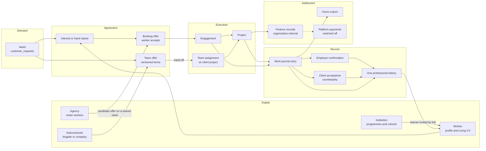
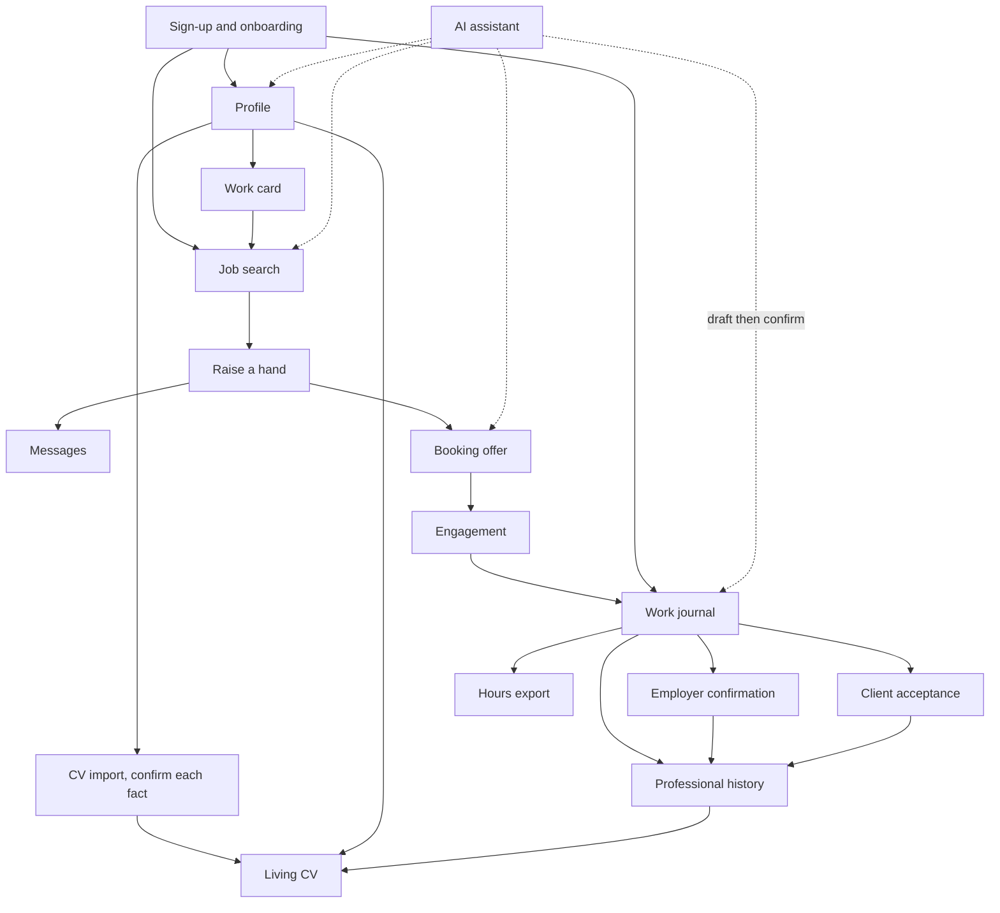
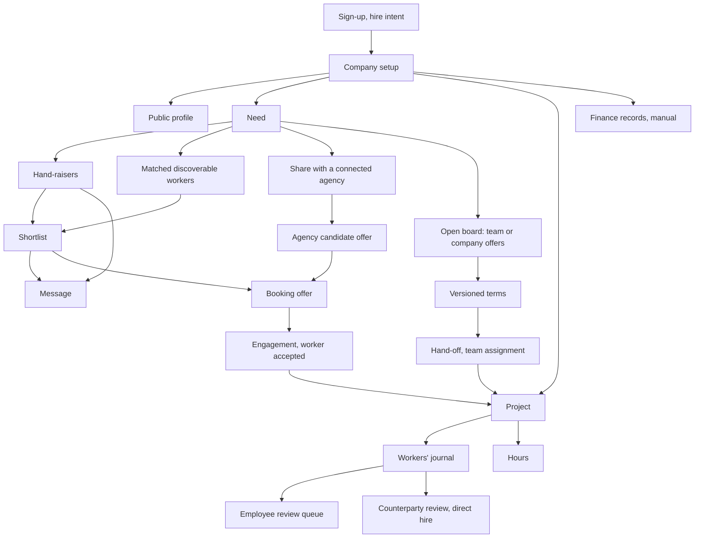
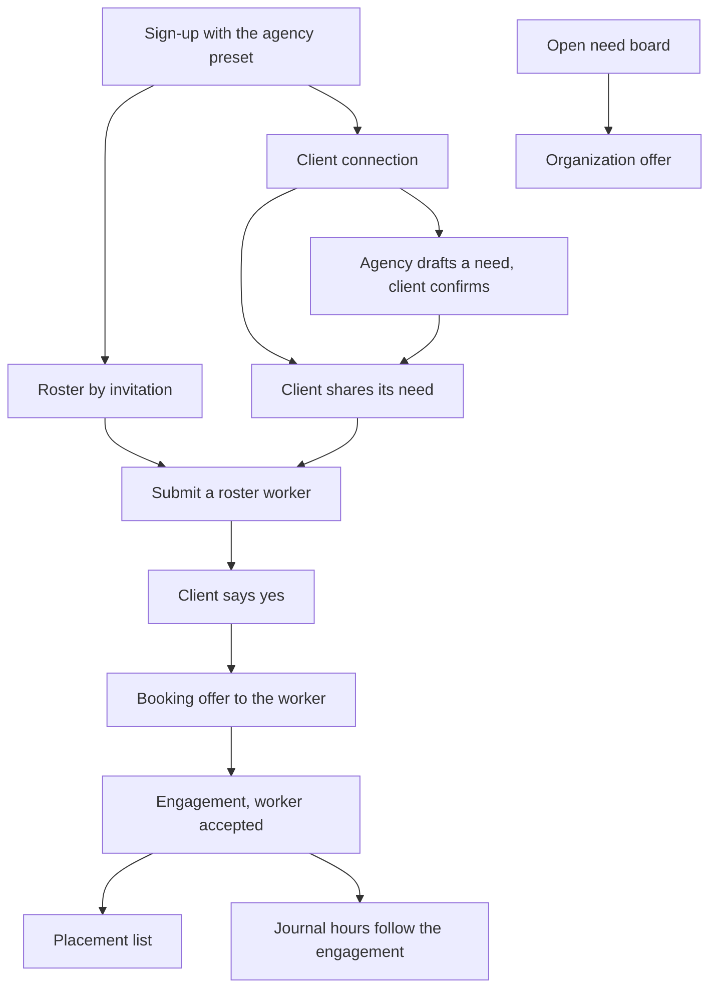
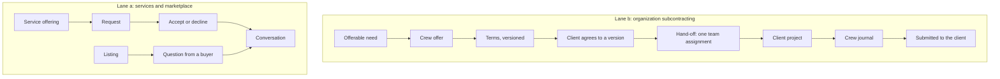
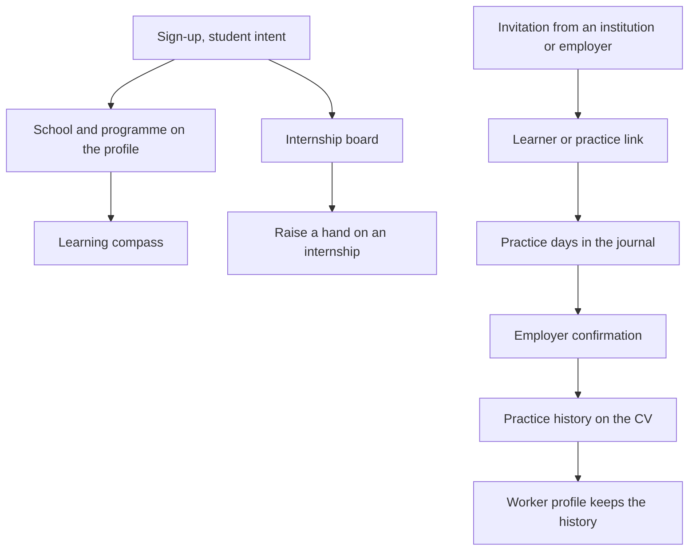
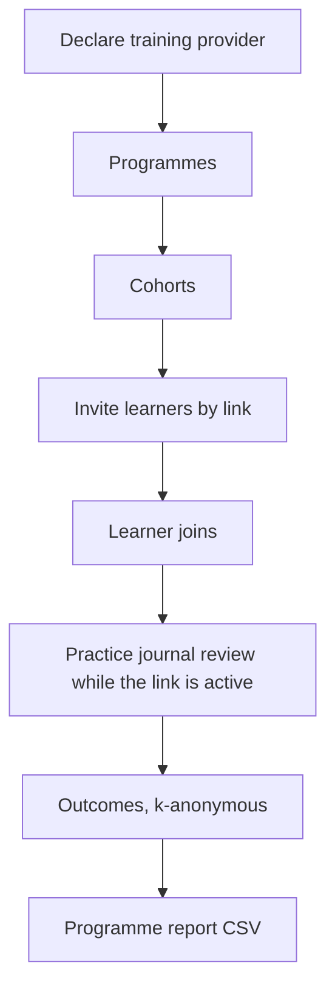
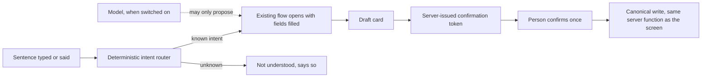

# Platform function map

**Status: SUPPORTING.** This document sits under
[`docs/OWNER_TARGET_ARCHITECTURE_V1.md`](../OWNER_TARGET_ARCHITECTURE_V1.md), which is the one canonical
architecture and takes precedence. This map is not a second architecture: it describes what each user
group can do **today**, how the functions connect, and how far each step is proven. Where this map and
the canonical file differ, the canonical file wins.

Deliverable A of the whole-project audit brief (issue #3679). Drafted from `origin/main` at `125e21827`
on 2026-11-23. Read-only: no production database was queried for this document.

**This map reuses these documents and does not copy them:**

| Document | Used for |
|---|---|
| [`docs/OWNER_TARGET_ARCHITECTURE_V1.md`](../OWNER_TARGET_ARCHITECTURE_V1.md) | the target graph, journeys and separations |
| [`docs/program/FUNCTION_REGISTER.md`](../program/FUNCTION_REGISTER.md) | per-function status and row ids (cited as "register 2.19" and so on) |
| [`docs/qa/LAUNCH_MATRIX_2026-11-23.md`](../qa/LAUNCH_MATRIX_2026-11-23.md) | the newest production walk per journey step |
| [`docs/CAPABILITY_INVENTORY.md`](../CAPABILITY_INVENTORY.md) and `apps/web/lib/product-gate/capability-register.ts` | capability states |
| [`docs/architecture/SCHEMA_INVENTORY.md`](SCHEMA_INVENTORY.md) | tables and functions |
| [`docs/launch/role-aware-navigation-contract-v1.md`](../launch/role-aware-navigation-contract-v1.md) | which group sees which door |
| `node .github/scripts/product-truth.mjs` | capability truth, broken journey links, open owner decisions |

Run ids and build distances per journey will live in `docs/qa/PRODUCTION_ACCEPTANCE_MATRIX.md`
(deliverable F, lane L). When that file lands, it is the authority for run ids, and this map links to it.

---

## 1. How to read the states

Every step carries exactly one class.

| Class | Meaning | Evidence required |
|---|---|---|
| **PROD (walk &lt;id&gt;)** | proven in production by a completed `prod-qa-walk.yml` run | the run id; the walk passed |
| **PROD (ledger)** | the database object is in the production migration ledger and code calls it, but no walk covers the step | ledger version plus the calling path. Weaker than a walk |
| **PROD (DB use)** | the database object is used in production, as reported by a lane from a read-only check, without a walk | the lane's report. Weaker than a walk. No counts are written in this public file |
| **PROD (register row n)** | the FUNCTION_REGISTER row is LIVE_VERIFIED on production facts or an owner record, not a walk | the row id. Weaker than a walk |
| **MAIN** | on `main` and deployed, not proven in production | path. "LOCAL" notes a proof on the isolated stack (`signup-isolated.yml`), which is still MAIN |
| **PR** | only in an open pull request | `#n` |
| **PLAN** | only in a document | doc path |
| **UNUSED-OR-DUP** | on `main`, but no caller reaches it, or it duplicates another implementation | importer search or route proof |
| **GAP** | not on main, in no open PR and in no plan document. Not a sixth state of a function: it marks a missing link, and every GAP is listed in Open gaps | the search that found nothing |

Rules this map follows:

- "Used" is proven by importers or callers, a reachable route, or a database object that code calls.
  A file name proves nothing.
- A walk proves the steps it runs on the build that was deployed then. It does not prove later changes.
- A walk that ran on a phone or desktop is named with its device.
- No production counts and no personal data are written here.

---

## 2. The shared chain, and where groups hand over

Every group uses one chain: **need → hire or order → project → work record → settlement**. The groups
differ in which link they start from and what rights they hold at each link. The chain is the canonical
J-COMPANY-EXECUTION and J-WORKER-EVIDENCE journeys
(`docs/OWNER_TARGET_ARCHITECTURE_V1.md`, and the journey register in
`apps/web/lib/product-gate/journey-register.ts`).

**Hand-overs between groups:**

| From | To | Hand-over | Where | State |
|---|---|---|---|---|
| Worker | Employer | raises a hand on a need; the employer sees them and contacts them | `apps/web/lib/opportunities/interest-actions.ts`; `prod-company-chain.spec.ts` C-1 to C-4 | PROD (walk 44858511879, desktop) |
| Employer | Worker | proposes a booking; the worker accepts; an engagement exists on both sides | `apps/web/lib/booking/booking-actions.ts:273` (propose), `:336` (respond) | PROD (walk 45049554634 desktop, 45052181467 phone) |
| Employer | Agency | shares its own need over an accepted connection | `apps/web/lib/agency/bridge-actions.ts:169`, `:282` | PROD (walk 44644887648, desktop) |
| Agency | Employer → Worker | submits a roster worker; the client's yes sends a booking to the worker, who decides | `bridge-actions.ts:365`, `:389` | PROD (walk 44644887648) |
| Subcontractor | Employer | offers a brigade to an open need; versioned terms; the client hands the brigade into its project | `apps/web/lib/company/team-offer.ts:191`, `:221`, `:248`, `:265` | PROD (walk 44906216102, desktop, B2B-1 to B2B-9b) |
| Institution | Student | invites a learner by link into a cohort | `apps/web/lib/navigation/work-areas.ts:140` (`learnerInviteHref`) | PROD (walk 44860184317, desktop, L-2/L-3) |
| Student | Employer | practice days recorded in the one journal, confirmed by the employer | `recognition-chain-isolated.spec.ts` I-9 to I-13b | MAIN (LOCAL) |
| Worker | Client (counterparty) | the worker submits an entry to a client link the client registered | `apps/web/lib/journal/counterparty-actions.ts:74`, `:129`, `:155` | MAIN (LOCAL, `client-review-isolated`, #3558) |

---

## 3. Worker

<!-- section owner: G — written by G -->

A worker is one person with one profile, one Living CV and one professional history, whoever recorded
the work and under whichever role (decision 0025, `docs/DECISIONS/0025-one-person-one-continuous-professional-history.md`).
A new worker starts without a company or a project.

### Can do

- Sign up by e-mail and password or Google, and onboard as a worker.
- Build a profile: summary, work card (availability, pay, locations), languages, employment history,
  practice and volunteering, education, achievements and declared certificates, skills and professions.
- Import a CV file into a proposal, and confirm each fact before it is saved.
- See the Living CV: skills sorted into evidence tiers (recorded, declared, potential, confirmed,
  certified; decision 0023), potential capabilities kept apart, and work in numbers.
- Search jobs signed out or signed in, save jobs, and raise a hand (express interest) on a need.
- Message an organization in a thread that third parties cannot read.
- Receive a booking offer and accept or decline it; see the resulting engagement.
- Record work in the one work journal: hours, tasks, photos, skills.
- Have an entry confirmed by the employer (manager review), or accepted by a client that registered a
  counterparty link (decision 0018). The worker cannot confirm their own work.
- Read one continuous professional history with one total, every hour once.
- Export journal and hours as CSV.
- Do the same through the AI assistant (section 9), which drafts and asks for a confirmation.

### Connections

The journal does not need an engagement: a new worker can record work before any employer exists
(`prod-fresh-activation.spec.ts:168`). The engagement is what lets an employer confirm the entry.

### Chain

| Step | What | Where (paths) | State | Evidence |
|---|---|---|---|---|
| 1. Registration | e-mail sign-up, then onboarding as a worker | `apps/web/app/[locale]/auth/signup/page.tsx` → `components/app/signup-form.tsx`; `app/[locale]/onboarding/page.tsx` → `components/app/onboarding-wizard.tsx` | PROD (walk 44901160408, desktop) | fresh-activation: a fresh worker onboards and the first journal entry reaches the Living CV. Role routes: walks 44899143018 desktop, 44900081769 phone. The full form sign-up was last walked as signup-form 43680057090 (2026-11-15); register 1.1, 1.4 |
| 2a. Profile and work card | summary, availability, pay, locations, languages | `app/[locale]/dashboard/profile/page.tsx`; `components/app/work-card-editor.tsx` (imported by the profile page and `components/app/workspace/player-card-result.tsx`) | PROD (walk 45094839877, desktop) | profile-cv-history P-3, P-4, P-5, P-26, 2026-11-23. Same spec passed on phone 45097071365 and phone-375 45091874326. An earlier phone run, 45096244318, failed the same day before 45097071365 passed. Register 2.1, 2.2, 2.9 |
| 2b. CV import | a CV file is read into a proposal; nothing is saved before a confirm | `apps/web/lib/profile/cv-section-import-actions.ts` (imported by `components/app/cv-import-section-review.tsx`, `capability-profile-section.tsx`) | PROD (walk 45094839877, desktop) | P-6, P-6b, P-6c; register 2.3 |
| 2c. Experience, education, achievements | employment rows, practice, education, declared certificates and achievements | `components/app/capability-profile-section.tsx`, `cv-engagement-cards.tsx`, `worker-education-section.tsx`, `worker-achievements-section.tsx` (each imported by `app/[locale]/dashboard/profile/page.tsx`) | PROD (walk 45094839877, desktop) | P-7 to P-10, P-22 to P-25; register 2.5 to 2.8. #3653 (every profile save answers on screen) merged before this run and is covered by P-26 |
| 2d. Skills and Living CV | catalogue skills, free-label claims, evidence tiers, potential capabilities kept apart | `app/[locale]/cv/page.tsx`; `apps/web/lib/journal/professional-experience.ts` (9 importers, including `app/[locale]/cv/page.tsx`) | PROD (walk 45094839877, desktop) | P-11 to P-14, P-17. Potential capabilities: living-cv-growth 41281984217 (2026-11-01, older build); register 2.4, 2.12 to 2.16, 2.29 |
| 2e. Experience records about the worker, with right of reply | read-only | `components/app/experience-response-form.tsx` and related | PROD (walk 45094839877, desktop) | P-15 read-only. Register 2.24 stays FAIL for an open moderation item (EVID-6); the walk does not change that |
| 3. Job search | public board, filters, job page, save privately | `app/[locale]/(marketing)/jobs/page.tsx`; `app/[locale]/dashboard/opportunities/page.tsx` | PROD (walk 44902071507, desktop) | jobs-search J-1 to J-7; phone 44902549477 |
| 4. Apply or raise a hand | interest on a need; interest on an imported vacancy | `apps/web/lib/opportunities/interest-actions.ts` (imported by `components/app/worker-interest-button.tsx`, which `dashboard/opportunities/page.tsx` imports); `lib/opportunities/vacancy-interest-actions.ts` | PROD (walk 44858511879, desktop) for interest on a need | company-chain C-1; orders-bookings O-2 on phone 45052181467. Interest on an imported vacancy is not in a walk this map found: MAIN |
| 5. Messages | the organization contacts the worker; a real thread; outsiders read nothing | `apps/web/lib/communication/*`; `app/[locale]/dashboard/communication/page.tsx` and `[conversationId]` | PROD (walk 44903881953, phone) | chat-continuity; company-chain C-3, C-4 (44858511879); notifications-inapp 44904905556 |
| 6. Offer or booking | the employer proposes dates; the worker accepts on the phone | `apps/web/lib/booking/booking-actions.ts:273`, `:336`; `components/app/booking-respond-buttons.tsx` (imported by `app/[locale]/dashboard/bookings/page.tsx`) | PROD (walk 45052181467, phone) | orders-bookings O-3 to O-7 |
| 7. Hire or engagement | the accepted booking becomes an engagement both sides see; an unrelated organization sees neither | `apps/web/lib/engagements/engagements-result.ts` (imported by `components/app/workspace/engagements-result.tsx`) | PROD (walk 45049554634, desktop) | orders-bookings O-9 to O-11 (#3628); also phone 45052181467 |
| 7b. End an engagement | end through the chat or MCP | `lib/engagements/end-engagement.ts` ← `engagement-executors.ts` ← `lib/conversation/dispatch.ts` | MAIN | no walk found that ends an engagement; the walks keep their synthetic engagement on purpose (register, 2026-11-16 entry) |
| 8. Work journal | record the day: hours, tasks, photos, skills | `app/[locale]/dashboard/journal/page.tsx`; `components/app/journal-entry-composer.tsx`; `apps/web/lib/journal/actions.ts` (6 importers) | PROD (walk 44902949287, desktop) | journal-confirm step 1; phone 44903366199; photos: worker-records-exports 44904394732 (register 2.22) |
| 9a. Employer confirmation | an authorised manager approves; the worker cannot name themselves as confirmer | `apps/web/lib/journal/review-actions.ts:88` (`review_journal_entry`), which imports `confirm-actions.ts:25` by relative path; `components/app/journal-inbox-entry.tsx`, `quick-confirm-card.tsx` | PROD (walk 44902949287, desktop) | journal-confirm steps 1b, 2, 3: trust rises, hours do not; register 2.20 (decision 0028) |
| 9b. Client (counterparty) acceptance | the client's representative registers a link from a real assignment; the worker submits the entry; the client accepts or disputes | `lib/journal/counterparty-actions.ts:74` (register), `:129` (submit), `:155` (decide); `components/app/counterparty-link-panel.tsx`, `entry-review-panel.tsx`, `counterparty-review-card.tsx`; `app/[locale]/dashboard/inbox/counterparty/page.tsx` | MAIN (LOCAL) | `client-review-isolated` (#3558). In production only the read is walked: profile-cv-history P-16 "readable on both sides, read-only" (45094839877). Decisions 0018, 0033 |
| 9c. Name who you did this for | the worker names the employer or client of an orphaned entry | `app/[locale]/dashboard/journal/page.tsx:504` `IDENTIFY_VERIFIER_HREF = "/dashboard/profile#capabilities"`, used at `:2387`; guard `lib/guards/orphaned-work-verifiability-connected.test.ts:67` | MAIN | the link goes to the self-declared work-history editor. No worker-initiated path to a counterparty exists. See Open gaps G-1 |
| 10. History | one total, every work hour once, roles without hours, unknown never zero | `apps/web/lib/journal/professional-experience.ts` | PROD (walk 45094839877, desktop) | P-18; register 2.26; decision 0025 |
| 11. Settlement | the worker's record for pay: journal and hours CSV export. No money moves through the platform | `app/[locale]/dashboard/hours`, `work-in-numbers`; export covered by `prod-worker-records-exports.spec.ts` E-1, E-2 | PROD (walk 44904394732, desktop) for the export | register 2.34. No payout exists; platform payments are off: section 10, Open gaps G-2 |

<!-- end section: worker -->

---

## 4. Employer

<!-- section owner: C — input received 2026-11-23 (read from origin/main 125e21827), spot-checked by G; C confirms -->

An employer is an organization whose members act for it in the active workspace. Rights come from
membership and role in that organization, never from the login alone. Short route paths below are under
`apps/web/app/[locale]/dashboard/`.

**Build distance caveat (lane C).** Most employer walks ran on builds 56 to 74 commits behind the deployed
one. orders-bookings (45049554634, 45052181467) is the only near-current employer walk, 3 commits
behind. Deliverable F carries the distance per run.

### Can do

- Sign up with the hire intent, set up the company, edit its public profile.
- Post a need through the demand intake (form or chat), close and reopen it; the plan gate can refuse
  a new open need.
- See candidates for a need from four sources: hand-raisers, matched discoverable workers,
  connected-agency offers, and team or company offers. Shortlist and acknowledge them.
- Contact a hand-raiser or a shortlisted person in a real thread.
- Hire by booking: propose dates, withdraw, reschedule; the worker decides.
- Accept a connected agency's candidate offer; the worker still accepts the booking.
- Agree versioned terms with a brigade and hand the brigade into a project.
- Request a service from another organization as a buyer.
- Create projects, assign people, hand teams in, read hours.
- Review the work journal of its employees; register as counterparty for direct hires (decision 0018).
- Keep manual finance records and export them.

### Connections

### Chain

| Step | What | Where (paths) | State | Evidence |
|---|---|---|---|---|
| 1. Sign-up | onboarding with the hire intent | `app/[locale]/onboarding/page.tsx` (test ids `onboarding-intent-hire`, `onboarding-submit`) | PROD (walk 44901160408, desktop) | fresh-activation; local E-1 in `tests/e2e/employer-journey-isolated.spec.ts` |
| 2a. Company setup | the company, its organization and membership | `start/company/page.tsx` → `company-setup-form.tsx` → `saveCompanySetupAction` (`lib/company/setup-actions.ts:42`) → `saveCompanySetup` (`lib/company/company-setup.ts:476`, `:488`, `:499`) | PROD (walk 44901160408, desktop) | tables organizations, companies, company_memberships; local E-2 |
| 2b. Public profile | public business profile and description | `business-public-profile-panel.tsx` → `lib/company/public-profile.ts:129`, `:142`; `description-actions.ts:40`, `:69`; public read in `apps/web/app/[locale]/business/[slug]/page.tsx` | MAIN | no walk found for the edit |
| 3. Need | post a need; the plan gate refuses with `over_open_need_limit` | `company/needs/page.tsx:180` (`#demand-intake`) → `components/app/demand-request-button.tsx` → `submitDemandRequestAction` (`lib/demand/demand-request-actions.ts:19`) → `lib/demand/demand-request.ts:405-407` | PROD (walk 44858511879, desktop) | company-chain C-0b; need-intake 44642526482 desktop, 44643169770 phone, 44643949860 phone-375; fresh-activation 44901160408. Table `customer_requests` |
| 4. Candidates for a need | hand-raisers, matched discoverable supply, connected-agency offers, team and company offers; shortlist; acknowledge | `company/scouting/page.tsx`; `lib/market/match-subject.ts:320`; `lib/visibility/discoverable-workers.ts:78`, `:99`; scouting reads at `scouting.ts:283`, `:685`, `:728`; `lib/opportunities/interest.ts:588`; agency-declared supply `lib/supply/employer-supply-discovery.ts:114` | PROD (walk 44858511879, desktop) | company-chain C-1, C-2. Local E-4: a stranger company sees nothing. There is no employer people search outside a need: `talent/page.tsx` is superadmin-only (`requireSuperadmin`) |
| 5a. Offer: worker interest | a worker raises a hand | `lib/opportunities/interest-actions.ts:18` | PROD (walk 44858511879, desktop) | C-1 to C-3 |
| 5b. Offer: agency candidate | a connected agency submits; the client answers | `lib/agency/bridge-actions.ts:379`, `:389`; client side `components/app/client-agency-bridge-section.tsx:217`, `:274` | PROD (walk 44644887648, desktop) | agency-chain A-6, A-6b. On an unshared open need: PR #3651 |
| 5c. Offer: brigade | versioned terms, hand-off | `lib/company/team-offer-actions.ts:58`, `:94`, `:108`; `lib/company/team-offer.ts:221-265` | PROD (walk 44906216102, desktop) | brigade-formation B2B-2 to B2B-7 |
| 5d. Offer: company | a company offers itself; accepted, then stops | `components/app/team-offers-received.tsx:271` shows a note only; hand-off refused in `supabase/migrations/20261011200000_supply_offer_negotiation_v1.sql:702` | MAIN | up to acceptance only. Fix: PR #3649 (draft, needs-human-gate) |
| 5e. Service request as buyer | request a service from another organization | `lib/marketplace/service-requests.ts:216`, `:242` | PROD (walk 44967795943, desktop) | marketplace-goods-services. Accepted request → project: no product door (launch matrix, BLOCKED product) |
| 6. Messaging | the worker contacts the need owner after a hand-raise; the employer contacts shortlisted people; team-offer thread | worker side `lib/opportunities/contact-employer.ts:66`, `:93`, `:125`; employer side `RequestCommunicationButton` in `company/scouting/page.tsx` → `lib/communication/request-worker-conversation.ts`; `team-offer-conversation.ts:81` | PROD (walk 44858511879, desktop) | C-3, C-4; orders-bookings O-6; agency A-7; local E-6: a stranger reads nothing. Writing about an open need before a hand-raise: PR #3647 (draft, needs-human-gate) |
| 7a. Terms: direct hire | a booking note and dates; no versioned terms | `lib/booking/booking-actions.ts` | PROD (walk 45049554634, desktop) | O-3, O-4; local E-7 |
| 7b. Terms: brigade | versioned; neither side accepts its own version; acceptance means agreed in principle, not a contract | `team-offer.ts:221-265` | PROD (walk 44906216102, desktop) | B2B-4 to B2B-6 |
| 7c. Terms: proposals and contracts | not linked to needs or bookings | `lib/commercial/commercial.ts:41`, `:63` | MAIN | no product door links them (Open gaps G-5) |
| 8. Hire | booking → worker accepts → engagement active | `components/app/propose-booking-button.tsx` → `proposeBookingAction` (`booking-actions.ts:172`); `respondBookingAction` (`:301`); withdraw `:465`, reschedule `:526`; project assignment reads `lib/projects/booking-engagement-workers.ts` | PROD (walk 45049554634, desktop) | orders-bookings O-3 to O-11; phone 45052181467. Agency path: the client's acceptance proposes the booking inside `respond_agency_candidate_offer_v1`; the worker still accepts |
| 9. Project | create, assign, hand a team in | `createProjectContextAction` (`lib/company/project-context-actions.ts:57`) and `createProjectAction` (`lib/projects/actions.ts:81`) both call `insertProjectForCompany` (`lib/projects/create-project-core.ts:33`; callers at `project-context-actions.ts:95`, `actions.ts:108`), so they are two entry points over one core, not duplicates; assign `assignWorkerToProjectAction` (`actions.ts:120`, `:140`), precheck `lib/projects/assignment-precheck.ts` | PROD (walk 44906961206, desktop) | project-execution E-1, E-5; brigade B2B-7. Direct hire → project → hours: MAIN (LOCAL, `hiring-chain-isolated` H-4, `employer-journey-isolated` E-9; #3611) |
| 10a. Work record: employee | review queue, approve or return; review toggled per engagement | `inbox/page.tsx:361` → `lib/journal/review-actions.ts:60`, `:88`; quick batch `inbox/quick/page.tsx`; `lib/operations/org-membership.ts:140` (`set_engagement_journal_review`), `company/people/page.tsx:473` | PROD (walk 44902949287, desktop) | journal-confirm |
| 10b. Work record: direct hire | no engagement context is opened; the employer registers as counterparty on the project page; the worker submits; the employer decides | `projects/[id]/page.tsx:634`; `lib/journal/counterparty-actions.ts:74`; `lib/journal/counterparty-core.ts:130`; `inbox/counterparty/page.tsx:225` | MAIN (LOCAL) | local E-10. Open gaps G-13 |
| 10c. Work record: agency placement | a collaborator engagement context; review off until the client enables it | `assign_worker_to_project` | MAIN (LOCAL) | `tests/e2e/role-journeys-isolated.spec.ts:670` J-WRK. Fresh-client variant BLOCKED (cast) |
| 10d. Work record: brigade | the buyer reads the brigade's hours; no buyer confirm step | `project_team_journal_hour_rows_v1` | PROD (walk 44906216102, desktop) for reading | B2B-9, B2B-9b |
| 10e. Hours | allocations and export | `hours/page.tsx` → `hours-page-data.ts` → `allocations.ts:99`; export `journal/hours/route.ts` | PROD (walk 44858511879, desktop) | company-chain H-1, H-2 |
| 11. Settlement | manual finance ledger; nothing derived from hours | `lib/finance/finance-actions.ts:252` (`create_finance_record_v2`); no journal, booking or engagement columns | PROD (walk 45049554634, desktop) | orders-bookings F-1 to F-3. Real charging: MKT-7, PLAN (`docs/OWNER_TARGET_ARCHITECTURE_V1.md:639`). Section 10b |

### Path differences

| | Direct hire | Agency placement | Brigade or team | Company offer |
|---|---|---|---|---|
| Entry | hand-raiser or matched worker on a need | connected agency's candidate offer on a shared need | team offer on an open need | organization offer on an open need |
| Agreement | booking note and dates | client says yes; booking to the worker | versioned terms, agreed in principle | accepted, then stops (PR #3649) |
| Hire object | booking → engagement | booking → engagement | one team assignment | none on main |
| Project | assignment of the engaged worker | assignment of the placed worker | hand-off into the buyer's project | refused on main |
| Journal decision | counterparty registration by the employer, then the worker submits (MAIN, LOCAL) | collaborator context; review off until the client enables it (MAIN, LOCAL) | the buyer reads hours; no confirm step | none |

### Gaps (lane C)

1. The company offer stops after acceptance (PR #3649).
2. A direct hire needs a manual counterparty registration before its days can reach the employer;
   nothing links the booking to that registration. Overlaps Open gaps G-1; listed as G-13.
3. An agency cannot offer on an unshared open need (PR #3651).
4. No messaging before a hand-raise or shortlist (PR #3647; pseudonyms PR #3657).
5. No employer people search outside a need.
6. Contracts and proposals are disconnected; an accepted service request leads to no project (G-5).
7. No settlement from confirmed hours (G-3).
8. Legacy function fallbacks in the setup and booking actions (for example `company-setup.ts:476-499`,
   `booking-actions.ts:273-275`, `:336-416`): fallback reachable only if the newer function is missing;
   production status unread.
9. Exported actions with no caller: none found in the modules lane C scanned, so nothing in them is
   UNUSED-OR-DUP.

<!-- end section: employer -->

---

## 5. Agency

<!-- section owner: H — input received 2026-11-23, spot-checked by G; H confirms -->

**Who is an agency (ORG-2).** A company with `company_type='staffing_agency'`, or a company that declared a
workforce role (workforce_provider, talent_provider or recruitment_partner):
`apps/web/lib/company/agency-capability.ts:5-7`, `readActsAsAgency` in
`apps/web/lib/company/agency-capability-read.ts:12`, SQL `company_acts_as_agency(uuid)`. Whether to move
these gates to `organization_roles` is the open owner decision ORG-2 (`product-truth.mjs`).

An agency places **individual workers** with a client. A subcontractor delivers **a crew or a company**
to a client's need. Their rights differ; see the shared table in section 7.

### Can do

- Sign up with the agency intent and get the `staffing_agency` preset; build a roster by invitation.
- Connect with a client; the client accepts and shares its own needs. The agency sees only shared needs.
- Draft a need for a client, which the client confirms.
- Submit a roster worker as a candidate on a shared need. Only the owner, only active roster workers,
  only on an active share.
- See its placements.
- Offer itself as an organization on an open need (the same board subcontractors use).

### Connections

### Chain

| Step | What | Where (paths) | State | Evidence |
|---|---|---|---|---|
| 1. Sign-up | agency intent → `staffing_agency` preset; company saved by `save_company_setup_v3` | `lib/company/company-setup.ts:476`; preset tested in `first-run-intent.test.ts:67` | PROD (walk 44644887648, desktop) | agency-chain; phone 44645924736, phone-375 44646951459 (build 7e517e32, many commits behind the current build) |
| 2a. Permitted needs: connection route | connect, accept, share; draft a need for the client | `lib/agency/bridge-actions.ts:169` (connect), `:282` (share), `:456` (draft), `:483` (confirm) | PROD (walk 44644887648, desktop) | agency-chain A-1 to A-4 |
| 2b. Permitted needs: open board | the open need board for any organization manager | `lib/company/team-offer.ts:97` (`list_open_demand_for_team_offer_v1`) | PROD (ledger) | client anonymity on the board: PR #3630 (draft, needs-human-gate); provider pseudonyms: PR #3657 (draft, needs-human-gate). Open gaps G-4 |
| 2c. Retired agency pool (Model A) | the earlier pool and open demand reader | `lib/agency/pool.ts:298`, `lib/agency/pool-actions.ts` | UNUSED-OR-DUP | no importer outside tests for either module (`@/lib/agency/pool` and `./pool` searched); the route `/dashboard/agency/pool` redirects (`apps/web/next.config.ts:152`); retired by owner decision 2026-09-14, `lib/product-gate/capability-register.ts:616-622`. Kept on purpose; not a deletion candidate without the owner |
| 3. Candidate submission | submit a roster worker on a shared need | `bridge-actions.ts:365` (`submit_agency_candidate_offer_v1`) | PROD (walk 44644887648, desktop) | agency-chain A-5. Named candidates on the open board: PR #3651 (draft, needs-human-gate). Agency-to-agency forwarding: PR #3353 (draft, needs-human-gate) |
| 4. Agreement | the client's answer sends a booking to the worker; nothing is accepted for the worker | `bridge-actions.ts:389` (`respond_agency_candidate_offer_v1`) → booking proposal | PROD (walk 44644887648, desktop) | agency-chain A-6. Placement fee and non-circumvention term: PR #3353 |
| 5. Authorised placement | the worker accepts → engagement; the client sees the worker's name only once a working relationship exists | `lib/agency/delegation-read.ts:93` (`list_agency_placements_v1`, imported by `app/[locale]/dashboard/company/partners/page.tsx`); `lib/visibility/worker-identity-visibility.ts:44` | PROD (ledger) | the worker-accepts step is walked in agency-chain (register 4.15; phone 43965333204, 2026-11-16). The launch matrix lists "placement with a client that does not already employ the worker" as BLOCKED (cast) |
| 6. Project and work record | a placement is a booking plus an engagement, not a project assignment; journal hours follow the engagement | as worker steps 7 and 8 | PROD (walk 45049554634, desktop) | proven through the employer booking chain, not through an agency-specific walk |
| 7. Settlement | placement term and commission | PR #3353 | PR | no agency invoicing on main (section 10b) |

Local only, not production: the agency journey J1 to J7 passed at 1440 and 390 px on a build of #3651
(reported by lane H).

<!-- end section: agency -->

---

## 6. Subcontractor and marketplace

<!-- section owner: D — input received 2026-11-23, spot-checked by G; D confirms -->

A subcontractor is any company or brigade that offers to an open need **without** the agency
capability. There are two separate lanes, and they are not connected:

- **(a) Personal services and the marketplace**, keyed on a profile: offering → request → accept →
  conversation; listings of goods and services.
- **(b) Organization subcontracting**, two-party: the client posts a need → the subcontractor offers a
  crew with versioned terms → the client agrees to a version → the client puts the crew on its
  project → crew members' journal entries are submitted to the client → the client accepts or disputes.

Only (b) is a two-party subcontract chain. Steps 1 to 5 of lane (b) are covered by one production walk,
brigade-formation 44906216102 (desktop, 2026-11-21): need, crew offer, terms v1 and the buyer's counter
v2, agreement, crew assigned to the buyer's project, a member journals on it and the buyer sees the
hours. That walk is desktop only; there is no phone run of it.

### Can do

- (b) See offerable open needs, offer a crew, propose and counter terms, have the crew handed into the
  client's project, record work there.
- (a) Publish a service offering, receive requests, accept or decline them with a note, and continue in a
  conversation; list goods or services in the one market.

### Connections

### Chain, lane (b)

| Step | What | Where (paths) | State | Evidence |
|---|---|---|---|---|
| 1. Order view | a submitted need of a verified company, not your own organization; the open-needs billing gate applies to the client side only, for pilot organizations | `components/app/team-demand-offer-form.tsx`; `lib/company/team-offer.ts:97`; rule `supabase/migrations/20261020010000_demand_company_one_rule_v1.sql:250-273`; `lib/billing/open-needs-gate.ts` | PROD (walk 44906216102, desktop) | brigade-formation B2B-1, B2B-2 |
| 2. Offer | offer a crew (a team with at least two active members) | `lib/company/team-offer-actions.ts:36` → `offer_team_to_demand_v1` (`team-offer.ts:191`); entry `components/app/team-brigades-panel.tsx:359` | PROD (walk 44906216102, desktop) | B2B-2. An organization-kind offer cannot be handed off (`organization_offer_not_a_unit`): MAIN. Making a company offer reach a project: PR #3649 (draft, needs-human-gate) |
| 3. Terms | versioned terms; the client agrees to the version it saw | `components/app/team-offer-terms.tsx`; `team-offer.ts:265` (propose), `:221` (`respond_team_demand_offer_v2`) | PROD (walk 44906216102, desktop) | B2B-4 to B2B-6. Two-sided confirmation of the latest version: PR #3649. One security item on the offer-agreement step was handed to the auth/RLS lane |
| 4. Order confirmation | offer status "accepted" means agreed in principle; no contract or order record is created | `components/app/team-offers-received.tsx` | PROD (walk 44906216102, desktop) | B2B-6. The copy says it is not a contract |
| 5. Execution | hand-off creates one team assignment; crew members see the client's project and record work | `team-offer-actions.ts:108` → `team-offer.ts:248` | PROD (walk 44906216102, desktop) | B2B-7 to B2B-9b |
| 6. Work reports to the client | the client registers as counterparty; a crew member submits; the client decides | `counterparty-link-panel.tsx`, `entry-review-panel.tsx`, `app/[locale]/dashboard/inbox/counterparty/page.tsx`; `lib/journal/counterparty-actions.ts` | MAIN (LOCAL) | `client-review-isolated` CR-0 to CR-4 (#3558); `subcontractor-chain-isolated` 13/13 in PR #3670 (open). Lane D reports this was never used in production. Timesheets are organization-internal and carry no client confirmation |
| 7. Settlement | agreed terms carry a free-text rate; no invoice, payment or price record is created from them | `team_demand_offer_terms` via `team-offer.ts:265`; `finance_records` are organization-internal | GAP | not built for subcontracting; section 10b; Open gaps G-3 |

### Chain, lane (a)

| Step | What | Where (paths) | State | Evidence |
|---|---|---|---|---|
| Offering | a service offering, discoverable | `app/[locale]/dashboard/services/page.tsx`; `components/app/service-offerings-section.tsx`; `lib/services/service-offerings.ts:249` | PROD (walk 44967795943, desktop) | marketplace-goods-services S-1, S-2; phone 44968374455 |
| Request → accept → conversation | request, accept with a note, thread | `app/[locale]/dashboard/service-requests/page.tsx`; `components/app/marketplace-loop-section.tsx`; `lib/marketplace/service-requests.ts` (6 importers) | PROD (walk 44967795943, desktop) | S-3 to S-5 |
| Listings | goods and services in the one market; buyer questions answered | `app/[locale]/dashboard/listings/page.tsx`; `lib/marketplace/listings.ts` | PROD (walk 44967795943, desktop) | G-1 to G-9; marketplace 44971191106 |
| Buyer workspace | a customer saves a request draft | `app/[locale]/dashboard/buyer/page.tsx`; `lib/buyer/*` | PROD (walk 45094390854, desktop) | buyer-workspace, 2026-11-23, after #3589. The earlier run 45093473297 failed the same day |
| Proposals and contracts | owner-only commercial rows | `app/[locale]/dashboard/commercial/page.tsx`; `components/app/commercial-panel.tsx`; `lib/commercial/commercial-actions.ts`; `supabase/migrations/20260718190000_commercial_crm.sql:14-75` | MAIN | the buyer never sees or agrees to them; no screen links a request, proposal or contract to a project (only MCP tools set `project_id`). Owner question, Open gaps G-5 |

<!-- end section: subcontractor -->

---

## 7. Agency and subcontractor: where rights differ

<!-- section owner: H and D — input received 2026-11-23 -->

| Right | Agency | Subcontractor |
|---|---|---|
| Client connection and shared needs | yes, the owner acts (`bridge-actions.ts:169`, `:282`) | no |
| Draft a need for a client | yes (`bridge-actions.ts:456`) | no |
| Named individual candidates | connection route: PROD (walk 44644887648); open board: PR #3651 | no; on #3651 the call refuses with `not_an_agency_offer` |
| Offer a team or company to an open need | yes, as an organization offer | yes, `offer_team_to_demand_v1` (`team-offer.ts:191`), PROD (walk 44906216102) |
| What reaches the client's project | individual workers, through a booking each worker accepts → engagement | a brigade through hand-off (`team-offer.ts:248`), one team assignment row. A company offer's crew: PR #3649 |
| Worker consent | the worker accepts each booking; discoverability consent on the open board (#3651) | brigade membership, accepted by the worker's own invitation |
| The client sees names | after the worker accepts | crew members after hand-off |
| Fee terms | PR #3353 | none; the price is in the terms |

---

## 8. Student and education institution

<!-- section owner: L — input received 2026-11-23, spot-checked by G; L confirms -->

### Student

A student is not a separate account type. A student is a worker identity (`profiles.active_role=worker`,
one worker row, no company; `signup-isolated` ST-1). Everything in section 3 applies.

#### Can do

- Sign up with the student intent and name the school and programme
  (`components/app/onboarding-wizard.tsx`, student fields, saved as education).
- See the learning compass (`components/app/learning-compass-section.tsx`).
- Use the internship board (`/dashboard/opportunities?opportunityType=internship`).
- Join an institution or an employer by invitation link.
- Record practice days in the one journal and have the employer confirm them.
- See those days on the CV as practice history (`app/[locale]/cv/page.tsx`; guard
  `lib/guards/practice-history-visibility.test.ts`).

#### Connections

#### Chain

| Step | What | Where (paths) | State | Evidence |
|---|---|---|---|---|
| Profile | student sign-up, school and programme | `components/app/onboarding-wizard.tsx` | PROD (walk 44883030318, phone) | learning-practice L-3, L-5, L-11 |
| Learning history | education rows on the Living CV | `components/app/worker-education-section.tsx` | PROD (walk 45094839877, desktop) | profile-cv-history P-9, P-22; phone 45097071365, phone-375 45091874326 |
| Find a practice | internship board | `app/[locale]/dashboard/opportunities/page.tsx` | PROD (walk 44883030318, phone) | L-11 |
| Internship need found and applied to | an internship-typed need | as worker step 4 | MAIN (LOCAL) | `journeys-coverage-isolated` (#3578) |
| Practice record and sign-off | practice day, employer confirmation | journal, as worker steps 8 and 9a | MAIN (LOCAL) | `recognition-chain-isolated` I-9 to I-13b; production walks must not write sign-offs. Register 11.7 records a recognition-chain production run, 41617507405 (2026-11-03), for practice → competency; lane L to reconcile which steps it covered |
| Profile keeps the history | the study period stays after studies end | `lib/journal/professional-experience.ts` | MAIN (LOCAL) | `signup-isolated` E-3 |

### Education institution

An organization with the training_provider capability. Its door is `/dashboard/company/education`;
the page redirects to `/dashboard/company` when the capability is missing
(`app/[locale]/dashboard/company/education/page.tsx:64`). The learning home appears in the header only
for an organization whose primary role is an institution (`isEducationFirstWorkspace`,
`lib/conversation/education-home.ts:38`; `lib/navigation/work-areas.ts:154`; #3525, #3562).

#### Can do

- Declare the capability (`components/app/organization-capabilities-card.tsx`).
- Create programmes and cohorts (`components/app/institution-programs-section.tsx`,
  `institution-program-forms.tsx`).
- Invite learners by link with a relationship preset (`learnerInviteHref`,
  `lib/navigation/work-areas.ts:140`, into the one invite panel); place learners in cohorts.
- Review practice journals only while the link is active and review is on
  (`supabase/migrations/20261115120000_journal_learning_access_follows_link_v1.sql`).
- See learner outcomes with k-anonymity applied (`components/app/institution-learners-section.tsx:9`,
  `OUTCOMES_K_ANONYMITY_FLOOR`), and download the programme report as CSV.
- Assign training (register 11.8).

An ended link keeps the records that were lawfully created (#3421; `signup-isolated` E-4;
`recognition-chain-isolated` I-14).

#### Connections

#### Chain

| Step | What | Where (paths) | State | Evidence |
|---|---|---|---|---|
| Programmes | create a programme | `components/app/institution-programs-section.tsx` | PROD (walk 44860184317, desktop) | learning-practice L-1, L-12; phone 44883030318, phone-375 44883485138 |
| Cohorts | create a cohort | same | PROD (walk 44860184317, desktop) | L-4 |
| Cohort join request | a learner asks to join | dispatch-only spec `prod-cohort-join-request.spec.ts` | PROD (walk 41611766407) | register 11.2 cites this run (2026-11-03, 6/6). Lane L's input and the launch matrix call it never run; the run exists and passed, on an older build. Lane L to reconcile |
| Invites | invite by link, learner accepts | `lib/navigation/work-areas.ts:140` | PROD (walk 44860184317, desktop) | L-2, L-3 |
| Practice: journal review | review while the link is active | migration `20261115120000` | PROD (walk 44860184317, desktop) | L-6, L-7 |
| Results | outcomes and CSV | `institution-learners-section.tsx` | PROD (walk 44860184317, desktop) | L-9 outcomes, L-10 CSV |
| Training assignment | assign training to members | register 11.8 | PROD (walk 44243678287) for members | company-governance T-4b, T-4c (register 11.8). Training for engaged non-members and learners waits on RED #2816; register 11.8 is BLOCKED. Lane L reported the training function as applied in production; this map did not verify that |

<!-- end section: student and institution -->

---

## 9. AI assistant (cross-cutting)

<!-- section owner: G — written by G -->

The assistant is one surface over the same graph, not a separate product (product-truth: "never an AI
chatbot"). It covers every group through the same canonical actions the screens use.

### How it works

- **Intent router.** `apps/web/lib/conversation/intent-router.ts` is deterministic and has no model. It
  maps a sentence to one intent (log work, availability, find work, write an employer, CV, profile,
  offers and others) in the routed locales, and never writes (file header, lines 1-21;
  `classifyIntent` at `:4341`). It is called by `components/app/conversation/chat/conversation-chat.tsx:6772`
  and 7 other non-test importers. When a model is switched on, it may only propose an action and fields;
  the router stays the floor.
- **Draft → confirm.** A consequential write shows a card with a token that is bound to the action, the
  input and the user, expires, and is spent once per state transition
  (`apps/web/lib/conversation/confirmation-token.ts:1-21`, issue `:74`, verify `:107`; used by
  `lib/conversation/dispatch.ts` and `lib/capabilities/confirmable.ts`). The MCP tools follow the same
  `_draft`/`_confirm` or `_prepare`/`_confirm` pairs.
- **AI off.** Production runs with `AI_PROVIDER_MODE=disabled` (`docs/ops/VPS_PRODUCTION_RUNBOOK.md`,
  section 3, line 58). With the provider off, the router and the canonical flows still work, and
  surfaces state that no text came from a model.

### Chain

| Step | What | Where (paths) | State | Evidence |
|---|---|---|---|---|
| Sentence to action | a known sentence opens its flow; an unknown one says "not understood" | `lib/conversation/intent-router.ts`; `conversation-chat.tsx` | PROD (walk 44973720651, desktop) | ai-off-honesty B-3, 2026-11-22 01:55 UTC. That run predates #3576, #3605, #3639 and #3644 |
| Draft → confirm once | the day told to the chat is confirmed once and lands in the journal once | `lib/conversation/confirmation-token.ts`; `lib/conversation/dispatch.ts` | PROD (walk 44972019714, desktop) | chat-confirm-once C-1, C-2. Manager chat: 44972421825. MCP: mcp-chain 44972915546, mcp-agents 44973332549 |
| AI-off honesty | rule-based reasons, honest off lines, deterministic CV reading | `prod-ai-off-honesty.spec.ts` B-1 to B-4, C-1, C-2 | PROD (walk 44973720651, desktop) | as above |
| "Fill in work reports" opens the journal | the report sentence reaches the journal flow, not figures and exports | #3576 (merged 2026-11-22, `397710f18`) | MAIN (LOCAL) | `tests/e2e/assistant-intent-isolated.spec.ts` R, run in `.github/workflows/signup-isolated.yml:197`, with `AI_PROVIDER_MODE=disabled`. Deployed (deploy-vps 45116356682 on `125e21827`); no production walk since |
| The goal survives a page load | the chat goal continues after reload and workspace switch | #3605 (merged 2026-11-22, `5fd730735`) | MAIN (LOCAL) | `assistant-intent-isolated.spec.ts` G |
| Headcount number words in every locale | "five" read as 5 in the need intake | #3639 (merged 2026-11-22, `8c94c2518`) | MAIN | unit tests in the PR; `assistant-intent-isolated.spec.ts` N covers the quantity |
| Dates, hours, trades and markets in 7 locales | structuring of the sentence | #3644 (merged 2026-11-22, `8c03bd823`) | MAIN | unit tests in the PR |
| Profile saves answer on screen | every profile save answers, across a deploy reload | #3653 (merged 2026-11-22, `f73206877`) | PROD (walk 45094839877, desktop) | profile-cv-history P-26, 2026-11-23 |
| Voice | the voice journal | `app/[locale]/dashboard/journal/voice/page.tsx` | MAIN | the transcription host is an open owner decision (COM-6, COM-8); register 2.30 BLOCKED |

<!-- end section: AI assistant -->

---

## 10. Payments and billing state

<!-- section owner: F — input received 2026-11-23 (audited on main 6c6061a83), spot-checked by G; F confirms -->

Two different things are kept apart here: **platform billing** (the platform charges an organization)
and **settlement between parties** (one party pays another for work). No money amounts, payment counts,
event counts or organization identities are written in this public file; production proof is cited by
its FUNCTION_REGISTER row.

### 10a. Platform billing

| Item | Where (paths) | State | Evidence |
|---|---|---|---|
| Plan catalogue | `supabase/migrations/20260905190000_public_plans_v1.sql:18-31` → `apps/web/lib/marketing/plans.ts:57` → `app/[locale]/(marketing)/pricing/page.tsx` | PROD (walk 40205429467) | register row 7.1 |
| Plan limits | `lib/billing/plans.ts:14-33` | MAIN | |
| Open-needs gate | `lib/billing/open-needs-gate.ts:52-105`, imported by `lib/demand/demand-request.ts:24` and `lib/demand/demand-lifecycle.ts:6`; enforced only while billing is active | MAIN | register row 7.2 PASS_CI_ONLY |
| Entitlement resolver | `lib/billing/effective-entitlements.ts` | PROD (register row 7.3) | production facts, no walk |
| Test and live configuration | `lib/billing/config-core.ts`: off by default; live needs four conditions; the pilot organization allow-list is deny-by-default. Payments switch `PAYMENTS_ENABLED`, read at `lib/billing/config.ts:36`; production value `false` per `docs/ops/VPS_PRODUCTION_RUNBOOK.md:58`, `:115` | MAIN | code and runbook; this map did not read production |
| Provider | `lib/billing/provider.ts:171-180`. Note: `lib/billing/providers/stripe-test.ts` also serves live mode, so its file name is misleading | MAIN | |
| Platform credit (LMC) | `lib/billing/lmc-flags.ts:20-27`: purchases, grants, referrals, top-ups, live payments and spending are each `false as const` | MAIN | constants on main |
| Self-serve subscription checkout | `app/api/billing/test-checkout/route.ts` | MAIN | register row 7.15 BLOCKED: off by owner decision; VAT in RED PR #2685 |
| Pilot pass | `app/api/billing/pilot-pass/route.ts`, `lib/billing/pilot-pass-core.ts` | PROD (register row 7.5) | owner-confirmed live payment. Payment testing stopped by owner decision (register, 2026-11-16 entry) |
| Webhook | `app/api/billing/webhook/route.ts`: signature checked before the first write, mode match, deduplication | PROD (register rows 7.16, 7.17) | production facts, no walk |
| Billing portal | `app/api/billing/portal/route.ts` | PROD (register row 7.21) for a single payer | a second billing manager is unverified |
| Refresh and reconcile | `app/api/billing/refresh/route.ts`, `app/api/billing/reconcile/route.ts` (superadmin, no UI caller) | MAIN | |
| Billing-recovery cron | `app/api/cron/billing-recovery/route.ts` | MAIN | off; register row 7.6 BLOCKED |
| Who pays | `lib/billing/billing-subject.ts`: a profile or an organization; an organization needs `manage-billing`, which is owner or admin (`lib/company/role-capabilities.ts:55-57`, `:82`) | MAIN | |
| In-app invoices and payment history | none on main | PLAN | register row 7.20; RED PR #2682 |
| Refunds and disputes | the webhook records them only | MAIN | |
| VAT and terms | none on main | PLAN | RED #2685; register row 7.28 FAIL |
| Arming real charging | two independent owner acts | PLAN | open owner decision MKT-7 (`product-truth.mjs`; `docs/OWNER_TARGET_ARCHITECTURE_V1.md:639`) |

### 10b. Settlement between parties

This is the settlement step of every group's chain.

| Item | Where (paths) | State | Evidence |
|---|---|---|---|
| Offer terms | the rate is free text (`supabase/migrations/20261011200000_supply_offer_negotiation_v1.sql`); no contract is stored | PROD (walk 44241546296, phone) | agency-chain; brigade-formation 44906216102 B2B-4 to B2B-6 |
| Agency placement term and commission | PR #3353 | PR | draft, needs-human-gate |
| Proposals and contracts with amounts | `supabase/migrations/20260718190000_commercial_crm.sql:14-53` | MAIN | records only; no money moves; owner-only (Open gaps G-5) |
| Agreements | `supabase/migrations/20260817200000_agreements_v1.sql`: no amount column | MAIN | |
| Timesheets | `supabase/migrations/20260817170000_timesheets_v1.sql`: no payroll, no pay rates | PROD (walk 41722638759) | register row 2.23 |
| Finance records | manual invoices issued and received; CSV export; MCP `finance.records.list`; no money moves (`lib/finance/finance.ts:1-25`) | PROD (walk 45049554634, desktop) | orders-bookings F-1 to F-4; register row 6.9 (walk 41718546706) |
| Work record → invoice | finance reads no timesheets | GAP | register row 7.30; Open gaps G-3 |
| Payouts | none | GAP | Open gaps G-2 |

### 10c. Who may touch money

| Action | Who | Where |
|---|---|---|
| Checkout and plan | organization owner or admin, through `billingAuthority` | `lib/billing/billing-subject.ts`; `lib/company/role-capabilities.ts:55-57`, `:82` |
| Billing portal | the caller's own customer only | `app/api/billing/portal/route.ts` |
| Billing tables | read by owner or admin; no write policies; webhook events admin-only | `supabase/migrations/20260613200000_billing_test_mode_records.sql` |
| Finance records | creator, admin, or organization owner or admin; managers excluded (`fr_select`) | `supabase/migrations/20260817123000_finance_org_authority_v1.sql` |
| Service role | only the billing stores and the webhook | as above |

<!-- end section: payments -->

---

## 11. Open gaps

Each gap has evidence. None of them is fixed here; fixes go through the simplification plan
(deliverable E) and the normal owner gates.

| Id | Gap | Evidence | Owner or lane |
|---|---|---|---|
| G-1 | **"Name who you did this for" has no worker-initiated counterparty path.** An orphaned journal entry offers "identify verifier", which links to the self-declared work-history editor. A counterparty link can only be registered by the client's own representative from a real assignment | `app/[locale]/dashboard/journal/page.tsx:504` and `:2387`; `lib/guards/orphaned-work-verifiability-connected.test.ts:64-69`; decision 0018 ("Authority = the party, not the login"); `lib/journal/counterparty-actions.ts:74` | G with C; owner if a worker-initiated invitation to a client is wanted |
| G-2 | **Settlement and payments are off; no payouts.** No money moves between parties; the worker's settlement record is the hours export. Self-serve checkout is off; VAT and terms are open; the recovery cron is unscheduled; there are no in-app invoices and no refund policy | `docs/ops/VPS_PRODUCTION_RUNBOOK.md:58`, `:115`; `lib/billing/lmc-flags.ts:20-27`; register rows 7.6, 7.15, 7.20, 7.28; MKT-7 | owner (MKT-7), F |
| G-3 | **Nothing turns work records into invoices.** Agreed terms carry a free-text rate; finance reads no timesheets; no subcontract or agency settlement | `lib/company/team-offer.ts:265`; `lib/finance/finance.ts:1-25`; register row 7.30 | D, F |
| G-4 | **The open need board can name the client.** Client anonymity and provider pseudonyms wait on RED PRs | PR #3630, PR #3657 (both draft, needs-human-gate) | H, D, auth/RLS lane |
| G-5 | **Proposals and contracts are owner-only.** The buyer never sees or agrees to them, and no screen links a request, proposal or contract to a project | `supabase/migrations/20260718190000_commercial_crm.sql:14-75`; `components/app/commercial-panel.tsx` | owner question, not a defect |
| G-6 | **No institution-arranged placement.** The employer invites the intern directly | practice relation `supabase/migrations/20261012170000_practice_in_company_relationship_v1.sql`; launch matrix "Institution-arranged placement" BLOCKED (product) | owner decision |
| G-7 | **Client acceptance has no production walk.** Register, submit and decide are proven only on the isolated stack | worker step 9b; subcontractor lane (b) step 6; #3558, PR #3670 | D, G |
| G-8 | **Agency commission and agency-to-agency forwarding are not on main** | PR #3353 (draft, needs-human-gate) | H, owner |
| G-9 | **Placement with a new client is not walked.** The QA agency's client already employs the worker | launch matrix, "Agency placement with a client that does not already employ the worker", BLOCKED (cast) | owner (cast change) |
| G-10 | **Phone layout walk is red.** mobile-surfaces phone failed again on 2026-11-23 | run 45098478024 (failure) | A, M |
| G-11 | **Billing rights not proven end to end.** Rights removal on payment failure (register row 7.18), a second billing manager (row 7.21) and the free-plan open-need limit in production (row 7.2) are unproven | register rows 7.2, 7.18, 7.21 | F |
| G-12 | **Billing documents contradict each other.** `lib/product-gate/capability-register.ts:1310` (MKT-7) says no payment was ever taken; register row 7.5 records one. `lib/billing/billing-subject.ts:42` and `docs/billing/STRIPE_LAUNCH_PREFLIGHT.md:67` are stale against `lib/billing/config-core.ts:11-15`. Reported only; this docs map edits none of them | as named | F |
| G-13 | **A direct hire's days do not reach the employer without a manual step.** The employer must register as counterparty on the project page; nothing links the booking to that registration. Same family as G-1 | `app/[locale]/dashboard/projects/[id]/page.tsx:634`; `lib/journal/counterparty-actions.ts:74`; employer step 10b | C, G |
| G-14 | **No employer people search outside a need; no messaging before a hand-raise or shortlist** | `app/[locale]/dashboard/talent/page.tsx` (`requireSuperadmin`); PR #3647, PR #3657 | C, owner |
| G-15 | **The company offer stops after acceptance; agencies cannot offer on an unshared open need** | PR #3649, PR #3651 (draft, needs-human-gate) | C, H |

---

## 12. What this map could not evidence

- Production ledger presence for the "PROD (ledger)" rows is taken from lane H's report; this session
  did not read the production ledger.
- "PROD (DB use)" claims from lane D were replaced by walk ids where a walk covers the step
  (brigade-formation 44906216102, marketplace-goods-services 44967795943). Where no walk exists, the
  step is MAIN.
- Whether a walk run's build equals today's build is not restated here; deliverable F carries the build
  distance per run.
- Lane L reported the training-assignment function as applied in production; this map did not verify
  it and keeps register row 11.8 (BLOCKED).
- Lane L's input and the launch matrix call the cohort join request never run in production, but run
  41611766407 (2026-11-03) exists and passed and register row 11.2 cites it. Lane L reconciles.
- The "PROD (register row n)" rows rest on the register's own production evidence; this session read
  the register, not production.
- Lane C's mermaid flowchart was referenced but not in the message G received; section 4 carries a
  flowchart G drew from C's steps. C replaces it if needed.
