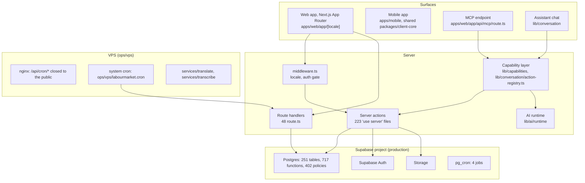

# Technical architecture map

**Owner:** Lane S. **Deliverable B** of the whole-project audit (#3679). **Measured:** 2026-11-23, 05:10–05:45 UTC.

**Status: SUPPORTING.** This file is not the architecture. [`docs/OWNER_TARGET_ARCHITECTURE_V1.md`](../OWNER_TARGET_ARCHITECTURE_V1.md) is, and it takes precedence wherever the two differ.

What this file records:
- what is built, where it lives in code, and how far each part is proven;
- the facts the simplification plan (deliverable E) needs before it removes or merges anything.

The audit only proposes. Nothing here was changed, deleted or applied in production.

**Measured against:**
- `main` at `125e2182` (#3672);
- the deployed build `430bd475`, as `/api/health` reported it at 05:15 UTC.

## 0. How to read this file

### Classes

| Class | Meaning in this file |
|---|---|
| **PROD** | Proven on production by one of three things: a completed, successful `prod-qa-walk.yml` run whose spec visits the item (run id, build and date given); a production read made for this file (HTTP GET, `/api/health`, Supabase logs, or a read-only SQL catalogue query); or both. |
| **MAIN** | On `main` and reachable in code, with no production proof found. It is not a FAIL: nothing was measured. |
| **PR** | Only in an open pull request. |
| **UNUSED** | No importer, caller or reference was found by the method stated beside it. |
| **DUP** | Two or more implementations of one function, with the evidence. Final classification belongs to deliverable C (`docs/audits/DUPLICATION_AUDIT.md`, Lane E). |

### Method limits

- **"Visited by a walk" is a text match.** A walk counts when it names the route's path in its spec file (`apps/web/tests/e2e/prod-*.spec.ts`, plus `prod-walk-routes.ts` for `role-routes`). The run id cited is the newest successful dispatched run of that spec. A green run means every step in the spec passed. It does not mean the spec asserts every element of the page.
- **"Used" means a static import.** A file counts as used when the TypeScript import graph of `apps/web/{app,components,lib}` reaches it: static imports, `export … from`, dynamic `import()` and `require()`, excluding `*.test.*` and `*.spec.*` files.
  - Next.js entry files (`page`, `layout`, `route`, `error`, `not-found`, and similar) count as used.
  - A file reached only by tests or by `apps/web/scripts/*` is reported as such, not as used.
- **Database "referenced"** is checked three ways:
  - the name appears in application code outside tests;
  - another production function's body, a policy, a trigger or a `pg_cron` job uses it (catalogue query, read-only);
  - for versioned functions: whether `authenticated` may `EXECUTE` it, from `has_function_privilege`.
- **Public-repo rule (AGENTS.md).** Production row volumes, traffic totals and infrastructure measurements are not written here. Integrity checks give counts of violations, and log tables give error counts only.

### Section inputs from other lanes

| Section | Lane | Received |
|---|---|---|
| §5 MCP, AI runtime, agent tools | B | 2026-11-23 05:17 UTC |
| §6 DB, RPCs, migration ledger vs repo | D | 05:16 and 05:17 UTC (with a correction); merged with Lane S's own reads |
| §7 Auth, roles, RLS, privacy, erasure | F | 05:21 UTC |

The repo is public. Following AGENTS.md and the lanes' own instructions, open security findings are named only by their tracking PR. Their mechanisms are with the coordinator.

## 1. The system at one glance



Counts come from production catalogue reads, 2026-11-23:

| Object | Count | Notes |
|---|---|---|
| Public tables | 251 | |
| Tables with RLS off | 0 | |
| Views | 4 | |
| Materialized views | 0 | |
| Functions | 717 | 635 of them `SECURITY DEFINER` |
| Policies | 402 | |
| Non-internal triggers | 135 | |
| Foreign keys | 608 | |
| `pg_cron` jobs | 4 | |
| Migration ledger rows | 482 | Newest version `20261120203335` |
| `supabase/migrations/*.sql` files on `main` | 482 | |

The equal counts do not prove the ledger and the repo hold the same set. Lane D's name comparison is in §6.2.

## 2. Routes and pages

There are 121 `page.tsx` files under `apps/web/app/[locale]`:
- 93 are PROD, by a successful production walk, a production GET made for this file, or both;
- 28 are MAIN.

The MAIN set breaks down as:

| Group | Pages |
|---|---|
| Admin console | 20. `prod-admin-console.spec.ts` exists but has no successful dispatched run among the last 100. |
| Dynamic public pages, no walk | `/questions/category/[category]`, `/business/[slug]` |
| `/invite/[token]` | Its walk is BLOCKED on a synthetic invited account (`docs/qa/LAUNCH_MATRIX_2026-11-23.md`, "Invited worker"). |
| Other signed-in pages | `/dashboard/inbox/quick`, `/dashboard/market/recognize`, `/dashboard/reports/evidence` |

**Signed-in routes on a signed-out GET.** Signed out, every `/dashboard/*`, `/cv` and `/onboarding` GET answers `307` to `/[locale]/auth/login?next=…`. That comes from `apps/web/middleware.ts` (`redirectToLogin`), so a signed-out GET proves nothing about the page itself. Only a walk does.

**The vision page.** `/vision` answers 404 to the public in production by design: `apps/web/app/[locale]/(marketing)/vision/page.tsx:72` calls `notFound()` until the page is published. The sitemap (`apps/web/app/sitemap.ts:64`) and the site navigation (`apps/web/components/layouts/site-nav.tsx:82`) read the same gate.

#### Public (32)

| Route (under `/[locale]`) | File | Class | Evidence |
|---|---|---|---|
| `/about` | `apps/web/app/[locale]/(marketing)/about/page.tsx` | PROD | walk public-org-locales phone · 44977198005 · eed72052 · 2026-11-22 |
| `/calculators/project-cost` | `apps/web/app/[locale]/(marketing)/calculators/project-cost/page.tsx` | PROD | walk public-org-locales phone · 44977198005 · eed72052 · 2026-11-22 |
| `/company-need` | `apps/web/app/[locale]/(marketing)/company-need/page.tsx` | PROD | walk public-org-locales phone · 44977198005 · eed72052 · 2026-11-22 |
| `/create-cv` | `apps/web/app/[locale]/(marketing)/create-cv/page.tsx` | PROD | production GET 2026-11-23 05:2x UTC, signed out: 200 |
| `/for-agencies` | `apps/web/app/[locale]/(marketing)/for-agencies/page.tsx` | PROD | walk public-org-locales phone · 44977198005 · eed72052 · 2026-11-22 |
| `/for-companies` | `apps/web/app/[locale]/(marketing)/for-companies/page.tsx` | PROD | walk public-org-locales phone · 44977198005 · eed72052 · 2026-11-22 |
| `/for-workers` | `apps/web/app/[locale]/(marketing)/for-workers/page.tsx` | PROD | walk public-org-locales phone · 44977198005 · eed72052 · 2026-11-22 |
| `/jobs/[id]` | `apps/web/app/[locale]/(marketing)/jobs/[id]/page.tsx` | PROD | walk jobs-search phone · 44902549477 · eed72052 · 2026-11-21 |
| `/jobs` | `apps/web/app/[locale]/(marketing)/jobs/page.tsx` | PROD | walk ai-off-honesty desktop · 44973720651 · eed72052 · 2026-11-22 |
| `/labour-market/[country]` | `apps/web/app/[locale]/(marketing)/labour-market/[country]/page.tsx` | PROD | walk public-org-locales phone · 44977198005 · eed72052 · 2026-11-22 |
| `/labour-market` | `apps/web/app/[locale]/(marketing)/labour-market/page.tsx` | PROD | walk public-org-locales phone · 44977198005 · eed72052 · 2026-11-22 |
| `/legal/cookies` | `apps/web/app/[locale]/(marketing)/legal/cookies/page.tsx` | PROD | walk public-org-locales phone · 44977198005 · eed72052 · 2026-11-22 |
| `/legal/data-access` | `apps/web/app/[locale]/(marketing)/legal/data-access/page.tsx` | PROD | walk public-org-locales phone · 44977198005 · eed72052 · 2026-11-22 |
| `/legal/data-deletion` | `apps/web/app/[locale]/(marketing)/legal/data-deletion/page.tsx` | PROD | walk public-org-locales phone · 44977198005 · eed72052 · 2026-11-22 |
| `/legal/data-protection` | `apps/web/app/[locale]/(marketing)/legal/data-protection/page.tsx` | PROD | walk public-org-locales phone · 44977198005 · eed72052 · 2026-11-22 |
| `/legal/legal-notice` | `apps/web/app/[locale]/(marketing)/legal/legal-notice/page.tsx` | PROD | walk public-org-locales phone · 44977198005 · eed72052 · 2026-11-22 |
| `/legal/marketplace-rules` | `apps/web/app/[locale]/(marketing)/legal/marketplace-rules/page.tsx` | PROD | walk public-org-locales phone · 44977198005 · eed72052 · 2026-11-22 |
| `/legal/privacy` | `apps/web/app/[locale]/(marketing)/legal/privacy/page.tsx` | PROD | walk public-org-locales phone · 44977198005 · eed72052 · 2026-11-22 |
| `/legal/terms` | `apps/web/app/[locale]/(marketing)/legal/terms/page.tsx` | PROD | walk public-org-locales phone · 44977198005 · eed72052 · 2026-11-22 |
| `/match-preview` | `apps/web/app/[locale]/(marketing)/match-preview/page.tsx` | PROD | walk ai-off-honesty desktop · 44973720651 · eed72052 · 2026-11-22 |
| `/pricing` | `apps/web/app/[locale]/(marketing)/pricing/page.tsx` | PROD | walk public-org-locales phone · 44977198005 · eed72052 · 2026-11-22 |
| `/professions` | `apps/web/app/[locale]/(marketing)/professions/page.tsx` | PROD | production GET 2026-11-23 05:2x UTC, signed out: 200 |
| `/questions/[slug]` | `apps/web/app/[locale]/(marketing)/questions/[slug]/page.tsx` | PROD | walk public-readiness · 43598017756 · 80900292 · 2026-11-14 |
| `/questions/category/[category]` | `apps/web/app/[locale]/(marketing)/questions/category/[category]/page.tsx` | MAIN | no production walk visits it |
| `/questions` | `apps/web/app/[locale]/(marketing)/questions/page.tsx` | PROD | production GET 2026-11-23 05:2x UTC, signed out: 200 |
| `/skills` | `apps/web/app/[locale]/(marketing)/skills/page.tsx` | PROD | production GET 2026-11-23 05:2x UTC, signed out: 200 |
| `/vision` | `apps/web/app/[locale]/(marketing)/vision/page.tsx` | PROD (gated) | production GET 2026-11-23: 404 by design until the page is published (`notFound()` at line 72) |
| `/work-abroad` | `apps/web/app/[locale]/(marketing)/work-abroad/page.tsx` | PROD | production GET 2026-11-23 05:2x UTC, signed out: 200 |
| `/work-opportunities` | `apps/web/app/[locale]/(marketing)/work-opportunities/page.tsx` | PROD | production GET 2026-11-23 05:2x UTC, signed out: 200 |
| `/worker-intake` | `apps/web/app/[locale]/(marketing)/worker-intake/page.tsx` | PROD | production GET 2026-11-23 05:2x UTC, signed out: 200 |
| `/business/[slug]` | `apps/web/app/[locale]/business/[slug]/page.tsx` | MAIN | no production walk visits it |
| `/` | `apps/web/app/[locale]/page.tsx` | PROD | production GET 2026-11-23 05:2x UTC, signed out: 200 |

#### Auth and entry (7)

| Route (under `/[locale]`) | File | Class | Evidence |
|---|---|---|---|
| `/[...rest]` | `apps/web/app/[locale]/[...rest]/page.tsx` | PROD | production GET of an unknown path 2026-11-23: 404 |
| `/auth/forgot-password` | `apps/web/app/[locale]/auth/forgot-password/page.tsx` | PROD | walk profile-cv-history phone · 45097071365 · 8bcda5be · 2026-11-23 |
| `/auth/login` | `apps/web/app/[locale]/auth/login/page.tsx` | PROD | production GET 2026-11-23 05:2x UTC, signed out: 200 |
| `/auth/reset-password` | `apps/web/app/[locale]/auth/reset-password/page.tsx` | PROD | production GET 2026-11-23 05:2x UTC, signed out: 200 |
| `/auth/signup` | `apps/web/app/[locale]/auth/signup/page.tsx` | PROD | walk fresh-activation desktop · 44901160408 · eed72052 · 2026-11-21 |
| `/invite/[token]` | `apps/web/app/[locale]/invite/[token]/page.tsx` | MAIN | spec exists, no successful dispatched run in the last 100: prod-invited-worker.spec.ts |
| `/oauth/consent` | `apps/web/app/[locale]/oauth/consent/page.tsx` | PROD | production GET 2026-11-23 05:2x UTC, signed out: 200 |

#### Signed-in (worker, organization) (60)

| Route (under `/[locale]`) | File | Class | Evidence |
|---|---|---|---|
| `/cv` | `apps/web/app/[locale]/cv/page.tsx` | PROD | walk profile-cv-history phone · 45097071365 · 8bcda5be · 2026-11-23 |
| `/dashboard/absences` | `apps/web/app/[locale]/dashboard/absences/page.tsx` | PROD | walk calendar-planning desktop · 44966863726 · eed72052 · 2026-11-22 |
| `/dashboard/account` | `apps/web/app/[locale]/dashboard/account/page.tsx` | PROD | walk search-support-privacy desktop · 44974866504 · eed72052 · 2026-11-22 |
| `/dashboard/activity` | `apps/web/app/[locale]/dashboard/activity/page.tsx` | PROD | walk notifications-inapp phone · 44904905556 · eed72052 · 2026-11-21 |
| `/dashboard/assets` | `apps/web/app/[locale]/dashboard/assets/page.tsx` | PROD | walk org-roster phone · 44905801746 · eed72052 · 2026-11-21 |
| `/dashboard/assist` | `apps/web/app/[locale]/dashboard/assist/page.tsx` | PROD | walk ai-off-honesty desktop · 44973720651 · eed72052 · 2026-11-22 |
| `/dashboard/bookings` | `apps/web/app/[locale]/dashboard/bookings/page.tsx` | PROD | walk orders-bookings phone · 45052181467 · ed4ecf85 · 2026-11-22 |
| `/dashboard/buyer` | `apps/web/app/[locale]/dashboard/buyer/page.tsx` | PROD | walk buyer-workspace desktop · 45094390854 · ee29a3b7 · 2026-11-23 |
| `/dashboard/candidates` | `apps/web/app/[locale]/dashboard/candidates/page.tsx` | PROD | walk search-support-privacy desktop · 44974866504 · eed72052 · 2026-11-22 |
| `/dashboard/commercial` | `apps/web/app/[locale]/dashboard/commercial/page.tsx` | PROD | walk documents-approvals desktop · 44974276075 · eed72052 · 2026-11-22 |
| `/dashboard/communication/[conversationId]` | `apps/web/app/[locale]/dashboard/communication/[conversationId]/page.tsx` | PROD | walk ai-off-honesty desktop · 44973720651 · eed72052 · 2026-11-22 |
| `/dashboard/communication` | `apps/web/app/[locale]/dashboard/communication/page.tsx` | PROD | walk marketplace-goods-services phone · 44968374455 · eed72052 · 2026-11-22 |
| `/dashboard/company/education` | `apps/web/app/[locale]/dashboard/company/education/page.tsx` | PROD | walk learning-practice phone-375 · 44883485138 · eed72052 · 2026-11-21 |
| `/dashboard/company/history` | `apps/web/app/[locale]/dashboard/company/history/page.tsx` | PROD | walk profile-cv-history phone · 45097071365 · 8bcda5be · 2026-11-23 |
| `/dashboard/company/needs` | `apps/web/app/[locale]/dashboard/company/needs/page.tsx` | PROD | walk ai-off-honesty desktop · 44973720651 · eed72052 · 2026-11-22 |
| `/dashboard/company` | `apps/web/app/[locale]/dashboard/company/page.tsx` | PROD | walk company-chain phone-375 · 44882509064 · eed72052 · 2026-11-21 |
| `/dashboard/company/partners` | `apps/web/app/[locale]/dashboard/company/partners/page.tsx` | PROD | walk role-routes phone · 44900081769 · eed72052 · 2026-11-21 |
| `/dashboard/company/people/[personId]` | `apps/web/app/[locale]/dashboard/company/people/[personId]/page.tsx` | PROD | walk company-talent-history desktop · 44975633092 · eed72052 · 2026-11-22 |
| `/dashboard/company/people` | `apps/web/app/[locale]/dashboard/company/people/page.tsx` | PROD | walk profile-cv-history phone · 45097071365 · 8bcda5be · 2026-11-23 |
| `/dashboard/company/planning` | `apps/web/app/[locale]/dashboard/company/planning/page.tsx` | PROD | walk calendar-planning desktop · 44966863726 · eed72052 · 2026-11-22 |
| `/dashboard/company/projects/new` | `apps/web/app/[locale]/dashboard/company/projects/new/page.tsx` | PROD | walk project-execution desktop · 44906961206 · eed72052 · 2026-11-21 |
| `/dashboard/company/scouting` | `apps/web/app/[locale]/dashboard/company/scouting/page.tsx` | PROD | walk ai-off-honesty desktop · 44973720651 · eed72052 · 2026-11-22 |
| `/dashboard/company/settings` | `apps/web/app/[locale]/dashboard/company/settings/page.tsx` | PROD | walk public-org-locales phone · 44977198005 · eed72052 · 2026-11-22 |
| `/dashboard/documents` | `apps/web/app/[locale]/dashboard/documents/page.tsx` | PROD | walk documents-approvals desktop · 44974276075 · eed72052 · 2026-11-22 |
| `/dashboard/finance` | `apps/web/app/[locale]/dashboard/finance/page.tsx` | PROD | walk orders-bookings phone · 45052181467 · ed4ecf85 · 2026-11-22 |
| `/dashboard/gallery` | `apps/web/app/[locale]/dashboard/gallery/page.tsx` | PROD | walk worker-records-exports desktop · 44904394732 · eed72052 · 2026-11-21 |
| `/dashboard/hours` | `apps/web/app/[locale]/dashboard/hours/page.tsx` | PROD | walk company-chain phone-375 · 44882509064 · eed72052 · 2026-11-21 |
| `/dashboard/inbox/counterparty` | `apps/web/app/[locale]/dashboard/inbox/counterparty/page.tsx` | PROD | walk profile-cv-history phone · 45097071365 · 8bcda5be · 2026-11-23 |
| `/dashboard/inbox` | `apps/web/app/[locale]/dashboard/inbox/page.tsx` | PROD | walk search-support-privacy desktop · 44974866504 · eed72052 · 2026-11-22 |
| `/dashboard/inbox/quick` | `apps/web/app/[locale]/dashboard/inbox/quick/page.tsx` | MAIN | spec exists, no successful dispatched run in the last 100: prod-organization-daily.spec.ts, prod-review-scope.spec.ts |
| `/dashboard/inbox/report` | `apps/web/app/[locale]/dashboard/inbox/report/page.tsx` | PROD | walk search-support-privacy desktop · 44974866504 · eed72052 · 2026-11-22 |
| `/dashboard/instructions` | `apps/web/app/[locale]/dashboard/instructions/page.tsx` | PROD | walk org-roster phone · 44905801746 · eed72052 · 2026-11-21 |
| `/dashboard/intelligence` | `apps/web/app/[locale]/dashboard/intelligence/page.tsx` | PROD | walk profile-cv-history phone · 45097071365 · 8bcda5be · 2026-11-23 |
| `/dashboard/journal` | `apps/web/app/[locale]/dashboard/journal/page.tsx` | PROD | walk profile-cv-history phone · 45097071365 · 8bcda5be · 2026-11-23 |
| `/dashboard/journal/voice` | `apps/web/app/[locale]/dashboard/journal/voice/page.tsx` | PROD | walk journal-confirm phone · 44903366199 · eed72052 · 2026-11-21 |
| `/dashboard/learning` | `apps/web/app/[locale]/dashboard/learning/page.tsx` | PROD | walk role-routes phone · 44900081769 · eed72052 · 2026-11-21 |
| `/dashboard/listings` | `apps/web/app/[locale]/dashboard/listings/page.tsx` | PROD | walk marketplace-goods-services phone · 44968374455 · eed72052 · 2026-11-22 |
| `/dashboard/market-map` | `apps/web/app/[locale]/dashboard/market-map/page.tsx` | PROD | walk search-support-privacy desktop · 44974866504 · eed72052 · 2026-11-22 |
| `/dashboard/market/recognize` | `apps/web/app/[locale]/dashboard/market/recognize/page.tsx` | MAIN | no production walk visits it |
| `/dashboard/network` | `apps/web/app/[locale]/dashboard/network/page.tsx` | PROD | walk company-talent-history desktop · 44975633092 · eed72052 · 2026-11-22 |
| `/dashboard/opportunities` | `apps/web/app/[locale]/dashboard/opportunities/page.tsx` | PROD | walk ai-off-honesty desktop · 44973720651 · eed72052 · 2026-11-22 |
| `/dashboard` | `apps/web/app/[locale]/dashboard/page.tsx` | PROD | walk role-routes phone · 44900081769 · eed72052 · 2026-11-21 |
| `/dashboard/people/[workerId]` | `apps/web/app/[locale]/dashboard/people/[workerId]/page.tsx` | PROD | walk search-support-privacy desktop · 44974866504 · eed72052 · 2026-11-22 |
| `/dashboard/planning` | `apps/web/app/[locale]/dashboard/planning/page.tsx` | PROD | walk calendar-planning desktop · 44966863726 · eed72052 · 2026-11-22 |
| `/dashboard/privacy` | `apps/web/app/[locale]/dashboard/privacy/page.tsx` | PROD | walk documents-approvals desktop · 44974276075 · eed72052 · 2026-11-22 |
| `/dashboard/profile` | `apps/web/app/[locale]/dashboard/profile/page.tsx` | PROD | walk profile-cv-history phone · 45097071365 · 8bcda5be · 2026-11-23 |
| `/dashboard/projects/[id]/operations` | `apps/web/app/[locale]/dashboard/projects/[id]/operations/page.tsx` | PROD | walk brigade-formation desktop · 44906216102 · eed72052 · 2026-11-21 |
| `/dashboard/projects/[id]` | `apps/web/app/[locale]/dashboard/projects/[id]/page.tsx` | PROD | walk profile-cv-history phone · 45097071365 · 8bcda5be · 2026-11-23 |
| `/dashboard/projects` | `apps/web/app/[locale]/dashboard/projects/page.tsx` | PROD | walk brigade-formation desktop · 44906216102 · eed72052 · 2026-11-21 |
| `/dashboard/reports/evidence` | `apps/web/app/[locale]/dashboard/reports/evidence/page.tsx` | MAIN | no production walk visits it |
| `/dashboard/reports` | `apps/web/app/[locale]/dashboard/reports/page.tsx` | PROD | walk profile-cv-history phone · 45097071365 · 8bcda5be · 2026-11-23 |
| `/dashboard/service-requests` | `apps/web/app/[locale]/dashboard/service-requests/page.tsx` | PROD | walk buyer-workspace desktop · 45094390854 · ee29a3b7 · 2026-11-23 |
| `/dashboard/services` | `apps/web/app/[locale]/dashboard/services/page.tsx` | PROD | walk buyer-workspace desktop · 45094390854 · ee29a3b7 · 2026-11-23 |
| `/dashboard/start/buyer` | `apps/web/app/[locale]/dashboard/start/buyer/page.tsx` | PROD | walk buyer-workspace desktop · 45094390854 · ee29a3b7 · 2026-11-23 |
| `/dashboard/start/company` | `apps/web/app/[locale]/dashboard/start/company/page.tsx` | PROD | walk fresh-activation desktop · 44901160408 · eed72052 · 2026-11-21 |
| `/dashboard/start` | `apps/web/app/[locale]/dashboard/start/page.tsx` | PROD | walk profile-cv-history phone · 45097071365 · 8bcda5be · 2026-11-23 |
| `/dashboard/talent` | `apps/web/app/[locale]/dashboard/talent/page.tsx` | PROD | walk role-routes phone · 44900081769 · eed72052 · 2026-11-21 |
| `/dashboard/tasks` | `apps/web/app/[locale]/dashboard/tasks/page.tsx` | PROD | walk project-execution desktop · 44906961206 · eed72052 · 2026-11-21 |
| `/dashboard/work-in-numbers` | `apps/web/app/[locale]/dashboard/work-in-numbers/page.tsx` | PROD | walk profile-cv-history phone · 45097071365 · 8bcda5be · 2026-11-23 |
| `/onboarding` | `apps/web/app/[locale]/onboarding/page.tsx` | PROD | walk profile-cv-history phone · 45097071365 · 8bcda5be · 2026-11-23 |

#### Admin (22)

| Route (under `/[locale]`) | File | Class | Evidence |
|---|---|---|---|
| `/dashboard/admin/agent-os` | `apps/web/app/[locale]/dashboard/admin/agent-os/page.tsx` | MAIN | spec exists, no successful dispatched run in the last 100: prod-admin-console.spec.ts |
| `/dashboard/admin/billing` | `apps/web/app/[locale]/dashboard/admin/billing/page.tsx` | MAIN | spec exists, no successful dispatched run in the last 100: prod-admin-console.spec.ts |
| `/dashboard/admin/candidate-pool` | `apps/web/app/[locale]/dashboard/admin/candidate-pool/page.tsx` | MAIN | spec exists, no successful dispatched run in the last 100: prod-admin-console.spec.ts |
| `/dashboard/admin/company-need-intakes` | `apps/web/app/[locale]/dashboard/admin/company-need-intakes/page.tsx` | MAIN | spec exists, no successful dispatched run in the last 100: prod-admin-console.spec.ts |
| `/dashboard/admin/company-verification` | `apps/web/app/[locale]/dashboard/admin/company-verification/page.tsx` | MAIN | spec exists, no successful dispatched run in the last 100: prod-admin-console.spec.ts |
| `/dashboard/admin/import-sandbox` | `apps/web/app/[locale]/dashboard/admin/import-sandbox/page.tsx` | MAIN | spec exists, no successful dispatched run in the last 100: prod-admin-console.spec.ts |
| `/dashboard/admin/intelligence-observations` | `apps/web/app/[locale]/dashboard/admin/intelligence-observations/page.tsx` | MAIN | spec exists, no successful dispatched run in the last 100: prod-admin-console.spec.ts |
| `/dashboard/admin/language-feedback` | `apps/web/app/[locale]/dashboard/admin/language-feedback/page.tsx` | MAIN | spec exists, no successful dispatched run in the last 100: prod-admin-console.spec.ts |
| `/dashboard/admin/launch-readiness` | `apps/web/app/[locale]/dashboard/admin/launch-readiness/page.tsx` | MAIN | spec exists, no successful dispatched run in the last 100: prod-admin-console.spec.ts |
| `/dashboard/admin/league` | `apps/web/app/[locale]/dashboard/admin/league/page.tsx` | MAIN | spec exists, no successful dispatched run in the last 100: prod-admin-console.spec.ts |
| `/dashboard/admin/market` | `apps/web/app/[locale]/dashboard/admin/market/page.tsx` | MAIN | spec exists, no successful dispatched run in the last 100: prod-admin-console.spec.ts |
| `/dashboard/admin/matching` | `apps/web/app/[locale]/dashboard/admin/matching/page.tsx` | MAIN | spec exists, no successful dispatched run in the last 100: prod-admin-console.spec.ts |
| `/dashboard/admin/need-structuring` | `apps/web/app/[locale]/dashboard/admin/need-structuring/page.tsx` | MAIN | spec exists, no successful dispatched run in the last 100: prod-admin-console.spec.ts |
| `/dashboard/admin` | `apps/web/app/[locale]/dashboard/admin/page.tsx` | PROD | walk fresh-activation desktop · 44901160408 · eed72052 · 2026-11-21 |
| `/dashboard/admin/pilots/[id]` | `apps/web/app/[locale]/dashboard/admin/pilots/[id]/page.tsx` | MAIN | no production walk visits it |
| `/dashboard/admin/pilots` | `apps/web/app/[locale]/dashboard/admin/pilots/page.tsx` | MAIN | spec exists, no successful dispatched run in the last 100: prod-admin-console.spec.ts |
| `/dashboard/admin/pipeline` | `apps/web/app/[locale]/dashboard/admin/pipeline/page.tsx` | MAIN | spec exists, no successful dispatched run in the last 100: prod-admin-console.spec.ts |
| `/dashboard/admin/project-truth` | `apps/web/app/[locale]/dashboard/admin/project-truth/page.tsx` | MAIN | spec exists, no successful dispatched run in the last 100: prod-admin-console.spec.ts |
| `/dashboard/admin/readiness` | `apps/web/app/[locale]/dashboard/admin/readiness/page.tsx` | MAIN | spec exists, no successful dispatched run in the last 100: prod-admin-console.spec.ts |
| `/dashboard/admin/support` | `apps/web/app/[locale]/dashboard/admin/support/page.tsx` | MAIN | spec exists, no successful dispatched run in the last 100: prod-admin-console.spec.ts |
| `/dashboard/admin/telemetry` | `apps/web/app/[locale]/dashboard/admin/telemetry/page.tsx` | MAIN | spec exists, no successful dispatched run in the last 100: prod-admin-console.spec.ts |
| `/dashboard/admin/users/[id]` | `apps/web/app/[locale]/dashboard/admin/users/[id]/page.tsx` | MAIN | no production walk visits it |

## 3. Route handlers, crons and internal APIs

There are 48 `route.ts` files.

**Callers** are the non-test files under `apps/web/{app,components,lib}`, `ops/`, `.github/` and `scripts/` that name the path.

**Production cron.** `/api/cron/*` and three `/api/internal/*` paths return 404 from the public host (`ops/vps/labourmarket.ai.nginx.conf:38-42`). They run only from the VPS. The schedule is `ops/vps/labourmarket.cron`, installed by `ops/vps/lm-cron-install.sh`.

| Route | Methods | Callers (examples) | Class and evidence |
|---|---|---|---|
| `/api/health` | GET | monitors; `ops/vps/lm-smoke.sh` | **PROD.** Three GETs at 05:15 UTC, each 200 with `{"ok":true}`: auth 85–108 ms, db 98–114 ms, vacancy freshness `current` (age 6 h, stale after 72 h). |
| `/api/mcp` | GET, POST | external MCP clients; `apps/web/lib/mcp/*` | **PROD.** Walks mcp-chain desktop 44972915546 and mcp-agents desktop 44973332549 (`eed72052`, 2026-11-22). |
| `/.well-known/oauth-protected-resource`, `…/api/mcp` | GET | MCP OAuth discovery (`apps/web/lib/mcp/protected-resource-metadata.ts`) | MAIN |
| `/[locale]/auth/callback`, `/[locale]/auth/logout` | GET / GET, POST | `components/app/login-form.tsx`, `google-button.tsx`, `account-menu.tsx` | **PROD.** fresh-activation desktop 44901160408 (`eed72052`) signs up and in. |
| `/api/assistant/transcript` | POST | `lib/assistant/transcript-client.ts` | MAIN |
| `/api/cv/extract` | POST | 2 callers | MAIN |
| `/api/dashboard-search` | GET | `components/app/command-finder.tsx`, `lib/navigation/command-registry.ts` | MAIN |
| `/api/documents/file/[fileId]` | GET | `components/app/linked-documents.tsx`, `org-documents-register.tsx`, `document-ack-inbox.tsx`, `worker-document-file-slot.tsx` | MAIN. No walk requests this path; documents-approvals 44974276075 walks the document pages only. |
| `/api/waitlist` | POST | 1 caller | MAIN |
| `/api/client-errors` | POST | `lib/telemetry/client-error-early-script.ts` and 1 more | MAIN. It writes only to the server log (route header). §12.2. |
| `/api/billing/{test-checkout,portal,refresh,pilot-pass}` | POST | 1 caller each | MAIN. All payment flags are off in production (§8). |
| `/api/billing/webhook` | POST | Stripe | MAIN. The newest `payment_webhook_events` row is 2026-10-23. |
| `/api/billing/reconcile` | GET | `lib/billing/reconcile.ts`, `billing-recovery.ts`, `refresh-billing-status.ts` | MAIN |
| `/api/cron/weekly-digest` | GET | VPS cron, Mondays 07:00 | MAIN |
| `/api/cron/commercial-handoffs` | GET | VPS cron, daily 06:00 | MAIN. The newest `commercial_handoffs` row is 2026-11-15. |
| `/api/cron/job-alerts` | GET | VPS cron, daily 06:17 | MAIN |
| `/api/cron/privacy-erasure` | GET | VPS cron, every 10 min | MAIN |
| `/api/cron/forecast-recompute` | GET | VPS cron, every 5 min | MAIN. `project_forecast_state` has never been written in production (§6.6). |
| `/api/cron/billing-recovery` | GET | manual only, `lm-cron.sh billing-recovery` | MAIN. It is not in `labourmarket.cron`. `.github/workflows/billing-recovery-cadence.yml` fails on purpose, because GitHub cannot reach `/api/cron/*` (file header). |
| `/api/cron/invitation-delivery-retry` | POST | `ops/vps/lm-invitation-delivery-retry.sh`, `lm-invitation-delivery-cron.sh` | MAIN |
| `/api/cron/referral-reprocess` | POST | `ops/vps/lm-referral-reprocess.sh` | MAIN |
| `/api/internal/capability-readback/v1` | GET | `.github/workflows/integration-probe.yml:80` | **PROD.** integration-probe 45085333428, scheduled, success, 2026-11-22 23:49 UTC. |
| `/api/internal/commercial-requests/v1` | GET | `lib/staffing/commercial-requests-feed.ts` (closed at nginx) | MAIN |
| `/api/internal/registrations-daily/v1` | GET | `lib/api/registrations-daily.ts` (closed at nginx) | MAIN |
| `/api/internal/supply-feed/first-party-v1` | GET | none found outside its own file. The emitter is `scripts/emit-first-party-supply-feed.ts`. | **UNUSED-candidate** (no caller by path) |
| `/api/public/claims/v1` | GET | `lib/public-claims/registry.ts` | MAIN |
| `/api/referrals/external/v1` | POST | `.github/workflows/integration-probe.yml`; `lib/invitations/external-referral-contract.ts` | PROD via integration-probe 45085333428 |
| `/api/professions/[professionId]/skills` | GET | `components/app/profession-skills-picker.tsx` | MAIN |
| `/api/workers/[workerId]/skills` | GET, POST | `components/app/profession-skills-picker.tsx`, `profile-text-first-flow.tsx` | MAIN |
| `/[locale]/dashboard/{finance,journal,privacy}/export`, `/journal/hours`, `/company/institution-report/export`, `/planning/timesheets/[id]/export`, `/projects/[id]/operations/report` | GET | their pages: `finance/page.tsx`, `reports/page.tsx`, `privacy/page.tsx`, `planning/timesheets-section.tsx`, `projects/[id]/operations/page.tsx`, `components/app/institution-programs-section.tsx` | MAIN, except two exports: journal export is PROD via worker-records-exports desktop 44904394732 (`prod-worker-records-exports.spec.ts:385`), and finance export is PROD via orders-bookings phone 45052181467 (`prod-orders-bookings.spec.ts:525`). |
| `/jobs-sitemap.xml`, `/jobs-sitemap/[shard]`, `/questions-sitemap.xml`, `/llms.txt`, `/sitemap.xml`, `/robots.txt` | GET | crawlers | **PROD.** Production GETs 200 in the Lane S crawl of 2026-11-22 (issue #3265 register). The sitemap function also appears in the 5xx list (§12.1). |
| `/.well-known/{apple-app-site-association,assetlinks.json,openai-apps-challenge}` | GET | app stores, OpenAI apps | MAIN |

**Database-side schedules.** `pg_cron` is read-only from `cron.job`:

| Job | Schedule (UTC) |
|---|---|
| `run_ai_runs_retention_sweep()` | 03:17 |
| `refresh_public_vacancy_supply_counts_v1()` | every 10 min |
| `delete from confirmation_spends where spent_at < now() - interval '1 day'` | 03:23 |
| `expire_stale_booking_requests_system_v1(14)` | 04:11 |

All four are active.

**Workflow schedules that touch production:**
- vacancy ingestion: `.github/workflows/sweden-supply-cadence.yml`, `nav-supply-cadence.yml`, `ingestion-freshness.yml` and `vacancy-retention.yml`. Health reports the last vacancy refresh at 2026-11-22 22:32 UTC;
- `integration-probe.yml`;
- the daily rotation in `prod-qa-walk.yml`.

## 4. Server actions and components

| Layer | Size | Notes |
|---|---|---|
| Server-action modules | 223 files with a top-level `"use server"` under `apps/web/{app,lib,components}` | Lanes B, F and D own the per-domain detail. |
| React components | 599 `.tsx` files under `apps/web/components` | |
| Library modules | 2,443 non-test `.ts`/`.tsx` files in `apps/web/{app,components,lib}` | |

### 4.1 Components that nothing imports (UNUSED, by import graph)

43 component files are imported by no non-test file in `apps/web/{app,components,lib}`. A second search found none of them imported by `apps/web/scripts`, `tests/e2e`, `next.config.ts` or `messages/*` either.
- Some of them appear by name in owner visual-acceptance scripts, for example `apps/web/scripts/qa-owner-visual-acceptance.mjs:25`. Those scripts list `conversation-os`, `draft-board` and `market-pulse` as sections that must be GONE from the page, so they confirm the components are removed from use.
- Eight shared UI primitives in `components/ui/` are imported only by their tests.

| Component file | Test files that import it |
|---|---|
| `apps/web/components/ui/StructureTree.tsx` | 1 |
| `apps/web/components/ui/GroupedList.tsx` | 1 |
| `apps/web/components/ui/Choice.tsx` | 1 |
| `apps/web/components/ui/EmptyState.tsx` | 1 |
| `apps/web/components/ui/Placeholder.tsx` | 0 |
| `apps/web/components/ui/ListRow.tsx` | 1 |
| `apps/web/components/ui/ResultShell.tsx` | 0 |
| `apps/web/components/ui/Table.tsx` | 1 |
| `apps/web/components/app/feature-availability-grid.tsx` | 0 |
| `apps/web/components/app/setup-role-choice.tsx` | 0 |
| `apps/web/components/app/labour-market-world-map.tsx` | 0 |
| `apps/web/components/app/demand-preview-card.tsx` | 0 |
| `apps/web/components/app/live-world-map.tsx` | 0 |
| `apps/web/components/app/live-ticker.tsx` | 0 |
| `apps/web/components/app/dashboard-section.tsx` | 0 |
| `apps/web/components/app/market-map-shell.tsx` | 0 |
| `apps/web/components/app/agency-pool-preview.tsx` | 0 |
| `apps/web/components/app/cv/living-cv-story.tsx` | 0 |
| `apps/web/components/app/role-catalogue-card.tsx` | 0 |
| `apps/web/components/app/open-in-waze.tsx` | 0 |
| `apps/web/components/app/market-counters.tsx` | 0 |
| `apps/web/components/app/agency-workers-section.tsx` | 1 |
| `apps/web/components/app/live-map.tsx` | 0 |
| `apps/web/components/marketing/living-worker-hero.tsx` | 0 |
| `apps/web/components/marketing/proof-band.tsx` | 0 |
| `apps/web/components/marketing/market-proof-band.tsx` | 2 |
| `apps/web/components/marketing/product-chain-band.tsx` | 0 |
| `apps/web/components/marketing/market-moment.tsx` | 0 |
| `apps/web/components/marketing/starting-contexts-band.tsx` | 0 |
| `apps/web/components/marketing/example-preview-frame.tsx` | 0 |
| `apps/web/components/marketing/trust-band.tsx` | 0 |
| `apps/web/components/marketing/landing-primary-actions.tsx` | 1 |
| `apps/web/components/marketing/how-it-works-band.tsx` | 0 |
| `apps/web/components/marketing/market-pulse.tsx` | 0 |
| `apps/web/components/marketing/audience-value-sections.tsx` | 0 |
| `apps/web/components/marketing/audience-page.tsx` | 0 |
| `apps/web/components/marketing/draft-board.tsx` | 0 |
| `apps/web/components/marketing/final-cta-band.tsx` | 1 |
| `apps/web/components/marketing/public-market-map-band.tsx` | 0 |
| `apps/web/components/marketing/service-offers.tsx` | 0 |
| `apps/web/components/marketing/landing-three-ways.tsx` | 0 |
| `apps/web/components/marketing/conversation-os-panel.tsx` | 0 |
| `apps/web/components/marketing/two-sides-section.tsx` | 0 |

**Proposal (for E):** remove these in one GREEN PR, with a guard that fails when a `components/**` file has no importer. Removing a file needs no migration. The risk is a component that is loaded by string, and none was found.

### 4.2 Library modules imported only by tests or tooling

73 `lib/` files have no importer in app, component or lib code. Most are expected tooling:
- `lib/guards/*`, `lib/testing/*`, `lib/test/*`;
- `__fixtures__/*`;
- AI eval fixtures, used by `apps/web/scripts/*`;
- vendored contracts.

Four have no importer anywhere outside guard tests:

| File | Finding |
|---|---|
| `apps/web/lib/answer-engine/indexnow.ts` | Unwired **by design**: `lib/guards/answer-engine-publishing-static.test.ts:82-92` pins that nothing imports it yet |
| `apps/web/lib/agency/pool-actions.ts` | Import banned from agency surfaces by `lib/guards/agency-direction-a.test.ts:79-81`; still listed as an anchor of a capability in `lib/product-gate/capability-register.ts:616` |
| `apps/web/lib/esco/evidence-correspondence.ts` | Read by two guard tests only |
| `apps/web/lib/config/suggestion-statuses.ts` | Read by `lib/guards/product-readiness.test.ts` only |

These are UNUSED in the product. Two of them are deliberately so. Deliverable C decides.

## 5. MCP, AI runtime and agent tools (Lane B)

Lane B measured this section on `main` `125e2182` against production build `430bd475`, which `/api/health` reported at 05:13 UTC.
- `430bd475` is an ancestor of `main`, and no later commit touches `lib/capabilities`, `lib/mcp` or `app/api/mcp`.
- The counts come from a vitest run that imported the real registries. The scratch test was deleted afterwards.

### 5.1 MCP doors (`/api/mcp*`)

| Item | Files | Class | Evidence |
|---|---|---|---|
| Full door `/api/mcp` | `apps/web/app/api/mcp/route.ts`; `lib/mcp/protocol.ts`; `lib/mcp/toolset.ts` | **PROD** | Production `GET /api/mcp` answers 405 with `toolsetVersion: "0.1.0+t241.52065620"` and `toolCount: 241`. `exposedCapabilities()` on main is also 241. Walks mcp-chain 44972915546 and mcp-agents 44973332549. |
| OAuth protected-resource metadata (RFC 9728) | `app/.well-known/oauth-protected-resource/route.ts` and `…/api/mcp/route.ts`; `lib/mcp/protected-resource-metadata.ts` | **PROD** | Both answer 200 in production, naming `https://labourmarket.ai/api/mcp` and the project's Supabase Auth as authorization server |
| Identity at the door | `lib/api/api-identity.ts` (`resolveApiIdentity`), `lib/api/external-client-auth.ts` (401 challenge), `lib/api/bearer-caller-scope.ts` (`runAsBearerCaller`) | MAIN | In the production build; no production auth run cited. `lib/guards/api-auth-boundary.test.ts` classifies the route. |
| Read-only door `/api/mcp/read` | `lib/mcp/door.ts`, `app/api/mcp/read/route.ts` | **PR #3164** | No production route |
| ChatGPT door `/api/mcp/chatgpt` | `lib/mcp/chatgpt-profile.ts` (22 pinned tools), `app/api/mcp/chatgpt/route.ts` | **PR #3219**, stacked on #3164; RED (auth door) | No production route |

### 5.2 Tool registries

| Registry | File | Size on main | Consumer | Class |
|---|---|---|---|---|
| Capabilities (the MCP toolset) | `lib/capabilities/registry.ts` (`listCapabilities` :2021, `exposedCapabilities` :2025, `runCapability` :2033) and the 15 modules it imports (:42–56) | 241 listed and exposed: read 66, draft 72, confirm 72, execute 31 | MCP door | **PROD** (count matches production) |
| Web chat actions | `lib/conversation/action-registry.ts` (`CONVERSATION_ACTIONS` :134) | 58 | Chat dispatcher; `worker-executors.ts`, `company-executors.ts` | MAIN |
| Chat action → capability bridge | `lib/capabilities/conversation-action-bridge.ts` | 56. Skips actions a dedicated capability already does (`ALREADY_CAPABILITIES` :62). | Capability registry | **PROD** (part of the 241) |
| Routed chat intents | `lib/conversation/intent-registry.ts` (`INTENT_REGISTRY` :186, `dispatchIntent` :458); matcher `intent-router.ts` | 95 | Web chat | MAIN |
| Intent catalogue for the model | `lib/conversation/intent-catalogue.ts` (`intentCatalogueFor` :171) | the same 95 ids | `lib/conversation/llm-proposal.ts` | MAIN |
| Command finder | `lib/navigation/command-registry.ts` (`COMMAND_REGISTRY` :72, `matchCommands` :2072) | 60 | `components/app/command-finder.tsx:301`, `lib/search/dashboard-search-model.ts:28` | MAIN |
| Dashboard modules | `lib/dashboard/dashboard-module-registry.ts` (`DASHBOARD_MODULES` :145) | 25 | Dashboard chrome and navigation | MAIN |

Guards on these registries:
- `lib/guards/mcp-execute-allowlist.test.ts`;
- `lib/mcp/toolset-fingerprint.test.ts`;
- `lib/capabilities/capabilities.test.ts`.

The single-use `_prepare` / `_confirm` step uses `lib/conversation/confirmation-token.ts` and the `confirmation_spends` table. It is PROD via chat-confirm-once desktop 44972019714.

### 5.3 Web chat assistant

| Part | Files | Class |
|---|---|---|
| Deterministic router, runs first, no model | `lib/conversation/intent-router.ts` → `intent-registry.ts` | MAIN |
| Model proposer for sentences the router cannot read | `lib/conversation/llm-proposal.ts` → `runAiAgent("conversation_intent")` | MAIN |
| What may leave for the proposer | `lib/conversation/intent-sentence-redaction.ts` | MAIN |
| Transcript append | `app/api/assistant/transcript/route.ts` (the only `/api/assistant/*` route) | MAIN |
| `/dashboard/assist` | `app/[locale]/dashboard/assist/page.tsx`, `lib/assist/assist.ts`, `assist-model.ts` | Page PROD via ai-off-honesty desktop 44973720651 |

How the redaction step works:
- it is an allow-list: every number and every word outside the vocabulary becomes a token, which is restored only locally;
- special-category and credential words block sending.

`/dashboard/assist` is a read-only attention page, not a generator: `lib/assist/assist.ts:60` says there is no `runAiAgent` call.

The chat surfaces themselves are PROD by walk: ai-off-honesty 44973720651 and manager-chat 44972421825.

### 5.4 AI runtime and providers (MAIN)

| Item | Files |
|---|---|
| Entry | `lib/ai/run-agent.ts`, `lib/ai/run-agent-server.ts` |
| Dispatch and chain | `lib/ai/runtime/run-core.ts`, `provider-chain.ts`, `provider-health.ts`, `provider-cooldown.ts`, `provider-counters.ts` |
| Egress | `data-egress.ts`, `data-sensitivity.ts`, `egress-precheck.ts` |
| Task policies | `lib/ai/runtime/task-routing.ts`: `translate_message` :347, `explain_market_demand` :384, `propose_conversation_intent` :426, `translate_vacancy` :486 |
| Budget and audit | `paid-budget.ts`, `org-run-cap.ts`, `audit-store.ts`, `model-pricing.ts`. Audit rows go to `ai_runs`, newest 2026-11-23 (PROD, DB read). The `pg_cron` retention sweep runs daily at 03:17. |
| Agents | `lib/ai/registry/agents/`: company-need, conversation-intent, country-readiness, market-explanation, matching-explanation, translation-copy, vacancy-translation, work-journal, worker-profile |
| Adapters | `lib/ai/runtime/providers/`: anthropic, openai, gemini, xai, cloudflare, deepl, libretranslate, local, free-tier, mock, disabled |

**Callers of `runAiAgent` outside `lib/ai`:** 10, proven by import:
- `lib/conversation/llm-proposal.ts`;
- `lib/journal/journal-ai-suggestions-actions.ts`;
- `lib/staffing/company-need-actions.ts`, `match-preview-actions.ts`, `worker-intake-actions.ts`;
- `lib/profile/cv-ai-structuring-actions.ts`;
- `lib/vacancy-store/vacancy-translation-read.ts`;
- `lib/communication/translation-read.ts`;
- `lib/country-readiness/readiness-reading-actions.ts`;
- `lib/market/market-explanation-actions.ts`.

No file outside `lib/ai` calls a provider host or SDK directly.

**Which providers are configured in production is NOT VERIFIED.** No public endpoint reports it, so no provider is marked PROD.

### 5.5 A second, inert provider path

- `lib/ai/provider.ts` (`getAiProvider`), `noop-provider.ts` and `legacy-assist-schemas.ts` always return the no-op provider (gate `AI_ASSIST_ENABLED`, `lib/config/ai.ts`).
- Its only caller is `lib/ai/estimate-clarify-actions.ts`, used by `components/app/estimate-clarify-assist.tsx` inside `estimate-builder.tsx`.
- Class: MAIN, inert. Handed to deliverable C as D-B1.

### 5.6 Services

| Service | Path | State |
|---|---|---|
| Voice transcription | `services/transcribe/server.mjs`; `/dashboard/journal/voice` | The production host is unverified: owner decisions COM-6 and COM-8 |
| Translation | `services/translate/` | Its production use is not verified in this file |

## 6. Database, RPCs and the migration ledger (Lane D, with Lane S)

All production figures are read-only catalogue reads on 2026-11-23, made between 05:11 and 05:16 UTC by Lane D, and from 05:15 by Lane S.

### 6.1 Size (PROD)

| Object | Count |
|---|---|
| Public tables | 251, RLS on for all 251 |
| Policies | 402 on 232 tables: SELECT 235, INSERT 63, UPDATE 37, DELETE 24, ALL 43 |
| Tables with RLS on and no policy | 19 |
| Tables anon can `SELECT` directly | 0 |
| Functions in `public` | 717, of which 635 `SECURITY DEFINER` |
| Foreign keys | 608 |
| Views | 4 |
| Non-internal triggers | 135 |

**The 19 tables with no policy** are server-only stores, closed to everyone except the service role by design: `company_need_public_intakes`, `email_send_ledger_v1`, the `email_verification*` tables, `invitation_delivery_attempts_v1`, `ops_runtime_samples`, the six `privacy_erasure_*` tables, `project_forecast_signals`, `public_vacancy_search`, `public_vacancy_supply_counts`, `team_demand_offer_terms`, `vacancy_import_cursors` and `worker_display_name_backfill_20260805`.

**Storage buckets:** 6, none public: `customer-request-attachments`, `journal-entry-photos`, `profile-avatars`, `conversation-attachments`, `document-files`, `evidence-media`.

**Extensions:** plpgsql, pg_stat_statements, uuid-ossp, pgcrypto, supabase_vault, btree_gist, pg_cron, pg_trgm.

### 6.2 Migration ledger vs repo (Lane D)

| Side | Count |
|---|---|
| Production ledger rows | 482 |
| Repo files in `supabase/migrations/*.sql` | 482 (481 distinct names) |

Ledger versions do not equal repo filename timestamps (`CLAUDE.md`, Migrations), so the comparison is by migration name, with the numeric prefixes stripped on both sides.

**Applied twice under one name:**
- `conversation_message_language`;
- `ai_runs_retention_redaction_v1`.

**In the ledger with no repo file of that name:** 8.
- `journal_entry_photos_table`, `_rpc` and `_storage` are the repo's single `20260612091000_journal_entry_photos.sql`, applied in three parts.
- `notification_types_union_workflow_document_v3` merges `20260817130100_notification_events_v3_workflow_types.sql` and `20260817140100_notification_document_types_v3.sql`.
- Four have no repo counterpart under any matched name. They are production-only changes:
  - `conversation_message_language_check`;
  - `company_memberships_v1_trigger_fn_revoke`;
  - `invitation_org_authority_v1_resend_completion`;
  - `public_vacancy_preview_v1_revoke_public`.

**In the repo but not applied in production:** 5. The objects are verified absent by catalogue read.

| File | What is absent | Where code still names it |
|---|---|---|
| `20260713120000_company_locations_v1.sql` | `company_locations` and its save and remove functions | Documented as a superseded draft (`lib/objects/objects-model.ts:11`, `lib/market-map/spatial-read.ts:18`); named in the allow-list `lib/security/canonical-authenticated-rpcs.ts:144,173` |
| `20260714211000_dashboard_preferences_v1.sql` | the table | `lib/privacy/personal-relations.ts:143` |
| `20260717150000_demand_interest_seen_v1.sql` | the table and `mark_demand_interest_seen_v1` | `lib/privacy/personal-relations.ts:244` |
| `20260713210000_multi_source_talent_v1.sql` | `talent_source_records`, `identity_resolution_events`, `record_talent_source_v1` | `lib/privacy/personal-relations.ts:290-291`; `canonical-authenticated-rpcs.ts:139` |
| `20260717130000_open_markets_countries_draft_v1.sql` | a data insert into `countries`; not in the ledger, rows not checked | — |

All five are MAIN, not PROD.

**Proposal:** mark them as unapplied drafts, or move them out of `supabase/migrations`, so the folder equals what production runs. Remove the stale allow-list entries. No production action.

**Parity races on `main`.** CI shows the live "Migration parity" gate failing twice when a migration was applied before its file merged, then passing on the next run:
- Quality Gates 44681164101 (`ec9b6ee9`), then 44684764996;
- Quality Gates 44775281257 (`1b56278d`), then 44781366524.

### 6.3 Relations, selected (Lane D)

Subcontractor and marketplace:
- `customer_requests` (the need) ← `team_demand_offers.request_id`;
- `team_demand_offers.team_org_id` → `organizations` (type team);
- `team_demand_offer_terms.offer_id` → `team_demand_offers`;
- `team_demand_offers.assignment_id` → `team_assignments` → `projects`.

Counterparty confirmation:
- `work_counterparty_links` (project, worker, counterparty organization) ← `journal_entry_review_submissions.link_id`;
- `journal_entry_confirmations.confirmation_scope` carries the counterparty authority.

Offerings and contracts:
- `service_offerings.provider_id`, `service_offering_requests.buyer_id` and `provider_id` → `profiles`. They are keyed to the profile, not the organization;
- `proposals.owner_id` and `contracts.owner_id` are owner-only;
- `contracts.proposal_id` → `proposals`.

Billing:
- `billing_subscriptions` (organization, plan key, provider subscription);
- `billing_checkout_operations`;
- `payment_webhook_events`.

### 6.4 Every table and function is referenced, with two exceptions per kind (Lane S)

**Tables.** Of 260 table names created in migrations, 3 never appear in application code:

| Table | Production state | Class |
|---|---|---|
| `email_send_ledger_v1` | Written today, through `reserve_email_send_v1` (DB-side) | used |
| `assistant_message_attachments` | Never written (`max(created_at)` is null); no code reference | **UNUSED** |
| `project_forecast_state` | Never written (`max(last_computed_at)` is null); created in `20261025045152_project_forecasts_v1.sql` | **UNUSED in production** (§3, forecast-recompute) |

**Functions.** Of 727 function names created in migrations, 78 never appear in application code. A production catalogue read classified them:

| State in production | Functions |
|---|---|
| Attached trigger function | 52 |
| Called by another function's body | 18 |
| Used in an RLS policy | 4 |
| Run by `pg_cron` | 2 |
| Absent in production (dropped later, or never applied: §6.2) | 3 |
| **No reference found** | **2**: `erase_assistant_transcript`, `revoke_competency_recognition_v1` |

### 6.5 Versioned function families (DUP-candidate)

30 function families exist in two or more versions in production, 63 functions in all. Examples:
- `respond_booking_request`, `_v2`, `_v3`, `_v4`;
- `save_company_setup`, `_v2`, `_v3`;
- `create_work_task_v1`, `_v2`.

**The pattern.** In the call sites read for this file (booking, tasks, documents, demand, invitations, marketplace), application code calls the newest version first. It falls back to an older version only when the newest is absent from the database. Example, `apps/web/lib/booking/booking-actions.ts:273-275`:

```ts
let { data: newBookingId, error } = await asAny(supabase).rpc("propose_booking_request_v3", args);
if (error && isAbsentFunction(error)) {
  ({ data: newBookingId, error } = await asAny(supabase).rpc("propose_booking_request", args));
}
```

The newest version of every family exists in production, so a fallback taken only on an absent function never runs there.

**Older versions already closed.** In 11 families the older version is already closed to signed-in callers in production, yet several call sites still name it as a fallback. Examples:
- `lib/invitations/actions.ts:521,570,615`;
- `lib/marketplace/listings.ts:515,588,658`.

Those branches can only fail.

Not every family was read line by line. `create_invitation_v1` and `_v2` have separate callers (`lib/organization-evidence/roster-link-actions.ts:144` vs `lib/invitations/actions.ts:723`), so they are **not shown to be duplicates**: their purpose must be compared.

The per-version execute rights and the full call-site list went to Lane E for deliverable C. They are not repeated in this public file. One security item among the versioned functions was handed to the auth and RLS lane.

**Proposal:**
1. **GREEN:** remove the dead fallback branches whose older version is already closed.
2. **RED, owner-gated:** per family, close the older version, then drop it with a rollback. Each step needs its own proof that no caller remains, including the mobile app and MCP.

**A related duplicate.** The "is this schema object missing?" check is written 48 times as a local function in 43 files. Examples:
- `isAbsentFunction`, `lib/booking/booking-actions.ts:51`;
- `isMigrationMissingCode`, `lib/finance/finance-model.ts:114` and `lib/tasks/task-model.ts:57`;
- `isMissingRpcCode`, `lib/agency/clients-model.ts:71`;
- `isMissingRpcError`, `lib/privacy/deletion-cancel-model.ts:27`.

163 non-test files test the missing-function codes `42883` or `PGRST202` directly. No shared helper exists.

### 6.6 Never written in production

These are production reads of the newest row date only:

| Table | State | Reading |
|---|---|---|
| `web_push_subscriptions` | No row | Expected: `WEB_PUSH_ENABLED` is off |
| `assistant_message_attachments` | No row | §6.4 |
| `project_forecast_state` | No row | The forecast-recompute cron runs every 5 min. Either nothing is due, or the pass writes elsewhere. NOT MEASURED which: the cron log is on the VPS. |

## 7. Identity, roles and permissions (Lane F)

Lane F's classes:
- **PROD** means a read-only production read by Lane F on 2026-11-22 or 23, or a recorded walk;
- **MAIN** means on `main`;
- **PR** means an open pull request.

The repo is public. Open security findings are named here only by their tracking PR. Their mechanism and the production reads behind them are with the coordinator.

### 7.1 Authentication chains

| Chain | Code | Class |
|---|---|---|
| Web sign-up | `apps/web/components/app/signup-form.tsx:282` | PROD via fresh-activation 44901160408 |
| Web sign-in | `components/app/login-form.tsx:204` | PROD via role-routes 44899143018, 44900081769 |
| OAuth (Google, LinkedIn OIDC, Facebook), one core | `components/app/google-button.tsx:238`; callback `app/[locale]/auth/callback/route.ts:147,168` | MAIN. No walk signs in with a provider. |
| Addressed-invite sign-up | `lib/invitations/signup-accept-action.ts:86`. The address comes from the token. | MAIN. Its walk is BLOCKED (§2). |
| Onboarding | `app/[locale]/onboarding` → `completeOnboarding` (`lib/auth/actions.ts:74`) → `complete_onboarding` | PROD via fresh-activation |
| Mobile sign-up and sign-in | `apps/mobile/src/auth-context.tsx:259,281`. There is no mobile onboarding. | MAIN. The drift from web was sent to Lane E. |
| Auth gate | `apps/web/middleware.ts` (`redirectToLogin`) | **PROD.** Signed-out GETs to `/lt/dashboard`, `/lt/cv` and `/lt/onboarding` answer 307 to login, 2026-11-23. |

**Sessions and API identity:**
- Server code re-reads auth on every request, and no organization role is held in the token.
- The active workspace is resolved on the server and re-checked against memberships and engagements (`lib/company/employer-company-context.ts`, `lib/company/active-organization.ts`).
- MCP runs as the caller's own RLS client: `app/api/mcp/route.ts` → `resolveApiIdentity` → `runAsBearerCaller` → `lib/supabase/server.ts`.
- Machine doors use constant-time secrets and refuse when the secret is unset: `lib/api/cron-auth.ts`, `supply-feed-auth.ts`, `commercial-requests-feed-auth.ts`, `external-referral-auth.ts`.
- Class: MAIN.

### 7.2 Role model: three layers, never merged (doctrine §5)

| Layer | Store | Written by | Class |
|---|---|---|---|
| Platform roles | `profile_roles` ∈ {worker, company, agency, customer, admin}; `is_admin()` | sign-up trigger, `complete_onboarding`, `add_role` | PROD (constraint read) |
| Organization governance | `company_memberships.role` ∈ {owner, admin, manager, external_manager, member}; status invited, active or revoked | `membership_invite_v1`, `membership_change_role_v1`, `membership_revoke_v1`, `membership_leave_v1`. Capabilities per role: `apps/web/lib/company/role-capabilities.ts`. | MAIN code, PROD functions |
| Work relationships | `engagement_contexts.relationship_slug` (owner, manager, external_manager, employee, collaborator, …) | engagement paths | MAIN |

Owner decision **ORG-2** is open: whether the seven industry gates move to `organization_roles` (product-truth).

### 7.3 Organization rights: the database helpers RLS reads

| Helper | Grants | Class |
|---|---|---|
| `owns_company(c)` | creator arm (unless governance ended) or an active owner or admin membership | PROD |
| `owns_agency(a)` | creator (unless governance ended) | PROD |
| `manages_organization(org)` | an active owner or manager engagement, or an active governance membership | MAIN |
| `has_org_demand_access(org)` | used by the need, booking and shortlist policies | MAIN |
| `belongs_to_organization(org)` | an active engagement or membership; used by `organizations_select` | PROD (policy read) |

**RLS everywhere.** RLS is on for every public table, with 0 exceptions (PROD). Anonymous visitors may execute only a small set of `SECURITY DEFINER` functions: the public read doors and `submit_company_need_public_v1` (PROD). The set is pinned by `lib/security/anon-secdef-allowlist.ts` and its live CI gate.

**Company and agency rows** are readable by any signed-in user, without the contact columns (PROD column grants).

**Decision 0033 (no hidden counterparty identifiable):**
- #3658 (merged) removed foreign owner and organization ids from marketplace and service discovery.
- The remaining items are listed under §7.5.

### 7.4 Privacy and erasure

| Item | Code | Class |
|---|---|---|
| Intake | `submit_privacy_request_v1` → `customer_requests` (kind `customer_request`, payload `source: privacy_self_service`) | PROD |
| Kept off commercial surfaces | boards accept only commercial kinds; #3631 (merged) closed the share picker, workbench write and counts | PROD, plus RED #3646 |
| Export | `lib/privacy/export-data.ts`; register `lib/privacy/personal-relations.ts` | MAIN (PARTIAL in the capability register) |
| Erasure executor | `privacy_erasure_executor_v3` (`20261019140000`): a registry per foreign key, value rules, sentinel severing, legal basis or refusal, a single-use token bound to the plan digest, one transaction, a receipt | PROD (functions present) |
| Runner | `/api/cron/privacy-erasure` every 10 min (VPS cron). It runs only requests with a `privacy_erasure_confirmations_v1` row. | PROD |
| Cooling-off | `privacy_account_deletion_grace()`: 30 days after confirmation; the holder can cancel | PROD |
| Admin view | `/dashboard/admin` privacy band: due date, overdue flag, review status, read-only plan preview. It deletes nothing. | MAIN |

**Not in production.** The admin privacy view reads a review-log table (`lib/admin/privacy-requests.ts`) that exists in neither the migrations nor production. Its review note cannot be stored. This is handed to Lane F.

### 7.5 Open security and privacy items (tracked, details withheld)

Lane F's open items are tracked in RED PRs:

| Area | PRs |
|---|---|
| Authentication and organization rights | #3575, #3620 |
| Privacy requests and erasure timing | #3632, #3646 |

Three more need a RED change or an owner decision: column-level access on listings and offerings, database-side caps on agency offer functions, and the counterparty rules of decision 0033.

Mechanisms and production reads are with the coordinator and Lane F. They are not written in this public file. Lane F rates the #3575 apply as urgent.

## 8. Commercial flows and payments

Access to billing and finance (Lane F):
- checkout and plan changes need owner or admin billing authority (`app/api/billing/test-checkout/route.ts`, `pilot-pass/route.ts`);
- billing tables are readable by their owner or an admin;
- finance records are readable by their creator, an admin, or an organization owner or admin. Managers are excluded.

The chain is: need → offer or booking → agreement → engagement → project → work record → settlement.

| Step | Code | Tables / RPCs | Class |
|---|---|---|---|
| Need (demand) | `lib/demand/*`, `lib/company/*` | `job_demands`; `save_demand_draft_v2`, `submit_demand_request_v2`, `close_demand_v1`, `reopen_demand_v1` | PROD: need-intake desktop, phone and phone-375 (44642526482, 44643169770, 44643949860) |
| Agency candidate offer | `lib/agency/*` | `agency_candidate_offers`; `submit_agency_candidate_offer_v1`, `respond_agency_candidate_offer_v1` | PROD: agency-chain desktop, phone and phone-375 (44644887648, 44645924736, 44646951459) |
| Team (brigade) offer | `lib/company/team-offer.ts` | `team_demand_offers`, `team_demand_offer_terms`; `respond_team_demand_offer_v2` | PROD: brigade-formation 44906216102 |
| Booking → engagement | `lib/booking/booking-actions.ts`, `lib/booking/engagement-invariant.ts` | `booking_requests`, `company_worker_engagements`; `propose_booking_request_v3`, `respond_booking_request_v4` | PROD: orders-bookings desktop 45049554634 and phone 45052181467. Invariant holds (§12.5). |
| Agreement / contract | `lib/agreements/*`, `lib/contracts` | `agreements`, `agreement_amendments`, `contracts`; `create_agreement_v1`, `create_contract_v1` | PROD: documents-approvals 44974276075 |
| Marketplace (goods, services) | `lib/marketplace/*`, `lib/services/*` | `marketplace_listings`, `service_offerings`, `service_offering_requests` | PROD: marketplace 44971191106; marketplace-goods-services 44967795943 and 44968374455; buyer-workspace desktop 45094390854 (2026-11-23) |
| Commercial hand-off | `lib/commercial/handoff-dispatch.ts`; daily VPS cron | `commercial_handoffs` | MAIN. Newest row 2026-11-15. |
| Project, execution, hours | `lib/projects/*`, `lib/tasks/*`, `lib/work-hours/*`, `lib/timesheets/*` | `projects`, `work_tasks`, `work_hour_allocations`, `timesheets` | PROD: project-execution 44906961206, company-chain 44858511879 |
| Finance records | `lib/finance/*`; `/dashboard/finance` | `finance_records`; `create_finance_record_v2` | PROD: orders-bookings phone 45052181467 visits `/dashboard/finance` |
| **Payments (real money)** | `lib/billing/*`, `lib/lmc/*`; `/api/billing/*` | `billing_*`, `payment_webhook_events`, `lmc_*` | **OFF in production.** Every `lmc_settings` flag is `false` in a production read: `live_payments_enabled`, `lmc_purchases_enabled`, `lmc_spending_enabled`, `lmc_referrals_enabled`, `lmc_promotional_grants_enabled`, `lmc_compensation_enabled`, `stripe_lmc_topups_enabled`. Owner decision MKT-7 ("two independent owner acts arm real charging") is open. `prod-billing-test-mode.spec.ts` has no successful dispatched run. Newest `billing_subscriptions` and `payment_webhook_events` rows: 2026-10-23. |

## 9. Notifications

| Channel | Code | Store | Class |
|---|---|---|---|
| In-app (bell) | `lib/notifications/events.ts` (insert at line 500) | `notification_events` (dedupe key `notification_events_dedupe`), `notification_preferences` | **PROD.** notifications-inapp phone 44904905556. Newest row 2026-11-23. |
| Email | `lib/email/*`. SMTP (`lib/email/smtp.ts`) is the provider in code; `resend` and `postmark` are named only as failure-provider labels (`lib/email/delivery-failure.ts:35`). | `email_send_ledger_v1`, written through `reserve_email_send_v1` | PROD (ledger row 2026-11-23). Delivery end to end: walks `alert-mail` and `digest-check`, no successful dispatched run in the last 100. |
| Web push | `lib/notifications/web-push-dispatch.ts` | `web_push_subscriptions` | **OFF.** Behind `WEB_PUSH_ENABLED`; no row in production. |
| Digest and alerts | `/api/cron/weekly-digest`, `/api/cron/job-alerts` | — | MAIN (VPS cron) |

**Reliability note.** Duplicate notifications are refused by the unique constraint, and the code treats `23505` as "duplicate" (`lib/notifications/events.ts:509`). That is correct behaviour, but each refusal is logged by Postgres as an ERROR: 365 of the 399 Postgres ERROR lines in the last 24 h (§12.1).

**Proposal:** an insert that ignores the conflict, so expected duplicates stop showing as errors. This is GREEN only if it is done without a new grant, for example an upsert with `ignoreDuplicates`.

## 10. Journal and professional history

| Part | Code | Store | Class |
|---|---|---|---|
| Journal entry, correction, confirmation | `lib/journal/actions.ts`; `/dashboard/journal` | `journal_entries` (hash chain `hash_prev`, `hash_self`, `verify_journal_chain_v1`), `journal_entry_confirmations`, `journal_entry_photos`; `journal_entry_supersede_v2` | **PROD.** journal-confirm desktop 44902949287 and phone 44903366199. Newest entry 2026-11-22. |
| One professional history (decision 0025) | `lib/journal/professional-experience.ts` | journal, `organization_history_periods`, `work_hour_allocations`, engagements | PROD via profile-cv-history desktop 45094839877 and phone 45097071365 (2026-11-23). phone-375 had a known race fixed by Lane G (launch matrix); its newest success is 45091874326. |
| Living CV | `lib/cv/*`, `lib/profile/*`; `/cv`, `/dashboard/profile` | `worker_skills`, `profile_skill_claims`, `journal_entry_skills` | PROD via profile-cv-history (above). `prod-living-cv-growth.spec.ts` has no successful dispatched run among the last 100. |
| Organization evidence import | `lib/organization-evidence/*`; MCP `evidence_import_*` | `evidence_import_sessions`, `evidence_import_rows`, `evidence_import_events` | PROD (DB). Newest session 2026-10-04. |
| Voice journal | `/dashboard/journal/voice`; `services/transcribe` | — | PROD page (journal-confirm phone visits it). Transcription host: COM-6, COM-8. |

## 11. External integrations

| Integration | Code | Class and evidence |
|---|---|---|
| Swedish public employment service adverts | `lib/vacancy-sources/providers/arbetsformedlingen-parse.ts`; `.github/workflows/sweden-supply-cadence.yml` | **PROD.** `/api/health` vacancy freshness is `current`, last refresh 2026-11-22 22:32 UTC. |
| Norwegian public employment service adverts | `lib/vacancy-sources/providers/nav-parse.ts`; `.github/workflows/nav-supply-cadence.yml` | PROD (same freshness read) |
| ESCO taxonomy | `lib/esco/*`, `lib/taxonomy/*`; `esco_*` tables; `search_esco_labels_v1` | MAIN |
| Eurostat | `lib/eurostat-import/*`; `market_intelligence_*` tables | MAIN. The importer modules are reached only from scripts (§4.2). |
| Stripe | `lib/billing/*`; `/api/billing/webhook` | OFF (§8) |
| Google sign-in | `components/app/google-button.tsx`; `/[locale]/auth/callback` | MAIN. No walk signs in with Google. |
| SMTP mail | `lib/email/smtp.ts` | PROD (ledger write; §9) |
| Agentai OS supply bridge | `lib/supply-bridge/*`; `/api/internal/supply-feed/first-party-v1`; `/api/internal/capability-readback/v1` | Capability read-back PROD (integration-probe). The supply-feed route has no caller (§3). |
| MCP clients and OpenAI apps | `/api/mcp`; `/.well-known/openai-apps-challenge` | MCP PROD (§5) |
| IndexNow | `lib/answer-engine/indexnow.ts` | UNUSED by design (§4.2) |
| Translation and transcription services | `services/translate`, `services/transcribe` | Lane B |
| Mobile stores | `apps/mobile`; `.github/workflows/{android,ios,mobile}.yml` | `mobile` CI green on recent runs; store release per `docs/mobile/STORE_RELEASE_READINESS_2026-09-13.md` |

## 12. Reliability facts (measured)

Window: 2026-11-22 05:15 → 2026-11-23 05:15 UTC, Supabase `query_logs`, read-only.

### 12.1 Production errors and log levels

**Edge (PostgREST) 5xx:** 18 in all, every one a `500`.

| Path | 5xx |
|---|---|
| `rpc/list_public_vacancy_sitemap_v1` | 7 |
| `public_vacancies` | 4 |
| `rpc/search_public_vacancy_previews_v1` | 3 |
| `rpc/count_public_vacancies_by_profession_v1` | 2 |
| `rpc/ops_product_metrics_v1` | 1 |
| `rpc/count_public_vacancies_v1` | 1 |

All of these are public-vacancy reads. The Postgres log shows 18 statement timeouts (`57014`) in the same window.

**Postgres log by severity and SQLSTATE:**

| Severity | SQLSTATE | Count | What it is |
|---|---|---|---|
| ERROR | 23505 | 369 | 365 are `notification_events_dedupe` (expected, §9); 3 `confirmation_spends_pkey` (the single-use confirmation refusing a second spend); 1 assistant-message sequence collision |
| ERROR | 57014 | 18 | Statement timeouts on the public-vacancy reads above. The known fix is a keyset sitemap function: a migration, proposed only (issue #3265 register). |
| ERROR | 42501 | 5 | Permission refusals on one table; the caller was not identified (handed to Lane F) |
| ERROR | 42703 | 5 | Undefined columns (`p.ui_locale`, `j.organization_id`, `j.review_status`, `entity_type`, `status`) |
| ERROR | 42P01 | 2 | `journal_entry_reviews`, `privacy_review_log`: relations that do not exist |
| LOG | 08006 / 08P01 | 3 / 1 | Client connection ends |

**The 42703 and 42P01 errors.** None of those column and table names is read by application code:
- `journal_entry_reviews` is in no file;
- `ui_locale` appears only as a TypeScript option value, `lib/communication/communication-core.ts:383`;
- `privacy_review_log` is read by `lib/admin/privacy-requests.ts` but exists in neither the migrations nor production.

These look like hand-written diagnostic queries. Querying production for this file produced two errors of exactly this class, so the source is NOT PROVEN.

`privacy_review_log` is a real finding for Lane F: the admin privacy page reads a table that does not exist.

### 12.2 Unhandled exceptions

**NOT MEASURED.**
- Uncaught server errors (`apps/web/instrumentation.ts`, `onRequestError`) and browser crash reports (`/api/client-errors`) are written only to the VPS container log. The route header says so, and nothing is written to the database.
- Only `ops/vps/lm-smoke.sh:57` and `ops/vps/lm-deploy-receive.sh:53` read that log, and both run on the VPS.
- This session has no VPS access. An owner-side run of `lm-smoke.sh` would give the count.

### 12.3 Flaky tests from CI history

Read-only, 2026-11-13 → 2026-11-23, 2,423 workflow runs. By workflow:

| Workflow | Runs | Window | Failed runs |
|---|---|---|---|
| Quality Gates | 1,299 | 11-13 → 11-23 | |
| E2E Smoke | 400 | 11-19 → 11-23 | 0 |
| Signup Isolated | 300 | 11-17 → 11-23 | 99 |
| Mobile | 200 | 11-22 → 11-23 | 0 |
| prod-qa-walk | 183 | | |
| ci-rerun-on-label | 41 | | |

**Flaky** means a test failed and then passed on a re-run of the same run (`run_attempt` 2) or on another run of the same commit.

| Test | Workflow | Evidence (failed → passed, commit) | Class |
|---|---|---|---|
| `journal-template-isolated.spec.ts:43`, T-1..T-3 (template prefills the entry; "T-3: the entry is stored" times out at 60 s) | Signup Isolated | 44618409649 a1 → a2 (`99ee1ef3`); 44470490897 a1 → a2 (`7157ba25`); 44317988112 a1 → a2 (`97230dc1`) | **FLAKY, measured 3×** |
| `teams-projects-isolated.spec.ts:213`, T-3 (owner creates a team and invites two people) | Signup Isolated | 44486061824 a1 → a2 (`44a618bc`) | **FLAKY, measured** |
| `audit-trail-isolated-web-a.spec.ts:47`, U-1 (close and reopen a need, one audit row each) | Signup Isolated | 44405544350 a1 → a2 (`c577f6a4`) | **FLAKY, measured** |
| `journal-reach-isolated.spec.ts:143`, R-3 | Signup Isolated | Failed 45029160294, 45035967979, 45045523617; passed 45039066542, 45040830710, 45052097953, 45064760609, 45082655542 (all 2026-11-22, different branches, no same-commit re-run) | SUSPECTED |
| `journal-reach-isolated.spec.ts:65`, R-1 (390) | Signup Isolated | Failed once in 45027671105 (`03efd8be`); passed in the 7 other runs read | SUSPECTED |
| `assistant-intent-isolated.spec.ts:402`, PG (goal survives a page switch), both viewports | Signup Isolated | Failed in 45000007922 and 45016245315, 2026-11-22, not re-run | Deterministic on those commits |
| `pay-placeholder-isolated.spec.ts:47`, P-1/P-2 (390) | Signup Isolated | Failed in 4 runs 15:34–17:55 on 2026-11-22; passes from 45064760609 on | Deterministic in that window, then fixed |

**No flaky test was measured in Quality Gates, E2E Smoke or Mobile.** E2E Smoke runs Playwright with `retries: 1` in CI, so a flake absorbed by that retry would not show as a failed run. Signup Isolated has no in-run retry.

**Not tests:**
- the two "Migration parity" failures on `main` (§6.2);
- an artifact-upload timeout in 45064760609, where 432 tests passed;
- deploy-brake refusals in prod-qa-walk 45096244318 and 45093473297, where no test ran.

### 12.4 `/api/health`

Three GETs at 05:15 UTC, each `200` with `{"ok":true}` on build `430bd475`:

| Check | Result |
|---|---|
| auth | 85–108 ms |
| db | 98–114 ms |
| vacancy freshness | `current` |

The full request took 0.59–0.80 s from this container.

### 12.5 Data integrity (read-only SQL, production)

Each row counts violations. No rows were changed.

| # | Check | Violations |
|---|---|---|
| I-1 | auth user without a `profiles` row | 0 |
| I-2 | `profiles` row without an auth user | 0 |
| I-3 | `companies` row without its `organizations` mirror (`legacy_company_id`) | 0 |
| I-4 | `agencies` row without its `organizations` mirror (`legacy_agency_id`) | 0 |
| I-5 | claimed, non-archived organization without an active owner membership | 0. Every organization without an owner membership is `claim_state = 'discovered'` with no owner profile: an unclaimed directory entry, by design (`ingest_discovered_organizations_v1`). |
| I-6 | accepted booking with no engagement | 0 under the rule in `lib/booking/engagement-invariant.ts`. Every accepted booking either minted an engagement or is `covered_active`: the same company and worker already hold an active engagement, which the RPC's `already_active` arm allows. |
| I-7 | worker with more than one active engagement at one company | 0 |
| I-8 | journal entry `superseded_by` a missing entry | 0 |
| I-9 | `profiles.active_organization_id` pointing to a missing organization | 0 |
| I-10 | two `workers` rows on one profile | 0 |
| I-11 | hour allocation `superseded_by` a missing row | 0 |
| I-12 | ended engagement without `ended_at` | 0 |

**Not checked:**
- the journal hash chain, end to end. `verify_journal_chain_v1` exists, but running it over every chain is a heavier read than this phase allows;
- storage objects against their rows.

## 13. Findings handed to deliverable C (duplication audit)

Sent to Lane E for `docs/audits/DUPLICATION_AUDIT.md`. Final classification is E's.

| # | Function | Implementations | Problem | Proposal | Risk |
|---|---|---|---|---|---|
| S-1 | Versioned RPC families with an absent-function fallback | §6.5: 30 families; per-version rights and call sites sent to E | The fallback never runs in production, and older versions stay in place. | GREEN: drop dead fallbacks whose old version is closed. RED, per family: revoke, then drop, each with a rollback. | A mobile or MCP caller of an old version; check each before a revoke |
| S-2 | "Schema object missing?" detection | 48 local functions in 43 files; 163 files test `42883`/`PGRST202` directly (§6.5) | One idea written 48 ways | One shared helper, introduced by small PRs with a guard | Low (pure functions) |
| S-3 | Unused components | 43 files (§4.1) | No importer | Remove in one PR, add a no-orphan guard | A string-loaded component; none found |
| S-4 | Unused or unwired library modules | §4.2 (4 files; 2 unwired by design) | No product importer | E decides; keep the two that guards pin | None |
| S-5 | Tables never written | `assistant_message_attachments`, `project_forecast_state` (§6.4, §6.6) | Unused in production | RED: drop only after the zero-row assertion and a reversible recreate (`CLAUDE.md`, Migrations) | Forecast work in progress (Lane D or the forecast owner) |
| S-6 | Functions with no reference | `erase_assistant_transcript`, `revoke_competency_recognition_v1` | No code, function, policy, trigger or cron use | Confirm with Lanes F and L (erasure; RPL revoke), then RED | Erasure and RPL may need them as owner tools |
| S-7 | Supply-feed route with no caller | `apps/web/app/api/internal/supply-feed/first-party-v1/route.ts` vs `apps/web/scripts/emit-first-party-supply-feed.ts` | Two exits for one feed | Keep one | Agentai OS consumer contract (`lib/supply-bridge/__contract__/`) |

## 14. Not measured in this file

These are open, not passed:
- unhandled server exceptions and browser crash counts (§12.2, VPS log only);
- 28 pages with no production walk (§2), including the whole admin console;
- email delivery end to end;
- which AI providers are configured in production (§5.4);
- OAuth sign-in in production (§7.1);
- the content of the four production-only ledger entries (§6.2).

The capability-level status of every function is in `apps/web/lib/product-gate/capability-register.ts` (112 capabilities, `node .github/scripts/product-truth.mjs`). This file does not restate it.
