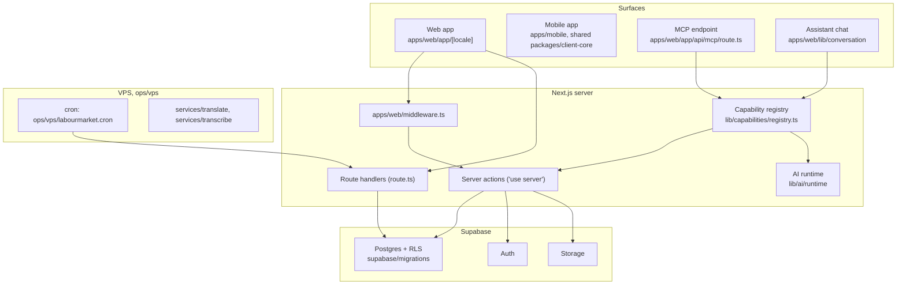

# Technical architecture map

**Owner:** Lane S. **Deliverable B** of the whole-project audit (#3679). **Measured:** 2026-11-23, 05:10–05:45 UTC.

**Status: SUPPORTING.** This file is not the architecture. [`docs/OWNER_TARGET_ARCHITECTURE_V1.md`](../OWNER_TARGET_ARCHITECTURE_V1.md) is, and it takes precedence wherever the two differ.

**Measured against:**
- `main` at `125e2182`;
- the production build `430bd475`.

**What this file holds.** This repository is public (`AGENTS.md`, "Capability pre-flight"), so this map uses the same format as the owner-approved status register `docs/program/FUNCTION_REGISTER.md`:
- function and code path;
- status;
- date;
- PR, commit or run id;
- whether it runs in production;
- a one-line remaining issue.

**What it leaves out.** Production volumes, infrastructure measurements, permission conditions and security analysis are not in this file. Lane S holds the full measured version for the owner's private Internal Brain. Its sections cover:
- database size and rights;
- Postgres and edge log levels;
- health timings;
- integrity counts;
- per-version execute rights;
- Lane F's role and RLS helper conditions.

A security row here says only that an item is open, and names its PR.

The audit only proposes. Nothing was changed, deleted or applied in production.

## 0. How to read this file

| Class | Meaning |
|---|---|
| **PROD** | It runs in production. The proof is a successful `prod-qa-walk.yml` run that visits it (run id, build, date), a production HTTP GET made on 2026-11-23, or a read-only production read held privately. |
| **MAIN** | On `main`, with no production proof found. It is not a FAIL: nothing was measured. |
| **PR** | Only in an open pull request. |
| **UNUSED** | No importer or caller was found by the method stated beside it. |
| **DUP** | Two or more implementations of one function. Final classification belongs to deliverable C (`docs/audits/DUPLICATION_AUDIT.md`, Lane E). |

**Method:**
- **"Visited by a walk"** means the spec file under `apps/web/tests/e2e/prod-*.spec.ts` names the path, and that spec's newest successful dispatched run is cited. For `role-routes` the spec also counts `prod-walk-routes.ts`.
- **"Used"** means the TypeScript import graph of `apps/web/{app,components,lib}` reaches the file: static and dynamic imports, `export … from` and `require()`, without tests.

**Inputs from other lanes:**

| Section | Lane | Received |
|---|---|---|
| §5 MCP, AI runtime, agent tools | B | 05:17 UTC |
| §6 Database, RPCs, migration ledger | D | 05:16 and 05:17 UTC |
| §7 Identity, roles, privacy | F | 05:21 UTC |

## 1. Layers

**Size in code** (`main`):

| Item | Count |
|---|---|
| `page.tsx` | 121 |
| `route.ts` | 48 |
| Files with `"use server"` | 223 |
| `.tsx` files under `apps/web/components` | 599 |
| Migration files under `supabase/migrations` | 482 |

## 2. Pages

There are 121 pages:
- **93 PROD**, by a successful production walk, a production GET on 2026-11-23, or both;
- **28 MAIN**: the 22 admin pages (`prod-admin-console.spec.ts` has no successful dispatched run among the last 100), `/invite/[token]` (its walk is BLOCKED, see `docs/qa/LAUNCH_MATRIX_2026-11-23.md`), and five more: `/questions/category/[category]`, `/business/[slug]`, `/dashboard/inbox/quick`, `/dashboard/market/recognize` and `/dashboard/reports/evidence`.

A walk that names a path only to prove a role cannot reach it does not count; `/dashboard/admin` in `prod-fresh-activation.spec.ts:436` is that case.

Signed out, every `/dashboard/*`, `/cv` and `/onboarding` GET is redirected to sign-in by `apps/web/middleware.ts`. So only a walk proves a signed-in page.

`/vision` answers 404 to the public by design until it is published (`apps/web/app/[locale]/(marketing)/vision/page.tsx:72`).

#### Public (32)

| Route (under `/[locale]`) | File | Class | Evidence |
|---|---|---|---|
| `/about` | `apps/web/app/[locale]/(marketing)/about/page.tsx` | PROD | walk public-org-locales phone · 44977198005 · eed72052 · 2026-11-22 |
| `/calculators/project-cost` | `apps/web/app/[locale]/(marketing)/calculators/project-cost/page.tsx` | PROD | walk public-org-locales phone · 44977198005 · eed72052 · 2026-11-22 |
| `/company-need` | `apps/web/app/[locale]/(marketing)/company-need/page.tsx` | PROD | walk public-org-locales phone · 44977198005 · eed72052 · 2026-11-22 |
| `/create-cv` | `apps/web/app/[locale]/(marketing)/create-cv/page.tsx` | PROD | production GET 2026-11-23 05:2x UTC, signed out: 200 |
| `/for-agencies` | `apps/web/app/[locale]/(marketing)/for-agencies/page.tsx` | PROD | walk public-org-locales phone · 44977198005 · eed72052 · 2026-11-22 |
| `/for-companies` | `apps/web/app/[locale]/(marketing)/for-companies/page.tsx` | PROD | walk public-org-locales phone · 44977198005 · eed72052 · 2026-11-22 |
| `/for-workers` | `apps/web/app/[locale]/(marketing)/for-workers/page.tsx` | PROD | walk public-org-locales phone · 44977198005 · eed72052 · 2026-11-22 |
| `/jobs/[id]` | `apps/web/app/[locale]/(marketing)/jobs/[id]/page.tsx` | PROD | walk jobs-search phone · 44902549477 · eed72052 · 2026-11-21 |
| `/jobs` | `apps/web/app/[locale]/(marketing)/jobs/page.tsx` | PROD | walk ai-off-honesty desktop · 44973720651 · eed72052 · 2026-11-22 |
| `/labour-market/[country]` | `apps/web/app/[locale]/(marketing)/labour-market/[country]/page.tsx` | PROD | walk public-org-locales phone · 44977198005 · eed72052 · 2026-11-22 |
| `/labour-market` | `apps/web/app/[locale]/(marketing)/labour-market/page.tsx` | PROD | walk public-org-locales phone · 44977198005 · eed72052 · 2026-11-22 |
| `/legal/cookies` | `apps/web/app/[locale]/(marketing)/legal/cookies/page.tsx` | PROD | walk public-org-locales phone · 44977198005 · eed72052 · 2026-11-22 |
| `/legal/data-access` | `apps/web/app/[locale]/(marketing)/legal/data-access/page.tsx` | PROD | walk public-org-locales phone · 44977198005 · eed72052 · 2026-11-22 |
| `/legal/data-deletion` | `apps/web/app/[locale]/(marketing)/legal/data-deletion/page.tsx` | PROD | walk public-org-locales phone · 44977198005 · eed72052 · 2026-11-22 |
| `/legal/data-protection` | `apps/web/app/[locale]/(marketing)/legal/data-protection/page.tsx` | PROD | walk public-org-locales phone · 44977198005 · eed72052 · 2026-11-22 |
| `/legal/legal-notice` | `apps/web/app/[locale]/(marketing)/legal/legal-notice/page.tsx` | PROD | walk public-org-locales phone · 44977198005 · eed72052 · 2026-11-22 |
| `/legal/marketplace-rules` | `apps/web/app/[locale]/(marketing)/legal/marketplace-rules/page.tsx` | PROD | walk public-org-locales phone · 44977198005 · eed72052 · 2026-11-22 |
| `/legal/privacy` | `apps/web/app/[locale]/(marketing)/legal/privacy/page.tsx` | PROD | walk public-org-locales phone · 44977198005 · eed72052 · 2026-11-22 |
| `/legal/terms` | `apps/web/app/[locale]/(marketing)/legal/terms/page.tsx` | PROD | walk public-org-locales phone · 44977198005 · eed72052 · 2026-11-22 |
| `/match-preview` | `apps/web/app/[locale]/(marketing)/match-preview/page.tsx` | PROD | walk ai-off-honesty desktop · 44973720651 · eed72052 · 2026-11-22 |
| `/pricing` | `apps/web/app/[locale]/(marketing)/pricing/page.tsx` | PROD | walk public-org-locales phone · 44977198005 · eed72052 · 2026-11-22 |
| `/professions` | `apps/web/app/[locale]/(marketing)/professions/page.tsx` | PROD | production GET 2026-11-23 05:2x UTC, signed out: 200 |
| `/questions/[slug]` | `apps/web/app/[locale]/(marketing)/questions/[slug]/page.tsx` | PROD | walk public-readiness · 43598017756 · 80900292 · 2026-11-14 |
| `/questions/category/[category]` | `apps/web/app/[locale]/(marketing)/questions/category/[category]/page.tsx` | MAIN | no production walk visits it |
| `/questions` | `apps/web/app/[locale]/(marketing)/questions/page.tsx` | PROD | production GET 2026-11-23 05:2x UTC, signed out: 200 |
| `/skills` | `apps/web/app/[locale]/(marketing)/skills/page.tsx` | PROD | production GET 2026-11-23 05:2x UTC, signed out: 200 |
| `/vision` | `apps/web/app/[locale]/(marketing)/vision/page.tsx` | PROD (gated) | production GET 2026-11-23: 404 by design until the page is published (`notFound()` at line 72) |
| `/work-abroad` | `apps/web/app/[locale]/(marketing)/work-abroad/page.tsx` | PROD | production GET 2026-11-23 05:2x UTC, signed out: 200 |
| `/work-opportunities` | `apps/web/app/[locale]/(marketing)/work-opportunities/page.tsx` | PROD | production GET 2026-11-23 05:2x UTC, signed out: 200 |
| `/worker-intake` | `apps/web/app/[locale]/(marketing)/worker-intake/page.tsx` | PROD | production GET 2026-11-23 05:2x UTC, signed out: 200 |
| `/business/[slug]` | `apps/web/app/[locale]/business/[slug]/page.tsx` | MAIN | no production walk visits it |
| `/` | `apps/web/app/[locale]/page.tsx` | PROD | production GET 2026-11-23 05:2x UTC, signed out: 200 |

#### Auth and entry (7)

| Route (under `/[locale]`) | File | Class | Evidence |
|---|---|---|---|
| `/[...rest]` | `apps/web/app/[locale]/[...rest]/page.tsx` | PROD | production GET of an unknown path 2026-11-23: 404 |
| `/auth/forgot-password` | `apps/web/app/[locale]/auth/forgot-password/page.tsx` | PROD | walk profile-cv-history phone · 45097071365 · 8bcda5be · 2026-11-23 |
| `/auth/login` | `apps/web/app/[locale]/auth/login/page.tsx` | PROD | production GET 2026-11-23 05:2x UTC, signed out: 200 |
| `/auth/reset-password` | `apps/web/app/[locale]/auth/reset-password/page.tsx` | PROD | production GET 2026-11-23 05:2x UTC, signed out: 200 |
| `/auth/signup` | `apps/web/app/[locale]/auth/signup/page.tsx` | PROD | walk fresh-activation desktop · 44901160408 · eed72052 · 2026-11-21 |
| `/invite/[token]` | `apps/web/app/[locale]/invite/[token]/page.tsx` | MAIN | spec exists, no successful dispatched run in the last 100: prod-invited-worker.spec.ts |
| `/oauth/consent` | `apps/web/app/[locale]/oauth/consent/page.tsx` | PROD | production GET 2026-11-23 05:2x UTC, signed out: 200 |

#### Signed-in (worker, organization) (60)

| Route (under `/[locale]`) | File | Class | Evidence |
|---|---|---|---|
| `/cv` | `apps/web/app/[locale]/cv/page.tsx` | PROD | walk profile-cv-history phone · 45097071365 · 8bcda5be · 2026-11-23 |
| `/dashboard/absences` | `apps/web/app/[locale]/dashboard/absences/page.tsx` | PROD | walk calendar-planning desktop · 44966863726 · eed72052 · 2026-11-22 |
| `/dashboard/account` | `apps/web/app/[locale]/dashboard/account/page.tsx` | PROD | walk search-support-privacy desktop · 44974866504 · eed72052 · 2026-11-22 |
| `/dashboard/activity` | `apps/web/app/[locale]/dashboard/activity/page.tsx` | PROD | walk notifications-inapp phone · 44904905556 · eed72052 · 2026-11-21 |
| `/dashboard/assets` | `apps/web/app/[locale]/dashboard/assets/page.tsx` | PROD | walk org-roster phone · 44905801746 · eed72052 · 2026-11-21 |
| `/dashboard/assist` | `apps/web/app/[locale]/dashboard/assist/page.tsx` | PROD | walk ai-off-honesty desktop · 44973720651 · eed72052 · 2026-11-22 |
| `/dashboard/bookings` | `apps/web/app/[locale]/dashboard/bookings/page.tsx` | PROD | walk orders-bookings phone · 45052181467 · ed4ecf85 · 2026-11-22 |
| `/dashboard/buyer` | `apps/web/app/[locale]/dashboard/buyer/page.tsx` | PROD | walk buyer-workspace desktop · 45094390854 · ee29a3b7 · 2026-11-23 |
| `/dashboard/candidates` | `apps/web/app/[locale]/dashboard/candidates/page.tsx` | PROD | walk search-support-privacy desktop · 44974866504 · eed72052 · 2026-11-22 |
| `/dashboard/commercial` | `apps/web/app/[locale]/dashboard/commercial/page.tsx` | PROD | walk documents-approvals desktop · 44974276075 · eed72052 · 2026-11-22 |
| `/dashboard/communication/[conversationId]` | `apps/web/app/[locale]/dashboard/communication/[conversationId]/page.tsx` | PROD | walk ai-off-honesty desktop · 44973720651 · eed72052 · 2026-11-22 |
| `/dashboard/communication` | `apps/web/app/[locale]/dashboard/communication/page.tsx` | PROD | walk marketplace-goods-services phone · 44968374455 · eed72052 · 2026-11-22 |
| `/dashboard/company/education` | `apps/web/app/[locale]/dashboard/company/education/page.tsx` | PROD | walk learning-practice phone-375 · 44883485138 · eed72052 · 2026-11-21 |
| `/dashboard/company/history` | `apps/web/app/[locale]/dashboard/company/history/page.tsx` | PROD | walk profile-cv-history phone · 45097071365 · 8bcda5be · 2026-11-23 |
| `/dashboard/company/needs` | `apps/web/app/[locale]/dashboard/company/needs/page.tsx` | PROD | walk ai-off-honesty desktop · 44973720651 · eed72052 · 2026-11-22 |
| `/dashboard/company` | `apps/web/app/[locale]/dashboard/company/page.tsx` | PROD | walk company-chain phone-375 · 44882509064 · eed72052 · 2026-11-21 |
| `/dashboard/company/partners` | `apps/web/app/[locale]/dashboard/company/partners/page.tsx` | PROD | walk role-routes phone · 44900081769 · eed72052 · 2026-11-21 |
| `/dashboard/company/people/[personId]` | `apps/web/app/[locale]/dashboard/company/people/[personId]/page.tsx` | PROD | walk company-talent-history desktop · 44975633092 · eed72052 · 2026-11-22 |
| `/dashboard/company/people` | `apps/web/app/[locale]/dashboard/company/people/page.tsx` | PROD | walk profile-cv-history phone · 45097071365 · 8bcda5be · 2026-11-23 |
| `/dashboard/company/planning` | `apps/web/app/[locale]/dashboard/company/planning/page.tsx` | PROD | walk calendar-planning desktop · 44966863726 · eed72052 · 2026-11-22 |
| `/dashboard/company/projects/new` | `apps/web/app/[locale]/dashboard/company/projects/new/page.tsx` | PROD | walk project-execution desktop · 44906961206 · eed72052 · 2026-11-21 |
| `/dashboard/company/scouting` | `apps/web/app/[locale]/dashboard/company/scouting/page.tsx` | PROD | walk ai-off-honesty desktop · 44973720651 · eed72052 · 2026-11-22 |
| `/dashboard/company/settings` | `apps/web/app/[locale]/dashboard/company/settings/page.tsx` | PROD | walk public-org-locales phone · 44977198005 · eed72052 · 2026-11-22 |
| `/dashboard/documents` | `apps/web/app/[locale]/dashboard/documents/page.tsx` | PROD | walk documents-approvals desktop · 44974276075 · eed72052 · 2026-11-22 |
| `/dashboard/finance` | `apps/web/app/[locale]/dashboard/finance/page.tsx` | PROD | walk orders-bookings phone · 45052181467 · ed4ecf85 · 2026-11-22 |
| `/dashboard/gallery` | `apps/web/app/[locale]/dashboard/gallery/page.tsx` | PROD | walk worker-records-exports desktop · 44904394732 · eed72052 · 2026-11-21 |
| `/dashboard/hours` | `apps/web/app/[locale]/dashboard/hours/page.tsx` | PROD | walk company-chain phone-375 · 44882509064 · eed72052 · 2026-11-21 |
| `/dashboard/inbox/counterparty` | `apps/web/app/[locale]/dashboard/inbox/counterparty/page.tsx` | PROD | walk profile-cv-history phone · 45097071365 · 8bcda5be · 2026-11-23 |
| `/dashboard/inbox` | `apps/web/app/[locale]/dashboard/inbox/page.tsx` | PROD | walk search-support-privacy desktop · 44974866504 · eed72052 · 2026-11-22 |
| `/dashboard/inbox/quick` | `apps/web/app/[locale]/dashboard/inbox/quick/page.tsx` | MAIN | spec exists, no successful dispatched run in the last 100: prod-organization-daily.spec.ts, prod-review-scope.spec.ts |
| `/dashboard/inbox/report` | `apps/web/app/[locale]/dashboard/inbox/report/page.tsx` | PROD | walk search-support-privacy desktop · 44974866504 · eed72052 · 2026-11-22 |
| `/dashboard/instructions` | `apps/web/app/[locale]/dashboard/instructions/page.tsx` | PROD | walk org-roster phone · 44905801746 · eed72052 · 2026-11-21 |
| `/dashboard/intelligence` | `apps/web/app/[locale]/dashboard/intelligence/page.tsx` | PROD | walk profile-cv-history phone · 45097071365 · 8bcda5be · 2026-11-23 |
| `/dashboard/journal` | `apps/web/app/[locale]/dashboard/journal/page.tsx` | PROD | walk profile-cv-history phone · 45097071365 · 8bcda5be · 2026-11-23 |
| `/dashboard/journal/voice` | `apps/web/app/[locale]/dashboard/journal/voice/page.tsx` | PROD | walk journal-confirm phone · 44903366199 · eed72052 · 2026-11-21 |
| `/dashboard/learning` | `apps/web/app/[locale]/dashboard/learning/page.tsx` | PROD | walk role-routes phone · 44900081769 · eed72052 · 2026-11-21 |
| `/dashboard/listings` | `apps/web/app/[locale]/dashboard/listings/page.tsx` | PROD | walk marketplace-goods-services phone · 44968374455 · eed72052 · 2026-11-22 |
| `/dashboard/market-map` | `apps/web/app/[locale]/dashboard/market-map/page.tsx` | PROD | walk search-support-privacy desktop · 44974866504 · eed72052 · 2026-11-22 |
| `/dashboard/market/recognize` | `apps/web/app/[locale]/dashboard/market/recognize/page.tsx` | MAIN | no production walk visits it |
| `/dashboard/network` | `apps/web/app/[locale]/dashboard/network/page.tsx` | PROD | walk company-talent-history desktop · 44975633092 · eed72052 · 2026-11-22 |
| `/dashboard/opportunities` | `apps/web/app/[locale]/dashboard/opportunities/page.tsx` | PROD | walk ai-off-honesty desktop · 44973720651 · eed72052 · 2026-11-22 |
| `/dashboard` | `apps/web/app/[locale]/dashboard/page.tsx` | PROD | walk role-routes phone · 44900081769 · eed72052 · 2026-11-21 |
| `/dashboard/people/[workerId]` | `apps/web/app/[locale]/dashboard/people/[workerId]/page.tsx` | PROD | walk search-support-privacy desktop · 44974866504 · eed72052 · 2026-11-22 |
| `/dashboard/planning` | `apps/web/app/[locale]/dashboard/planning/page.tsx` | PROD | walk calendar-planning desktop · 44966863726 · eed72052 · 2026-11-22 |
| `/dashboard/privacy` | `apps/web/app/[locale]/dashboard/privacy/page.tsx` | PROD | walk documents-approvals desktop · 44974276075 · eed72052 · 2026-11-22 |
| `/dashboard/profile` | `apps/web/app/[locale]/dashboard/profile/page.tsx` | PROD | walk profile-cv-history phone · 45097071365 · 8bcda5be · 2026-11-23 |
| `/dashboard/projects/[id]/operations` | `apps/web/app/[locale]/dashboard/projects/[id]/operations/page.tsx` | PROD | walk brigade-formation desktop · 44906216102 · eed72052 · 2026-11-21 |
| `/dashboard/projects/[id]` | `apps/web/app/[locale]/dashboard/projects/[id]/page.tsx` | PROD | walk profile-cv-history phone · 45097071365 · 8bcda5be · 2026-11-23 |
| `/dashboard/projects` | `apps/web/app/[locale]/dashboard/projects/page.tsx` | PROD | walk brigade-formation desktop · 44906216102 · eed72052 · 2026-11-21 |
| `/dashboard/reports/evidence` | `apps/web/app/[locale]/dashboard/reports/evidence/page.tsx` | MAIN | no production walk visits it |
| `/dashboard/reports` | `apps/web/app/[locale]/dashboard/reports/page.tsx` | PROD | walk profile-cv-history phone · 45097071365 · 8bcda5be · 2026-11-23 |
| `/dashboard/service-requests` | `apps/web/app/[locale]/dashboard/service-requests/page.tsx` | PROD | walk buyer-workspace desktop · 45094390854 · ee29a3b7 · 2026-11-23 |
| `/dashboard/services` | `apps/web/app/[locale]/dashboard/services/page.tsx` | PROD | walk buyer-workspace desktop · 45094390854 · ee29a3b7 · 2026-11-23 |
| `/dashboard/start/buyer` | `apps/web/app/[locale]/dashboard/start/buyer/page.tsx` | PROD | walk buyer-workspace desktop · 45094390854 · ee29a3b7 · 2026-11-23 |
| `/dashboard/start/company` | `apps/web/app/[locale]/dashboard/start/company/page.tsx` | PROD | walk fresh-activation desktop · 44901160408 · eed72052 · 2026-11-21 |
| `/dashboard/start` | `apps/web/app/[locale]/dashboard/start/page.tsx` | PROD | walk profile-cv-history phone · 45097071365 · 8bcda5be · 2026-11-23 |
| `/dashboard/talent` | `apps/web/app/[locale]/dashboard/talent/page.tsx` | PROD | walk role-routes phone · 44900081769 · eed72052 · 2026-11-21 |
| `/dashboard/tasks` | `apps/web/app/[locale]/dashboard/tasks/page.tsx` | PROD | walk project-execution desktop · 44906961206 · eed72052 · 2026-11-21 |
| `/dashboard/work-in-numbers` | `apps/web/app/[locale]/dashboard/work-in-numbers/page.tsx` | PROD | walk profile-cv-history phone · 45097071365 · 8bcda5be · 2026-11-23 |
| `/onboarding` | `apps/web/app/[locale]/onboarding/page.tsx` | PROD | walk profile-cv-history phone · 45097071365 · 8bcda5be · 2026-11-23 |

#### Admin (22)

| Route (under `/[locale]`) | File | Class | Evidence |
|---|---|---|---|
| `/dashboard/admin/agent-os` | `apps/web/app/[locale]/dashboard/admin/agent-os/page.tsx` | MAIN | spec exists, no successful dispatched run in the last 100: prod-admin-console.spec.ts |
| `/dashboard/admin/billing` | `apps/web/app/[locale]/dashboard/admin/billing/page.tsx` | MAIN | spec exists, no successful dispatched run in the last 100: prod-admin-console.spec.ts |
| `/dashboard/admin/candidate-pool` | `apps/web/app/[locale]/dashboard/admin/candidate-pool/page.tsx` | MAIN | spec exists, no successful dispatched run in the last 100: prod-admin-console.spec.ts |
| `/dashboard/admin/company-need-intakes` | `apps/web/app/[locale]/dashboard/admin/company-need-intakes/page.tsx` | MAIN | spec exists, no successful dispatched run in the last 100: prod-admin-console.spec.ts |
| `/dashboard/admin/company-verification` | `apps/web/app/[locale]/dashboard/admin/company-verification/page.tsx` | MAIN | spec exists, no successful dispatched run in the last 100: prod-admin-console.spec.ts |
| `/dashboard/admin/import-sandbox` | `apps/web/app/[locale]/dashboard/admin/import-sandbox/page.tsx` | MAIN | spec exists, no successful dispatched run in the last 100: prod-admin-console.spec.ts |
| `/dashboard/admin/intelligence-observations` | `apps/web/app/[locale]/dashboard/admin/intelligence-observations/page.tsx` | MAIN | spec exists, no successful dispatched run in the last 100: prod-admin-console.spec.ts |
| `/dashboard/admin/language-feedback` | `apps/web/app/[locale]/dashboard/admin/language-feedback/page.tsx` | MAIN | spec exists, no successful dispatched run in the last 100: prod-admin-console.spec.ts |
| `/dashboard/admin/launch-readiness` | `apps/web/app/[locale]/dashboard/admin/launch-readiness/page.tsx` | MAIN | spec exists, no successful dispatched run in the last 100: prod-admin-console.spec.ts |
| `/dashboard/admin/league` | `apps/web/app/[locale]/dashboard/admin/league/page.tsx` | MAIN | spec exists, no successful dispatched run in the last 100: prod-admin-console.spec.ts |
| `/dashboard/admin/market` | `apps/web/app/[locale]/dashboard/admin/market/page.tsx` | MAIN | spec exists, no successful dispatched run in the last 100: prod-admin-console.spec.ts |
| `/dashboard/admin/matching` | `apps/web/app/[locale]/dashboard/admin/matching/page.tsx` | MAIN | spec exists, no successful dispatched run in the last 100: prod-admin-console.spec.ts |
| `/dashboard/admin/need-structuring` | `apps/web/app/[locale]/dashboard/admin/need-structuring/page.tsx` | MAIN | spec exists, no successful dispatched run in the last 100: prod-admin-console.spec.ts |
| `/dashboard/admin` | `apps/web/app/[locale]/dashboard/admin/page.tsx` | MAIN | fresh-activation names the path, but only as a page a new account must not reach; no admin walk has run |
| `/dashboard/admin/pilots/[id]` | `apps/web/app/[locale]/dashboard/admin/pilots/[id]/page.tsx` | MAIN | no production walk visits it |
| `/dashboard/admin/pilots` | `apps/web/app/[locale]/dashboard/admin/pilots/page.tsx` | MAIN | spec exists, no successful dispatched run in the last 100: prod-admin-console.spec.ts |
| `/dashboard/admin/pipeline` | `apps/web/app/[locale]/dashboard/admin/pipeline/page.tsx` | MAIN | spec exists, no successful dispatched run in the last 100: prod-admin-console.spec.ts |
| `/dashboard/admin/project-truth` | `apps/web/app/[locale]/dashboard/admin/project-truth/page.tsx` | MAIN | spec exists, no successful dispatched run in the last 100: prod-admin-console.spec.ts |
| `/dashboard/admin/readiness` | `apps/web/app/[locale]/dashboard/admin/readiness/page.tsx` | MAIN | spec exists, no successful dispatched run in the last 100: prod-admin-console.spec.ts |
| `/dashboard/admin/support` | `apps/web/app/[locale]/dashboard/admin/support/page.tsx` | MAIN | spec exists, no successful dispatched run in the last 100: prod-admin-console.spec.ts |
| `/dashboard/admin/telemetry` | `apps/web/app/[locale]/dashboard/admin/telemetry/page.tsx` | MAIN | spec exists, no successful dispatched run in the last 100: prod-admin-console.spec.ts |
| `/dashboard/admin/users/[id]` | `apps/web/app/[locale]/dashboard/admin/users/[id]/page.tsx` | MAIN | no production walk visits it |

## 3. Route handlers and scheduled jobs

| Route | File (under `apps/web/app`) | Class | Evidence | Remaining issue |
|---|---|---|---|---|
| `/api/health` | `api/health/route.ts` | PROD | production GET 2026-11-23, `ok: true` | — |
| `/api/mcp` | `api/mcp/route.ts` | PROD | mcp-chain 44972915546, mcp-agents 44973332549 | — |
| `/.well-known/oauth-protected-resource` (+ `/api/mcp`) | `.well-known/oauth-protected-resource/…` | PROD | production GET (Lane B) | — |
| `/[locale]/auth/callback`, `/[locale]/auth/logout` | `[locale]/auth/…/route.ts` | PROD | fresh-activation 44901160408 | — |
| `/api/assistant/transcript` | `api/assistant/transcript/route.ts` | MAIN | — | — |
| `/api/cv/extract` | `api/cv/extract/route.ts` | MAIN | — | — |
| `/api/dashboard-search` | `api/dashboard-search/route.ts` | MAIN | — | — |
| `/api/documents/file/[fileId]` | `api/documents/file/[fileId]/route.ts` | MAIN | — | no walk requests it |
| `/api/waitlist` | `api/waitlist/route.ts` | MAIN | — | — |
| `/api/client-errors` | `api/client-errors/route.ts` | MAIN | — | writes only to the server log (route header) |
| `/api/billing/*` (checkout, portal, refresh, pilot pass, webhook, reconcile) | `api/billing/*` | MAIN | — | live payments are off (§8) |
| `/api/cron/{weekly-digest,commercial-handoffs,job-alerts,privacy-erasure,forecast-recompute}` | `api/cron/*` | MAIN | schedule in `ops/vps/labourmarket.cron` | run results are in the VPS log only |
| `/api/cron/billing-recovery` | `api/cron/billing-recovery/route.ts` | MAIN | — | not in `labourmarket.cron`. It runs by hand only; `.github/workflows/billing-recovery-cadence.yml` fails on purpose (file header). |
| `/api/cron/{invitation-delivery-retry,referral-reprocess}` | `api/cron/*` | MAIN | `ops/vps/lm-invitation-delivery-retry.sh`, `lm-referral-reprocess.sh` | — |
| `/api/internal/capability-readback/v1` | `api/internal/capability-readback/v1/route.ts` | PROD | integration-probe 45085333428 | — |
| `/api/referrals/external/v1` | `api/referrals/external/v1/route.ts` | PROD | integration-probe 45085333428 | — |
| `/api/internal/commercial-requests/v1`, `/api/internal/registrations-daily/v1` | `api/internal/*` | MAIN | — | — |
| `/api/internal/supply-feed/first-party-v1` | `api/internal/supply-feed/first-party-v1/route.ts` | **UNUSED-candidate** | no caller by path; the feed is emitted by `apps/web/scripts/emit-first-party-supply-feed.ts` | two exits for one feed (§13, S-7) |
| `/api/public/claims/v1` | `api/public/claims/v1/route.ts` | MAIN | — | — |
| `/api/professions/[professionId]/skills`, `/api/workers/[workerId]/skills` | `api/professions/…`, `api/workers/…` | MAIN | — | — |
| `/[locale]/dashboard/journal/export` | `[locale]/dashboard/journal/export/route.ts` | PROD | worker-records-exports 44904394732 (`prod-worker-records-exports.spec.ts:385`) | — |
| `/[locale]/dashboard/finance/export` | `[locale]/dashboard/finance/export/route.ts` | PROD | orders-bookings phone 45052181467 (`prod-orders-bookings.spec.ts:525`) | — |
| Other dashboard exports (privacy, journal hours, institution report, timesheet, operations report) | `[locale]/dashboard/**/route.ts` | MAIN | — | — |
| `/jobs-sitemap.xml`, `/jobs-sitemap/[shard]`, `/questions-sitemap.xml`, `/llms.txt`, `/sitemap.xml`, `/robots.txt` | `app/*` | PROD | production GET (Lane S crawl, #3265) | the public-vacancy reads behind the sitemap sometimes time out (§12.1) |
| `/.well-known/{apple-app-site-association,assetlinks.json,openai-apps-challenge}` | `.well-known/*` | MAIN | — | — |

Other scheduled work:
- **Database-side jobs:** defined in the migrations (`pg_cron`). They run in production (PROD, private read).
- **Production workflows:** `.github/workflows/sweden-supply-cadence.yml`, `nav-supply-cadence.yml`, `ingestion-freshness.yml`, `vacancy-retention.yml`, `integration-probe.yml` and the daily rotation in `prod-qa-walk.yml`.

## 4. Components and library modules

### 4.1 Components that nothing imports (UNUSED, by import graph)

No non-test file in `apps/web/{app,components,lib}` imports these 43 component files. A second search found no import of them from `apps/web/scripts`, `tests/e2e`, `next.config.ts` or `messages/*` either.

Some of them appear in owner visual-acceptance scripts as sections that must be **gone**, for example `apps/web/scripts/qa-owner-visual-acceptance.mjs:25`. Eight primitives in `components/ui/` are imported only by their tests.

| Component file | Test files that import it |
|---|---|
| `apps/web/components/ui/StructureTree.tsx` | 1 |
| `apps/web/components/ui/GroupedList.tsx` | 1 |
| `apps/web/components/ui/Choice.tsx` | 1 |
| `apps/web/components/ui/EmptyState.tsx` | 1 |
| `apps/web/components/ui/Placeholder.tsx` | 0 |
| `apps/web/components/ui/ListRow.tsx` | 1 |
| `apps/web/components/ui/ResultShell.tsx` | 0 |
| `apps/web/components/ui/Table.tsx` | 1 |
| `apps/web/components/app/feature-availability-grid.tsx` | 0 |
| `apps/web/components/app/setup-role-choice.tsx` | 0 |
| `apps/web/components/app/labour-market-world-map.tsx` | 0 |
| `apps/web/components/app/demand-preview-card.tsx` | 0 |
| `apps/web/components/app/live-world-map.tsx` | 0 |
| `apps/web/components/app/live-ticker.tsx` | 0 |
| `apps/web/components/app/dashboard-section.tsx` | 0 |
| `apps/web/components/app/market-map-shell.tsx` | 0 |
| `apps/web/components/app/agency-pool-preview.tsx` | 0 |
| `apps/web/components/app/cv/living-cv-story.tsx` | 0 |
| `apps/web/components/app/role-catalogue-card.tsx` | 0 |
| `apps/web/components/app/open-in-waze.tsx` | 0 |
| `apps/web/components/app/market-counters.tsx` | 0 |
| `apps/web/components/app/agency-workers-section.tsx` | 1 |
| `apps/web/components/app/live-map.tsx` | 0 |
| `apps/web/components/marketing/living-worker-hero.tsx` | 0 |
| `apps/web/components/marketing/proof-band.tsx` | 0 |
| `apps/web/components/marketing/market-proof-band.tsx` | 2 |
| `apps/web/components/marketing/product-chain-band.tsx` | 0 |
| `apps/web/components/marketing/market-moment.tsx` | 0 |
| `apps/web/components/marketing/starting-contexts-band.tsx` | 0 |
| `apps/web/components/marketing/example-preview-frame.tsx` | 0 |
| `apps/web/components/marketing/trust-band.tsx` | 0 |
| `apps/web/components/marketing/landing-primary-actions.tsx` | 1 |
| `apps/web/components/marketing/how-it-works-band.tsx` | 0 |
| `apps/web/components/marketing/market-pulse.tsx` | 0 |
| `apps/web/components/marketing/audience-value-sections.tsx` | 0 |
| `apps/web/components/marketing/audience-page.tsx` | 0 |
| `apps/web/components/marketing/draft-board.tsx` | 0 |
| `apps/web/components/marketing/final-cta-band.tsx` | 1 |
| `apps/web/components/marketing/public-market-map-band.tsx` | 0 |
| `apps/web/components/marketing/service-offers.tsx` | 0 |
| `apps/web/components/marketing/landing-three-ways.tsx` | 0 |
| `apps/web/components/marketing/conversation-os-panel.tsx` | 0 |
| `apps/web/components/marketing/two-sides-section.tsx` | 0 |

**Proposal (for E):** remove them in one GREEN PR, with a guard that fails on a `components/**` file that has no importer.

### 4.2 Library modules with no product importer

73 `lib/` files have no importer in app, component or lib code. Most are expected tooling: `lib/guards`, `lib/testing`, `lib/test`, fixtures, AI eval fixtures used by `apps/web/scripts`, and vendored contracts. Four have no importer outside guard tests:

| File | Note |
|---|---|
| `apps/web/lib/answer-engine/indexnow.ts` | Unwired by design. `lib/guards/answer-engine-publishing-static.test.ts:82-92` pins that nothing imports it. |
| `apps/web/lib/agency/pool-actions.ts` | `lib/guards/agency-direction-a.test.ts:79-81` bans importing it on agency surfaces. It is still a capability anchor at `lib/product-gate/capability-register.ts:616`. |
| `apps/web/lib/esco/evidence-correspondence.ts` | Read by guard tests only |
| `apps/web/lib/config/suggestion-statuses.ts` | Read by `lib/guards/product-readiness.test.ts` only |

## 5. MCP, AI runtime and agent tools (Lane B)

| Function | Code | Class | Evidence | Remaining issue |
|---|---|---|---|---|
| MCP door `/api/mcp` | `apps/web/app/api/mcp/route.ts`, `lib/mcp/protocol.ts`, `lib/mcp/toolset.ts` | PROD | production `GET /api/mcp` reports `toolCount: 241`, equal to `exposedCapabilities()` on main; walks mcp-chain 44972915546, mcp-agents 44973332549 | — |
| OAuth protected-resource metadata | `app/.well-known/oauth-protected-resource/**`, `lib/mcp/protected-resource-metadata.ts` | PROD | production GET 200 (Lane B) | — |
| Caller identity at the door | `lib/api/api-identity.ts`, `lib/api/external-client-auth.ts`, `lib/api/bearer-caller-scope.ts` | MAIN | guard `lib/guards/api-auth-boundary.test.ts` | — |
| Read-only door `/api/mcp/read` | `lib/mcp/door.ts`, `app/api/mcp/read/route.ts` | PR #3164 | — | not in production |
| ChatGPT door `/api/mcp/chatgpt` | `lib/mcp/chatgpt-profile.ts`, `app/api/mcp/chatgpt/route.ts` | PR #3219 (RED, auth door) | — | stacked on #3164 |
| Capability registry (the MCP toolset, 241) | `lib/capabilities/registry.ts` (`listCapabilities` :2021, `exposedCapabilities` :2025, `runCapability` :2033) | PROD | count matches production | — |
| Web chat actions (58) | `lib/conversation/action-registry.ts` (`CONVERSATION_ACTIONS` :134) | MAIN | — | — |
| Chat action → capability bridge (56) | `lib/capabilities/conversation-action-bridge.ts` | PROD | part of the 241 | — |
| Routed chat intents (95) | `lib/conversation/intent-registry.ts`, `intent-router.ts` | MAIN | — | — |
| Intent catalogue for the model | `lib/conversation/intent-catalogue.ts` | MAIN | — | — |
| Command finder (60) | `lib/navigation/command-registry.ts` | MAIN | — | — |
| Dashboard modules (25) | `lib/dashboard/dashboard-module-registry.ts` | MAIN | — | — |
| Single-use confirmation | `lib/conversation/confirmation-token.ts` | PROD | chat-confirm-once 44972019714 | — |
| Chat surfaces | `/dashboard/assist`, `lib/conversation/*` | PROD | ai-off-honesty 44973720651, manager-chat 44972421825 | `/dashboard/assist` is a read-only attention page, not a generator (`lib/assist/assist.ts:60`) |
| Model proposer | `lib/conversation/llm-proposal.ts`, `intent-sentence-redaction.ts` | MAIN | — | — |
| AI runtime | `lib/ai/run-agent.ts`, `lib/ai/runtime/*`, `lib/ai/registry/agents/*` | MAIN | 10 callers of `runAiAgent` outside `lib/ai` (Lane B) | which providers are configured in production: NOT VERIFIED |
| Second, inert provider path | `lib/ai/provider.ts`, `noop-provider.ts`, `legacy-assist-schemas.ts`; one caller, `lib/ai/estimate-clarify-actions.ts` | MAIN, inert | — | sent to E as D-B1 |
| Voice transcription | `services/transcribe`, `/dashboard/journal/voice` | MAIN | — | owner decisions COM-6 and COM-8 open |
| Translation service | `services/translate` | MAIN | — | — |

## 6. Database, RPCs and the migration ledger (Lanes D and S)

| Item | Code | Class | Remaining issue |
|---|---|---|---|
| Migration ledger vs repo | `supabase/migrations/*.sql` | PROD (ledger read, Lane D) | Compared by name, because filenames are not ledger versions (`CLAUDE.md`, Migrations). 4 production entries have no repo file; Lane D gave their names to the coordinator. |
| `20260713120000_company_locations_v1.sql` | | MAIN, never applied | A superseded draft (`lib/objects/objects-model.ts:11`). It is still named in `lib/security/canonical-authenticated-rpcs.ts`. |
| `20260714211000_dashboard_preferences_v1.sql` | | MAIN, never applied | named in `lib/privacy/personal-relations.ts:143` |
| `20260717150000_demand_interest_seen_v1.sql` | | MAIN, never applied | named in `lib/privacy/personal-relations.ts:244` |
| `20260713210000_multi_source_talent_v1.sql` | | MAIN, never applied | named in `lib/privacy/personal-relations.ts:290-291` and `canonical-authenticated-rpcs.ts` |
| `20260717130000_open_markets_countries_draft_v1.sql` | | MAIN, never applied | — |
| Table `assistant_message_attachments` | migrations only | **UNUSED** | no code reference; never written in production |
| Table `project_forecast_state` | `20261025045152_project_forecasts_v1.sql` | **UNUSED in production** | never written, although `/api/cron/forecast-recompute` is scheduled |
| Functions `erase_assistant_transcript`, `revoke_competency_recognition_v1` | migrations only | **UNUSED** | no code, function, policy, trigger or schedule reference; confirm with F and L first |
| Versioned function families | 30 families, for example `respond_booking_request`…`_v4` (`lib/booking/booking-actions.ts`), `save_company_setup`…`_v3` (`lib/company/company-setup.ts`) | **DUP-candidate** | Code calls the newest version and falls back to an older one when the newest is absent (e.g. `lib/booking/booking-actions.ts:273-275`). The newest exists in production, so those fallbacks never run there. One open security item among them is with Lane F. |
| "Schema object missing?" check | 48 local functions in 43 files, e.g. `lib/booking/booking-actions.ts:51`, `lib/finance/finance-model.ts:114`, `lib/agency/clients-model.ts:71` | **DUP** | no shared helper; 163 files test the missing-function codes directly |

**Proposal:**
1. **GREEN:** mark or move the five never-applied files so `supabase/migrations` equals what production runs, and drop their stale references.
2. **GREEN:** remove dead fallback branches whose older function is no longer callable.
3. **RED, per family and owner-gated:** retire older function versions, each with a rollback.

The per-version detail went to E and the coordinator.

**CI parity races on `main`.** The live "Migration parity" gate failed twice when a migration was applied before its file merged, then passed on the next run:
- Quality Gates 44681164101, then 44684764996;
- Quality Gates 44775281257, then 44781366524.

## 7. Identity, roles and privacy (Lane F)

| Function | Code | Class | Evidence | Remaining issue |
|---|---|---|---|---|
| Web sign-up | `apps/web/components/app/signup-form.tsx` | PROD | fresh-activation 44901160408 | — |
| Web sign-in | `components/app/login-form.tsx` | PROD | role-routes 44899143018, 44900081769 | — |
| OAuth (Google, LinkedIn, Facebook) | `components/app/google-button.tsx`, `app/[locale]/auth/callback/route.ts` | MAIN | — | no walk signs in with a provider |
| Addressed-invite sign-up | `lib/invitations/signup-accept-action.ts` | MAIN | — | its walk is BLOCKED (launch matrix) |
| Onboarding | `app/[locale]/onboarding`, `lib/auth/actions.ts` | PROD | fresh-activation 44901160408 | — |
| Mobile sign-up and sign-in | `apps/mobile/src/auth-context.tsx` | MAIN | — | differs from web; no mobile onboarding (sent to E) |
| Auth gate | `apps/web/middleware.ts` | PROD | signed-out GETs redirect to sign-in, 2026-11-23 | — |
| Active workspace | `lib/company/active-organization.ts`, `lib/company/employer-company-context.ts` | PROD | org-roster 44905313755 | — |
| Platform roles, organization governance, work relationships (three layers, doctrine §5) | `lib/company/role-capabilities.ts`, membership functions in migrations | PROD | Lane F production read | owner decision ORG-2 open |
| Row-level security | `supabase/migrations` | PROD | Lane F production read | open security items, see below |
| Privacy request intake | `submit_privacy_request_v1` | PROD | Lane F production read | — |
| Data export | `lib/privacy/export-data.ts`, `lib/privacy/personal-relations.ts` | MAIN | — | PARTIAL in the capability register |
| Erasure executor and runner | `privacy_erasure_*` functions; `/api/cron/privacy-erasure` | PROD | Lane F production read | no owner-approval screen |
| Admin privacy view | `/dashboard/admin`, `lib/admin/privacy-requests.ts` | MAIN | — | reads a review-log table that is not in the migrations; handed to Lane F |

**Open security and privacy items** are tracked in RED PRs:

| Area | PRs |
|---|---|
| Authentication and organization rights | #3575, #3620 |
| Privacy requests and erasure timing | #3632, #3646 |

Three more need a RED change or an owner decision. Details are with the coordinator and Lane F.

## 8. Commercial flows and payments

| Step | Code | Class | Evidence | Remaining issue |
|---|---|---|---|---|
| Need | `lib/demand/*`, `lib/company/*` | PROD | need-intake desktop, phone, phone-375 (44642526482, 44643169770, 44643949860) | — |
| Agency candidate offer | `lib/agency/*` | PROD | agency-chain desktop, phone, phone-375 (44644887648, 44645924736, 44646951459) | — |
| Team (brigade) offer | `lib/company/team-offer.ts` | PROD | brigade-formation 44906216102 | — |
| Booking → engagement | `lib/booking/booking-actions.ts`, `lib/booking/engagement-invariant.ts` | PROD | orders-bookings desktop 45049554634, phone 45052181467 | — |
| Agreement and contract | `lib/agreements/*`, `lib/contracts` | PROD | documents-approvals 44974276075 | — |
| Marketplace (goods, services) | `lib/marketplace/*`, `lib/services/*` | PROD | marketplace 44971191106; marketplace-goods-services 44967795943, 44968374455; buyer-workspace 45094390854 | — |
| Commercial hand-off | `lib/commercial/handoff-dispatch.ts`, `/api/cron/commercial-handoffs` | MAIN | — | — |
| Project, tasks, hours, timesheets | `lib/projects/*`, `lib/tasks/*`, `lib/work-hours/*`, `lib/timesheets/*` | PROD | project-execution 44906961206, company-chain 44858511879 | — |
| Finance records | `lib/finance/*`, `/dashboard/finance` | PROD | orders-bookings phone 45052181467 | — |
| Payments | `lib/billing/*`, `lib/lmc/*`, `/api/billing/*` | **OFF in production** | production settings read: every payment and credit flag is off | Owner decision MKT-7 is open. `prod-billing-test-mode.spec.ts` has no successful run. |

## 9. Notifications

| Channel | Code | Class | Evidence | Remaining issue |
|---|---|---|---|---|
| In-app | `lib/notifications/events.ts` | PROD | notifications-inapp 44904905556 | Each duplicate refused by the dedupe constraint is logged by the database as an error. Proposal: an insert that ignores the conflict. |
| Email | `lib/email/*` (SMTP, `lib/email/smtp.ts`) | PROD (send ledger) | — | end-to-end delivery walks (`alert-mail`, `digest-check`) have no successful dispatched run |
| Web push | `lib/notifications/web-push-dispatch.ts` | OFF | — | behind `WEB_PUSH_ENABLED` |
| Digest and job alerts | `/api/cron/weekly-digest`, `/api/cron/job-alerts` | MAIN | — | — |

## 10. Journal and professional history

| Function | Code | Class | Evidence | Remaining issue |
|---|---|---|---|---|
| Journal entry, correction, confirmation | `lib/journal/actions.ts`, `/dashboard/journal` | PROD | journal-confirm 44902949287, 44903366199 | — |
| One professional history (decision 0025) | `lib/journal/professional-experience.ts` | PROD | profile-cv-history desktop 45094839877, phone 45097071365, phone-375 45091874326 | — |
| Living CV | `lib/cv/*`, `lib/profile/*`, `/cv`, `/dashboard/profile` | PROD | profile-cv-history (above) | `prod-living-cv-growth.spec.ts` has no successful run |
| Organization evidence import | `lib/organization-evidence/*`, MCP `evidence_import_*` | PROD | Lane S production read | — |
| Voice journal | `/dashboard/journal/voice` | PROD (page) | journal-confirm phone 44903366199 | transcription host: COM-6, COM-8 |

## 11. External integrations

| Integration | Code | Class | Evidence | Remaining issue |
|---|---|---|---|---|
| Swedish public employment service adverts | `lib/vacancy-sources/providers/arbetsformedlingen-parse.ts`, `sweden-supply-cadence.yml` | PROD | `/api/health` vacancy freshness `current`, 2026-11-23 | — |
| Norwegian public employment service adverts | `lib/vacancy-sources/providers/nav-parse.ts`, `nav-supply-cadence.yml` | PROD | same read | — |
| ESCO taxonomy | `lib/esco/*`, `lib/taxonomy/*` | MAIN | — | — |
| Eurostat | `lib/eurostat-import/*` | MAIN | — | the importer is reached only from scripts |
| Stripe | `lib/billing/*` | OFF | — | §8 |
| SMTP mail | `lib/email/smtp.ts` | PROD | — | §9 |
| Agentai OS supply bridge | `lib/supply-bridge/*` | PROD (capability read-back) | integration-probe 45085333428 | the supply-feed route has no caller (§3) |
| IndexNow | `lib/answer-engine/indexnow.ts` | UNUSED by design | — | §4.2 |
| Mobile stores | `apps/mobile`, `.github/workflows/{android,ios,mobile}.yml` | MAIN | — | `docs/mobile/STORE_RELEASE_READINESS_2026-09-13.md` |

## 12. Reliability

### 12.1 Production errors

Status from read-only reads of the Supabase logs over the 24 h before 05:15 UTC. The counts are kept privately.

| Item | Status | Remaining issue |
|---|---|---|
| Server errors from the database API | open | Only public-vacancy reads (sitemap, search, counts) answered with server errors, all from statement timeouts. The fix is a keyset sitemap function: a migration, proposed only. |
| Database error lines | open | Most are the expected notification dedupe (§9). A few come from queries that name tables or columns absent from the schema; their source is not proven. |

### 12.2 Unhandled exceptions

**NOT MEASURED.** Uncaught server errors (`apps/web/instrumentation.ts`, `onRequestError`) and browser crash reports (`/api/client-errors`) go only to the VPS container log. Only `ops/vps/lm-smoke.sh` and `ops/vps/lm-deploy-receive.sh` read that log. An owner-side run of `lm-smoke.sh` would give the count.

### 12.3 Flaky tests (CI history 2026-11-13 → 2026-11-23)

The read covered Quality Gates, E2E Smoke, Signup Isolated, Mobile and prod-qa-walk.

**Flaky** means a test failed, then passed on a re-run of the same run or on another run of the same commit.

| Test | Workflow | Evidence | Class |
|---|---|---|---|
| `journal-template-isolated.spec.ts:43`, T-1..T-3 (T-3 waits 60 s for the stored entry) | Signup Isolated | 44618409649, 44470490897, 44317988112: each failed on attempt 1 and passed on attempt 2 | **FLAKY, measured 3×** |
| `teams-projects-isolated.spec.ts:213`, T-3 | Signup Isolated | 44486061824: attempt 1 failed, attempt 2 passed | **FLAKY, measured** |
| `audit-trail-isolated-web-a.spec.ts:47`, U-1 | Signup Isolated | 44405544350: attempt 1 failed, attempt 2 passed | **FLAKY, measured** |
| `journal-reach-isolated.spec.ts:143`, R-3 | Signup Isolated | Failed 45029160294, 45035967979, 45045523617; passed 45039066542, 45040830710, 45052097953, 45064760609, 45082655542. No same-commit re-run. | SUSPECTED |
| `journal-reach-isolated.spec.ts:65`, R-1 (390) | Signup Isolated | Failed once, 45027671105; passed in the 7 other runs read | SUSPECTED |
| `assistant-intent-isolated.spec.ts:402`, PG, both viewports | Signup Isolated | Failed in 45000007922 and 45016245315 | deterministic on those commits |
| `pay-placeholder-isolated.spec.ts:47`, P-1/P-2 (390) | Signup Isolated | Failed in four runs on 2026-11-22; passes from 45064760609 on | fixed |

No flaky test was measured in Quality Gates, E2E Smoke or Mobile. E2E Smoke retries once in CI, so a flake that retry absorbs would not show.

### 12.4 Health and data integrity

| Check | Status | Evidence |
|---|---|---|
| `/api/health` | PROD, `ok: true` | 3 GETs, 2026-11-23 05:15 UTC, build `430bd475` |
| 12 read-only integrity checks | no violation | Lane S production read, held privately. The checks cover auth ↔ profile, the company and agency organization mirrors, owners of claimed organizations, accepted booking → engagement (the rule in `lib/booking/engagement-invariant.ts`), duplicate active engagements, broken correction links in the journal and in hour allocations, dangling active workspaces, one worker row per profile, and ended engagements without an end date. |
| Journal hash chain, end to end | NOT MEASURED | `verify_journal_chain_v1` exists; it was not run in this read-only phase |

## 13. Findings handed to deliverable C (duplication audit)

Sent to Lane E. Final classification is E's.

| # | Function | Implementations | Proposal | Risk |
|---|---|---|---|---|
| S-1 | Versioned functions with an absent-function fallback | §6, 30 families | GREEN: drop dead fallbacks. RED, per family: retire old versions with a rollback. | a mobile or MCP caller of an old version |
| S-2 | "Schema object missing?" check | 48 local functions in 43 files | one shared helper, introduced by small PRs | low |
| S-3 | Unused components | 43 files (§4.1) | remove, plus a no-orphan guard | a component loaded by string; none found |
| S-4 | Library modules with no product importer | §4.2 | E decides; keep the two that guards pin | none |
| S-5 | Tables never written | `assistant_message_attachments`, `project_forecast_state` | RED: drop only after the zero-row assertion, with a reversible recreate | forecast work in progress |
| S-6 | Functions with no reference | `erase_assistant_transcript`, `revoke_competency_recognition_v1` | confirm with F and L, then RED | erasure and RPL may need them |
| S-7 | Supply feed with two exits | `api/internal/supply-feed/first-party-v1/route.ts` vs `scripts/emit-first-party-supply-feed.ts` | keep one | the Agentai OS consumer contract |

## 14. Not measured

These are open, not passed:
- unhandled server exceptions (§12.2);
- 28 pages with no production walk (§2), including the whole admin console;
- OAuth sign-in in production;
- email delivery end to end;
- which AI providers are configured in production;
- the four production-only ledger entries (with the coordinator).

The capability-level status of every function is in `apps/web/lib/product-gate/capability-register.ts` (`node .github/scripts/product-truth.mjs`). This file does not restate it.
