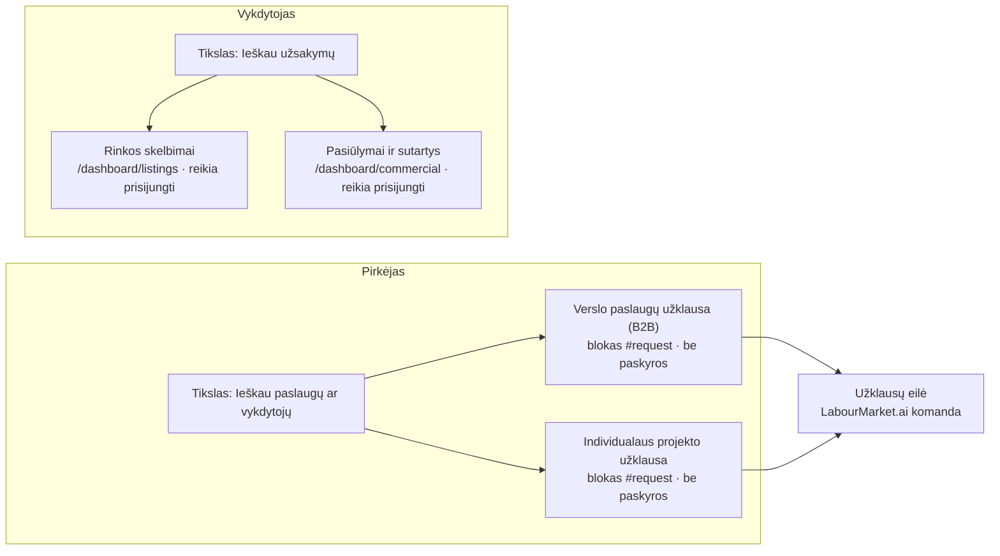

# LabourMarket.ai V3 — D1 maršrutų ir veiksmų schema

**Būsena:** pasiūlymas savininko peržiūrai. Nieko neįgyvendinta, produkcija nekeista.
**Sprendimas (2026-11-13):** išsaugomos abi galimybės — pirkėjas ieško paslaugų, vykdytojas ieško užsakymų.
**Savininko sprendimas dėl išdėstymo (2026-11-13): A variantas** — lieka šeši tikslai, ketvirtas skirtas paslaugų pirkėjui, užsakymų paieška išsaugoma paslaugų teikėjo skydelyje „Siūlau paslaugas“. Patikros rezultatai — 5 skyriuje.
Maršrutai patikrinti pagal pagrindinės šakos kodą (`apps/web/lib/navigation/public-intents.ts`, `apps/web/lib/staffing/request-doors.ts`).

## 1. Kas veikia šiandien

| Tikslas | Kam | Veiksmai | Maršrutas | Paskyra |
|---|---|---|---|---|
| Siūlau paslaugas (`services`) | Vykdytojui | Mano paslaugos | `/dashboard/services` | reikia |
| | | Paslaugų užklausos | `/dashboard/service-requests` | reikia |
| Ieškau užsakymų (`orders`) | Vykdytojui | Rinkos skelbimai | `/dashboard/listings` | reikia |
| | | Pasiūlymai ir sutartys | `/dashboard/commercial` | reikia |
| Pateikti poreikį (trys formos) | Pirkėjui | Darbuotojų paieškos užklausa | pagrindinio puslapio blokas `#request`, forma atveriama mygtuku | nereikia |
| | | Verslo paslaugų užklausa (B2B) | tas pats blokas `#request` | nereikia |
| | | Individualaus projekto užklausa | tas pats blokas `#request` | nereikia |

Pirkėjo **tikslo** tikslų sąraše šiandien nėra: pirkėjas formas pasiekia tik per bloką „Pateikti poreikį“. Formos atsiveria tame pačiame puslapyje; atskiro adreso kiekviena forma neturi.

## 2. Siūloma: du atskiri keliai

| Tikslas | LT | EN | Veiksmas | Maršrutas | Žyma |
|---|---|---|---|---|---|
| Pirkėjas (naujas) | Ieškau paslaugų ar vykdytojų | Find services or contractors | Verslo paslaugų užklausa (B2B) | blokas `#request`, B2B forma | Paskyros nereikia |
| | | | Individualaus projekto užklausa | blokas `#request`, projekto forma | Paskyros nereikia |
| Vykdytojas (esamas) | Ieškau užsakymų | Find orders | Rinkos skelbimai | `/dashboard/listings` | Reikia prisijungti |
| | | | Pasiūlymai ir sutartys | `/dashboard/commercial` | Reikia prisijungti |

Pirkėjo tikslas naudoja jau veikiančias formas — naujos formos ar lentelės kurti nereikia. Vienintelis papildymas: tikslo veiksmas turi nuvesti į bloką ir iškart atverti reikiamą formą (šiandien forma atveriama tik mygtuku bloke). Vykdytojo tikslo veiksmai nekeičiami.

## 3. Išdėstymo variantai (savininko sprendimas)

Patvirtintas viešų tikslų skaičius — 6. Naujas tikslas reiškia vieną iš trijų:

| Variantas | Kas keičiasi | Pasekmė |
|---|---|---|
| **A (PASIRINKTA)** | Pirkėjo tikslas tampa 4-uoju. „Ieškau užsakymų“ veiksmai perkeliami į 3-ąjį tikslą „Siūlau paslaugas“ (abu skirti vykdytojui). | Lieka 6 tikslai. Vykdytojo veiksmai išsaugomi viename skydelyje; sena nuoroda `#goal=orders` turi atverti „Siūlau paslaugas“. |
| B | Pirkėjo tikslas tampa 4-uoju, „Ieškau užsakymų“ lieka atskiru tikslu. | 7 tikslai — reikia naujo sprendimo dėl tikslų skaičiaus ir telefono išdėstymo. |
| C | Tikslai nekeičiami; pirkėjo kelias lieka tik bloke „Pateikti poreikį“. | Nieko kurti nereikia, bet pirkėjas tikslų sąraše savęs neranda. |

## 4. Ką reikės patikrinti įgyvendinant (ne dabar)

- Abu keliai atsidaro 375 px ir 1440 px pločio ekrane, šviesiame ir tamsiame režime.
- Pirkėjo veiksmai atveria formas be prisijungimo; vykdytojo veiksmai po prisijungimo grąžina į tą pačią vietą.
- Sena nuoroda į tikslą „Ieškau užsakymų“ niekur nenutrūksta.
- Tekstai visose šešiose kalbose (po LT ir EN patvirtinimo).

## 5. A varianto patikra prieš įgyvendinimą (2026-11-13)

Patikrinta pagal pagrindinės šakos kodą ir produkcijoje (versija `59b1c759`, tik skaitymas, neprisijungus).

### Skydelis „Siūlau paslaugas“ po pakeitimo (vykdytojas)

| Nr. | Veiksmas | Maršrutas | Puslapis yra | Neprisijungus | Būsena |
|---|---|---|---|---|---|
| 1 | Jūsų paslaugos | `/dashboard/services` | taip | 307 → prisijungimas, grąžina atgal | PATIKRINTA |
| 2 | Paslaugų užklausos | `/dashboard/service-requests` | taip | 307 → prisijungimas, grąžina atgal | PATIKRINTA |
| 3 | Rinkos skelbimai | `/dashboard/listings` | taip | 307 → prisijungimas, grąžina atgal | PATIKRINTA |
| 4 | Pasiūlymai ir sutartys | `/dashboard/commercial` | taip | 307 → prisijungimas, grąžina atgal | PATIKRINTA |

### Naujas 4 tikslas „Ieškau paslaugų ar vykdytojų“ (pirkėjas)

| Nr. | Veiksmas | Kur veda | Paskyra | Būsena |
|---|---|---|---|---|
| 1 | Verslo paslaugų užklausa (B2B) | blokas `#request`, B2B forma | nereikia | FORMA VEIKIA, NUORODOS NĖRA |
| 2 | Individualaus projekto užklausa | blokas `#request`, projekto forma | nereikia | FORMA VEIKIA, NUORODOS NĖRA |

### Ką reikės padaryti įgyvendinant (dar nedaryta)

1. **Formos atvėrimas nuoroda.** Forma šiandien atveriama tik mygtuku bloke; adreso ar žymos, kuri ją atvertų iškart, nėra. Į bloką `#request` šiandien neveda nė viena nuoroda.
2. **Sena nuoroda `#goal=orders`.** Pašalinus tikslą ji neatvertų jokio skydelio ir neparodytų klaidos. Reikia nukreipimo į „Siūlau paslaugas“.
3. **Testai, kurie fiksuoja šešių tikslų sąrašą ir `orders`:** `apps/web/lib/guards/public-intents.test.ts`, `apps/web/lib/guards/landing-intent-choice.test.ts`, `apps/web/tests/e2e/landing-intent-choice.spec.ts`, `apps/web/tests/e2e/premium-nav.spec.ts`. Juos reikės atnaujinti kartu su pakeitimu, ne išjungti.
4. **Smulkus trūkumas.** Jei tarpinė prisijungimo patikra praleidžiama (pasenęs slapukas), atsarginė patikra puslapyje „Pasiūlymai ir sutartys“ grąžinimo adreso neišsaugo. Kiti trys puslapiai išsaugo.

### Nepatikrinta

- Naujo tikslo dar nėra, todėl jo veiksmų pasiekiamumas 375 px ir 1440 px ekrane, šviesiame ir tamsiame režime, bus patikrintas tik jį sukūrus.
- Prisijungusio naudotojo kelias keturiuose vykdytojo puslapiuose šioje patikroje netikrintas (tikrinta tik neprisijungus).
