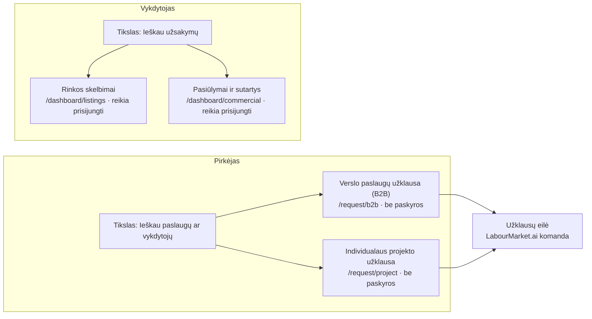

# LabourMarket.ai V3 — D1 maršrutų ir veiksmų schema

**Būsena:** pasiūlymas savininko peržiūrai. Nieko neįgyvendinta, produkcija nekeista.
**Sprendimas (2026-11-13):** išsaugomos abi galimybės — pirkėjas ieško paslaugų, vykdytojas ieško užsakymų.
Maršrutai patikrinti pagal pagrindinės šakos kodą (`apps/web/lib/navigation/public-intents.ts`, `apps/web/lib/staffing/request-doors.ts`).

## 1. Kas veikia šiandien

| Tikslas | Kam | Veiksmai | Maršrutas | Paskyra |
|---|---|---|---|---|
| Siūlau paslaugas (`services`) | Vykdytojui | Mano paslaugos | `/dashboard/services` | reikia |
| | | Paslaugų užklausos | `/dashboard/service-requests` | reikia |
| Ieškau užsakymų (`orders`) | Vykdytojui | Rinkos skelbimai | `/dashboard/listings` | reikia |
| | | Pasiūlymai ir sutartys | `/dashboard/commercial` | reikia |
| Pateikti poreikį (trys formos) | Pirkėjui | Darbuotojų paieškos užklausa | `/request/worker-search` | nereikia |
| | | Verslo paslaugų užklausa (B2B) | `/request/b2b` | nereikia |
| | | Individualaus projekto užklausa | `/request/project` | nereikia |

Pirkėjo **tikslo** tikslų sąraše šiandien nėra: pirkėjas formas pasiekia tik per bloką „Pateikti poreikį“.

## 2. Siūloma: du atskiri keliai

| Tikslas | LT | EN | Veiksmas | Maršrutas | Žyma |
|---|---|---|---|---|---|
| Pirkėjas (naujas) | Ieškau paslaugų ar vykdytojų | Find services or contractors | Verslo paslaugų užklausa (B2B) | `/request/b2b` | Paskyros nereikia |
| | | | Individualaus projekto užklausa | `/request/project` | Paskyros nereikia |
| Vykdytojas (esamas) | Ieškau užsakymų | Find orders | Rinkos skelbimai | `/dashboard/listings` | Reikia prisijungti |
| | | | Pasiūlymai ir sutartys | `/dashboard/commercial` | Reikia prisijungti |

Pirkėjo tikslas naudoja jau veikiančias formas — naujos formos, lentelės ar maršruto kurti nereikia. Vykdytojo tikslo veiksmai nekeičiami.

## 3. Išdėstymo variantai (savininko sprendimas)

Patvirtintas viešų tikslų skaičius — 6. Naujas tikslas reiškia vieną iš trijų:

| Variantas | Kas keičiasi | Pasekmė |
|---|---|---|
| **A (rekomenduojama)** | Pirkėjo tikslas tampa 4-uoju. „Ieškau užsakymų“ veiksmai perkeliami į 3-ąjį tikslą „Siūlau paslaugas“ (abu skirti vykdytojui). | Lieka 6 tikslai. Vykdytojo veiksmai išsaugomi viename skydelyje; sena nuoroda `#goal=orders` turi atverti „Siūlau paslaugas“. |
| B | Pirkėjo tikslas tampa 4-uoju, „Ieškau užsakymų“ lieka atskiru tikslu. | 7 tikslai — reikia naujo sprendimo dėl tikslų skaičiaus ir telefono išdėstymo. |
| C | Tikslai nekeičiami; pirkėjo kelias lieka tik bloke „Pateikti poreikį“. | Nieko kurti nereikia, bet pirkėjas tikslų sąraše savęs neranda. |

## 4. Ką reikės patikrinti įgyvendinant (ne dabar)

- Abu keliai atsidaro 375 px ir 1440 px pločio ekrane, šviesiame ir tamsiame režime.
- Pirkėjo veiksmai atveria formas be prisijungimo; vykdytojo veiksmai po prisijungimo grąžina į tą pačią vietą.
- Sena nuoroda į tikslą „Ieškau užsakymų“ niekur nenutrūksta.
- Tekstai visose šešiose kalbose (po LT ir EN patvirtinimo).
