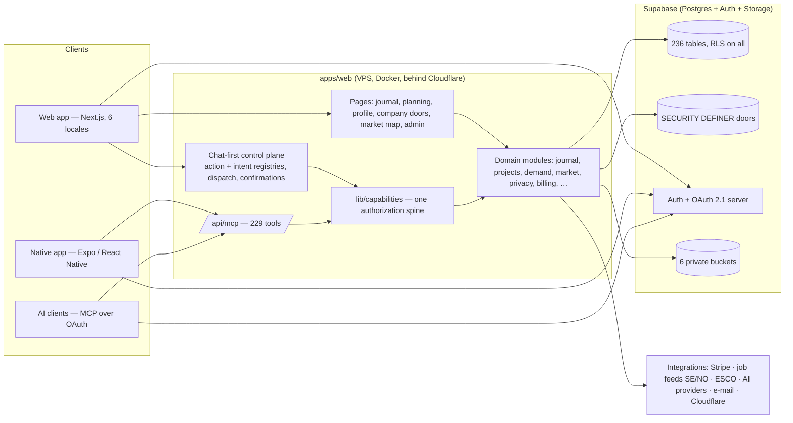
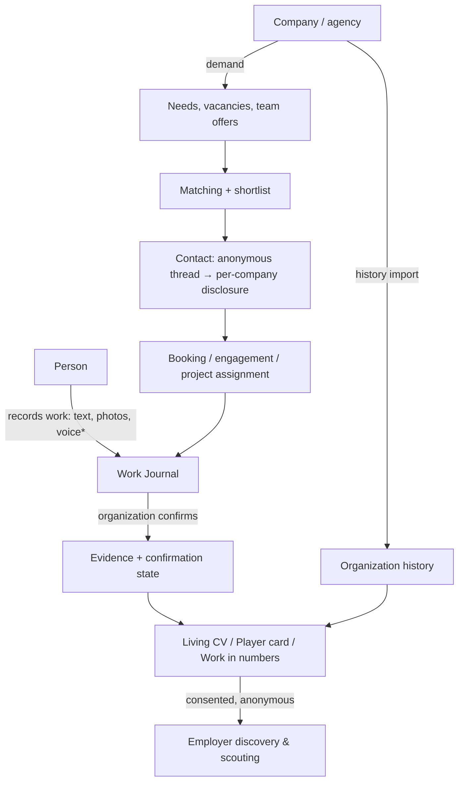

# LABOURMARKET-MASTER-MAP

The one-page map of the whole system: what exists, how it fits together, and where it is fragile.
Companion documents: [FUNCTIONAL-AUDIT](LABOURMARKET-FUNCTIONAL-AUDIT.md) (what really works) ·
[IMPROVEMENT-OPPORTUNITIES](LABOURMARKET-IMPROVEMENT-OPPORTUNITIES.md) (critical review) ·
[EXECUTION-ROADMAP](LABOURMARKET-EXECUTION-ROADMAP.md) (what to do, in which order).

**Public-safe by design.** Production data, security evidence and sensitive infrastructure detail live in
the owner's private annex, never here. **Living document:** it is rewritten when a capability changes
state, and `apps/web/lib/guards/master-map-register-sync.test.ts` fails CI when the register snapshot
below no longer matches the capability register.

> Register snapshot: 111 capabilities — BUILT_AND_USABLE 34 · PARTIAL 69 · BUILT_NOT_CONNECTED 1 · BLOCKED 2 · ARCHITECTURE_ONLY 2 · MISSING 2 · RETIRED 1

Last full audit: 2026-10-18 (main `fb741339a`).

---

## 1. What LabourMarket.ai is

One labour/work graph (28 nodes, `docs/OWNER_TARGET_ARCHITECTURE_V1.md`):

```
REAL WORK → EVIDENCE → CAPABILITY → CAPACITY → DEMAND → MATCH → EXECUTION → VERIFIED RESULT → LIVING HISTORY → BETTER DECISION
```

It must never be narrowed into a job board, recruitment site, staffing marketplace, CV builder, timesheet
app, workforce planner, evidence database, qualification platform, booking calendar or chatbot — each is
one edge of the graph (`node .github/scripts/product-truth.mjs`).

## 2. High-level architecture



### Main user flows


`*` voice depends on a transcription host (dormant).

## 3. Modules (apps/web/lib)

| Layer | Modules | Notes |
|---|---|---|
| Control plane | `conversation/*` (action registry 58 actions, intent registry, dispatch, confirmation tokens), `capabilities/*` (229 MCP tools), `mcp/*` | One spine for chat, pages and agents |
| Person | `journal/*`, `profile/*`, `cv`, `player-card/*`, `worker/*`, `evidence/*`, `trust/*`, `skills/*` | `journal/professional-experience.ts` is the one history (decision 0025) |
| Organization | `company/*`, `organizations/*`, `projects/*`, `planning/*`, `tasks/*`, `work-hours/*`, `timesheets/*`, `organization-evidence/*`, `organization-people/*` | Workspace resolved server-side |
| Market | `demand/*`, `market/*` (match-v1), `scouting/*`, `marketplace/*`, `booking/*`, `services/*`, `market-map/*`, `vacancy-*` | Anonymous discovery; identity by disclosure |
| Trust & privacy | `privacy/*` (consents, disclosures, export, erasure plan), `visibility/*`, `security/*`, `limits/*` | Consent registry is hashed and versioned |
| Commercial | `billing/*` (plans, entitlements, Stripe), `lmc/*` | Charging not armed |
| Education | `education/*`, recognitions | RPL structure deferred |
| Platform | `i18n/*`, `seo/*`, `ai/*` (runtime, egress guard), `notifications/*`, `email/*`, `guards/*` (hundreds of architecture tests), `product-gate/*` | |

## 4. Data, access and consent boundaries

- **236 tables, row-level security on every one.** Writes go through owner-scoped policies or
  SECURITY DEFINER functions that re-check authority (`manages_organization`, `can_manage_project`,
  `can_view_worker`, `owns_worker`). Anonymous callers reach only an explicit allowlist.
- **Identity vs discovery.** A worker found through the employer-visibility consent is anonymous; their
  identity reaches one organization only through the worker's own per-organization disclosure
  (decision 0027, PROPOSED with RED #2477).
- **Consents** (`lib/privacy/consent-definitions.ts`): `profile_discoverability`, `employer_data_disclosure`,
  `partner_supply_representation` — each versioned and hash-pinned in the database.
- **Migrations:** 401 files in the repo (35 legacy-numbered, the rest timestamped), each with a rollback;
  risky ones are human-gated (`.github/scripts/migration-safety.mjs`). Production applies happen only via
  the Supabase MCP tool after owner approval — never `db push` (the ledger and file names differ).
- **Auth:** e-mail + Google live; LinkedIn and Facebook switched off; the same Auth service is the OAuth
  server for MCP clients.

## 5. Delivery and operations

| Step | How |
|---|---|
| Change | PR → Quality Gates (typecheck, lint, build, unit tests incl. guards) + migration-safety + e2e smoke + CodeQL |
| Merge | GREEN class: auto-merge (squash). RED class: draft + `needs-human-gate`, owner approval |
| Deploy | `deploy-vps.yml` after Quality Gates passes on `main` → VPS (Docker) with health-gated rollback |
| Database | migrations applied separately by the owner-approved MCP step |
| Production proof | `prod-qa-walk.yml`: synthetic cast walks real production (budget 12 runs / 24 h) |
| Scheduled jobs | VPS cron (digest, job alerts, handoffs) + GitHub cadences (vacancy feeds, retention, health probe) |
| Mobile | `android.yml`, `ios.yml`, `mobile.yml` (builds and emulator journeys; store signing is owner-only) |
| Browser crashes | Inline `<head>` reporter + error boundaries → `POST /api/client-errors` → one sanitised `[client-error]` line in the container log; nothing stored (#2484) |
| Hosting move | Before and after any host change: every auth redirect names the public origin (no bind or internal host), and every partner door answers `unauthorized`, not `not_configured`, to a credential-free probe (§8) |

## 6. Single points of failure (summary)

One application host; one database project on a free tier (no point-in-time restore); one complete copy
of runtime secrets; GitHub as CI, deploy, scheduler and alert channel at once; many owner-only actions
(DNS, Stripe, stores, secrets, RED approvals); one person plus agents. Details and mitigations: roadmap
P0/P1 and the private annex.

## 7. Blast-radius modules (a change here can break many features)

`can_view_worker` / `caller_has_worker_relation_v1` · `manages_organization` · `lib/conversation/dispatch.ts`
· `lib/capabilities/registry.ts` · `lib/billing/entitlements*` · `lib/journal/professional-experience.ts` ·
`lib/company/active-organization.ts` / `getWorkspaceContext` · `lib/privacy/consent-definitions.ts` (hash pins)
· `lib/market/match-subject.ts` · `components/app/conversation/chat/conversation-chat.tsx` (≈8.3k lines) ·
`lib/i18n/*` · `middleware.ts` · `app/[locale]/dashboard/layout.tsx` (role gates) · `app/[locale]/auth/callback`
(every sign-in return) · the first `<head>` scripts in `app/[locale]/layout.tsx` (regex shim, crash reporter) ·
migration guards with pinned counts. Every one of them is covered by guards; change them only with the canonical §12 review.

## 8. Incident log — defects, causes, prevention

Public-safe summaries; evidence stays in the private annex. Newest first.

| Date | Defect (who it hit) | Root cause | Fix | Prevention |
|---|---|---|---|---|
| 2026-10-18 | After Google sign-in, e-mail confirmation, password reset or sign-out a person was sent to an unreachable address; an invitee also lost the invitation link (every new user since the VPS move) | The sign-in callback and logout built redirects from the request URL, which behind the VPS proxy is the container's bind address | #2482 — both use `requestPublicOrigin` | Guard `redirect-public-origin`: no route builds an origin from the request URL; walks sign in by password and never covered this path → HTTP redirect probe after every host change |
| 2026-10-18 | Home, sign-up and sign-in crashed on load — "Application error: a client-side exception" — on Safari / iOS < 16.4 and old in-app browsers | Chat text understanding builds regular expressions with lookbehind while a module loads; those browsers cannot compile lookbehind | #2483 — first-in-`<head>` compatibility shim (no-op on current browsers) | Shim test pins the order; old-browser emulation run against production; crash reports (#2484) make a recurrence visible |
| 2026-10-18 | Partner referrals from Nonstop refused (lead delivery `NOT_CONFIGURED`) | The shared referral secret lived only in the previous host's environment; the partner also changed hosting and lost its copy | Owner re-pairs one new secret on both sides, then the same lead is resent (idempotent) | Hosting-move checklist (§5): probe every partner door; the minimal VPS environment is listed in the private annex |
| 2026-10-18 | Browser crashes were invisible to the team | No client error reporting existed | #2484 — sanitised crash reports, logged not stored | Read `[client-error]` lines in the container log after each release |

## 9. How to keep this map true

1. When a capability changes state, update `apps/web/lib/product-gate/capability-register.ts` and the
   snapshot line at the top of this file in the same PR (the sync guard enforces it).
2. When a production walk proves or breaks a feature, update the FUNCTIONAL-AUDIT row and its evidence.
3. When the owner decides, move the item in the EXECUTION-ROADMAP and record the decision under `docs/DECISIONS/`.
4. The owner's interactive **Product Master Map** (value chain, journeys, commercial model, priorities) is a VIEW of
   these documents, never a second source: regenerate it with
   `python .github/scripts/product-map/build.py docs/master/LABOURMARKET-FUNCTIONAL-AUDIT.md <out.html> <sha> [private-facts.json]`
   after every FUNCTIONAL-AUDIT change. Production numbers come only from the private facts file.
